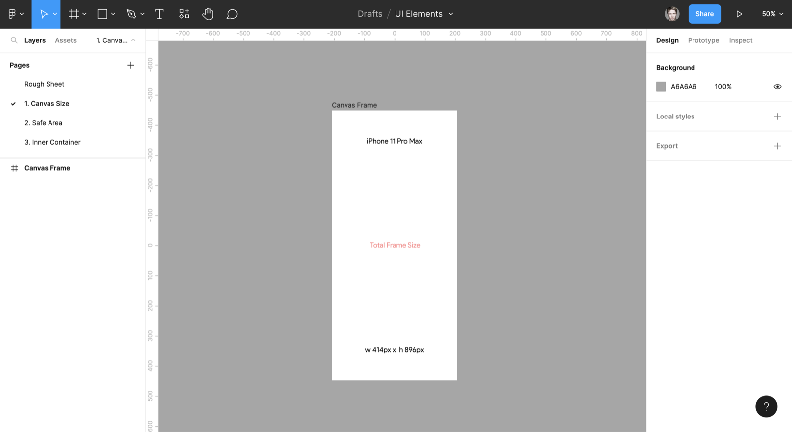
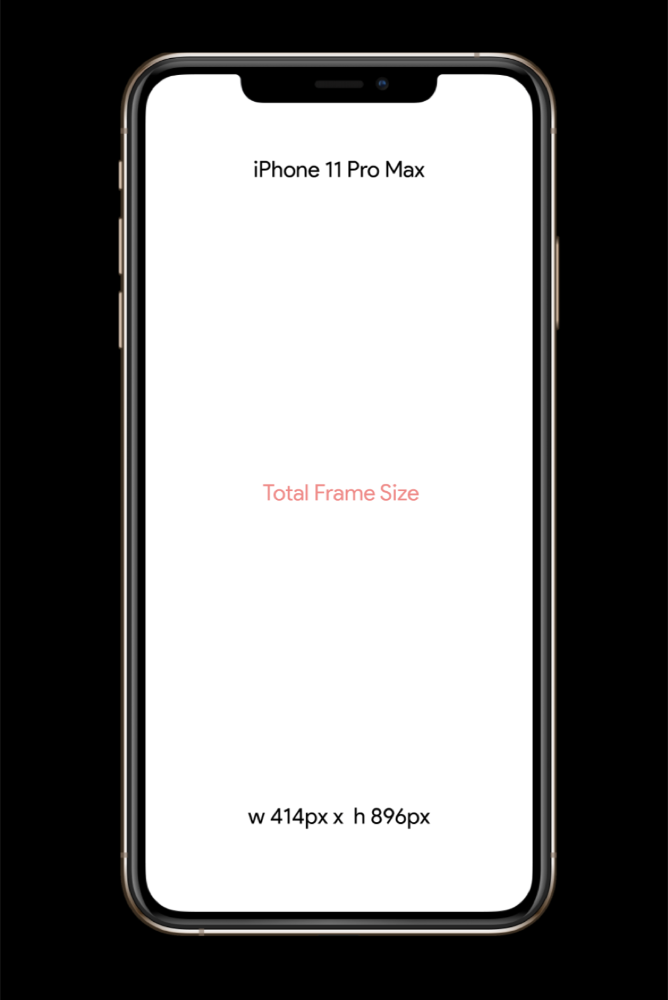
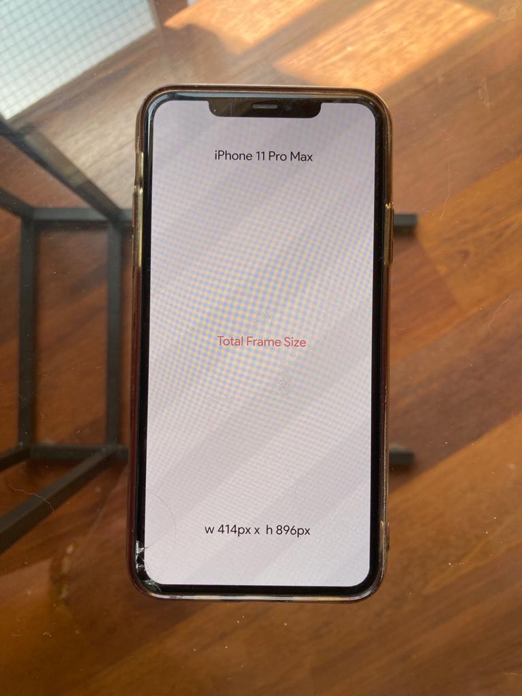

# Choose your Frame

Before we jump into everything, just a little note;

## In Figma, we have the option to create many types of frames for different devises.

Measured in pixels, some popular frame sizes include;

- 1920px x 1080px = HD Television
- 1080px x 1920px = Instagram Stories
- 2160px x 3840px = 4K TV
- 3024px x 1984px = MacBook Pro 14”
- 1170px x 2532px = iPhone 14
- 2688px x 1242px = iPhone 11 Pro Max

---

But always remember;

1. You should always choose a frame size based on the **type of device** you are building your application for. 

1. You should always choose a frame size for the device that you will be **conducting your prototype sessions** on.

---

For Example;

I personally own an **iPhone 11 Pro Max** and so, for me, I know whatever I want to prototype, I will be using my own phone to conduct sessions on and so I will chose that frame in Figma for all of my screens. 

Figma gives us the iPhone 11 Pro Max as a screen width of **414px**. This represents the logical pixels (points) rather than the actual resolution which is 2688px x 1242px. 

Figma simply reduces the total size by a factor of x3 to make the screens easier to work with.

In fact, just as a little note; 

414px x 896px share the same **aspect ratio as** 2688px x 1242px which is **19.5:9**

This means that for every 19.5 parts vertically, there are 9 parts horizontally. 

It doesn’t matter if those parts are pixels, points, cm or inches as long as there is an aspect ratio of 19.5 to 9, the content will fit perfectly inside an iPhone 11 Pro Max!

Here is my art board;

 

On prototype, this frame will align to the iPhone 11 Pro Max mock-up perfectly like this; 

And equally in real world we have this; 

So we can have complete confidence in our Figma screen provided we are using the correct aspect ratio!
