# Color Variables

## What you'll build

A Colors variable collection with three colours taken from a gradient, the start of your design tokens. Variables let you change a colour once and update it everywhere.

## Before you start

- You've finished [Dynamic Buttons Part Deux](dynamic-buttons-part-deux.html)
- A browser tab open on Grabient
- About 20 minutes

## Let's go

1. On a totally blank page, without anything selected, click on **Variables** on the right hand side

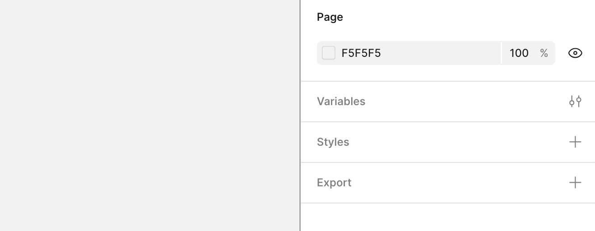

1. Select **Create** button
    
    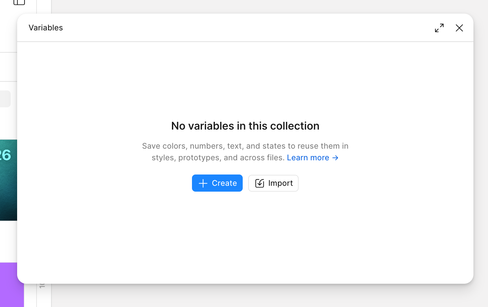
    

1. Select the **Color** variable option
    
    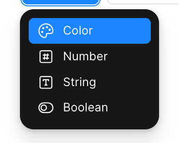
    
2. Go to [Grabient](https://grabient.com/?steps=3)
    
    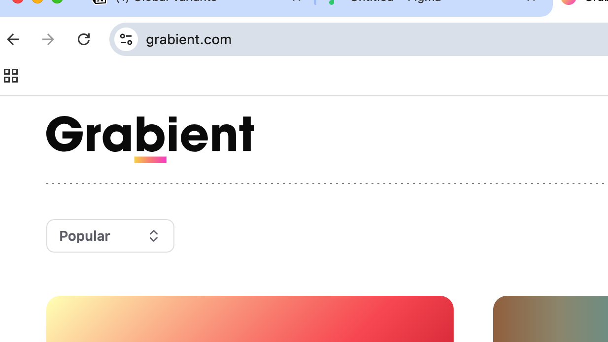
    

1. Find a gradient that you like

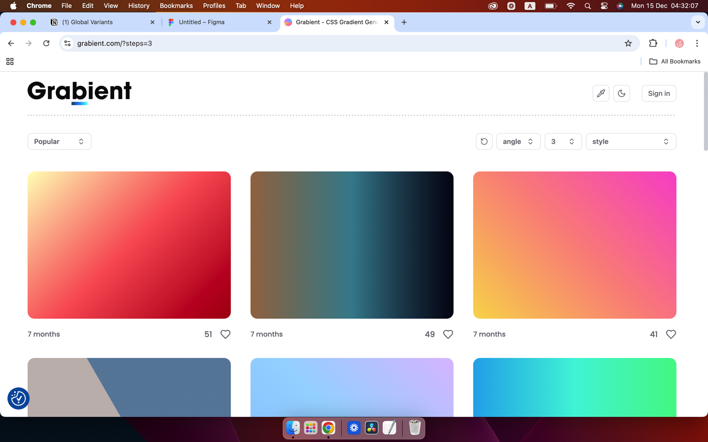

1. Change the steps to three and the angle to 45**° then copy CSS**
    
    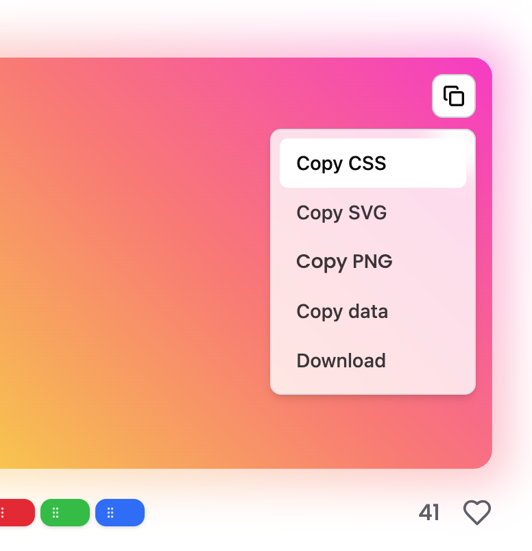
    

6. Paste into Figma using the Text tool

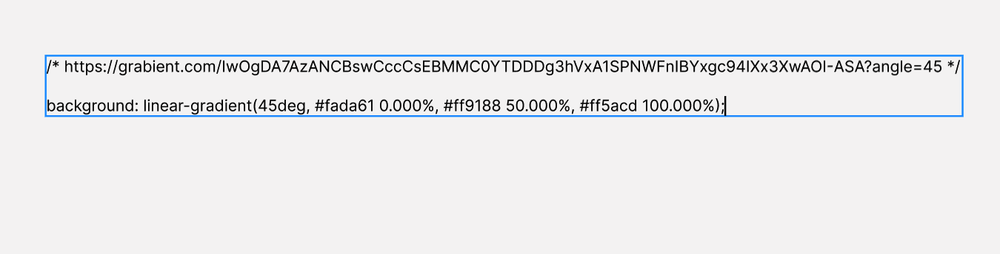

1. Extract the hex values of the colours, go back to **Global Variables** and create the three colours variables, ascribing names to them as well. 
    
    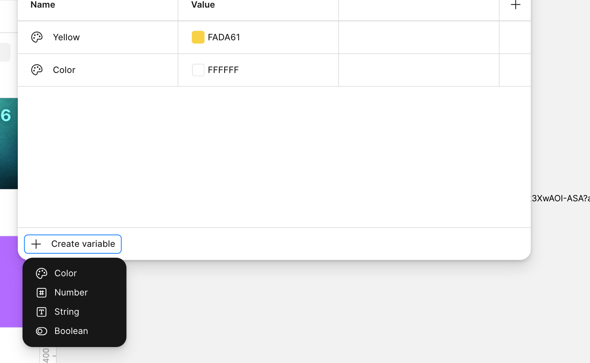
    

1. Should look like this.

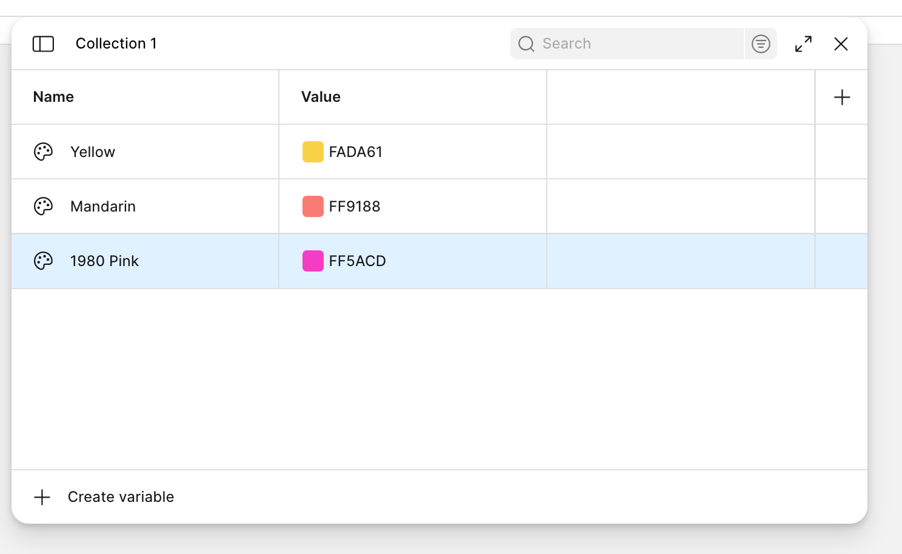

1. Open the sidebar.
    
    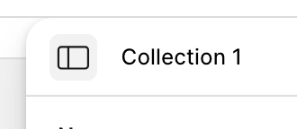
    

1. Should look like this. 
    
    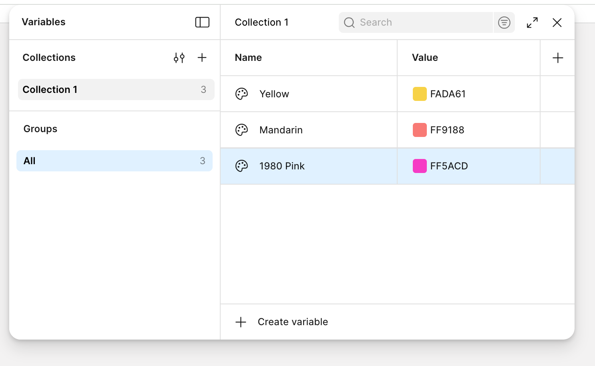
    

1. Double click on **Collection 1**

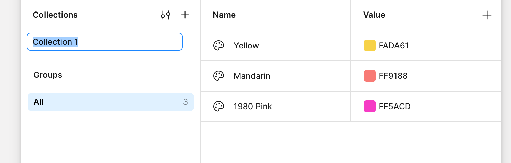

1. Rename to Colors

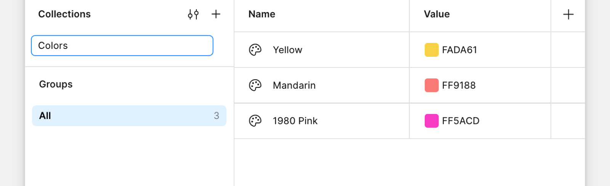

1. Click on the **plus icon +** Name new collection **Numbers**
    
    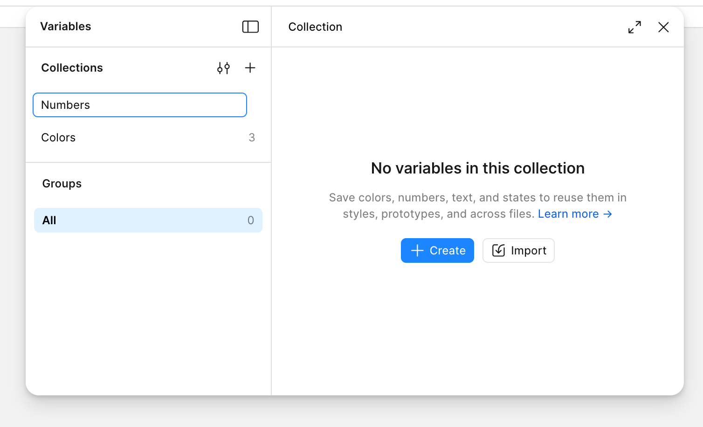

## Well done!

You can now:

- Create colour variables and organise them in collections
- Extract HEX values from a CSS gradient
- Prepare a Numbers collection for the next lesson

**Next:** [Number Variables](number-variables.html)
