# Colour Values

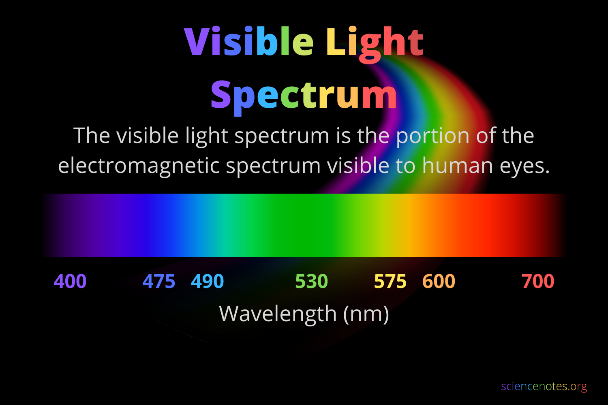

So as designers we are of course totally concerned with variations in light to create perception and interpretation and therefore we should be aware of the spectrum of light and everything that can be seen with the human eye. In design, the light portion of the electro magnetic spectrum is represented in values and it’s important you know those values.  

**HEX**

Hexadecimal value or Hex value is an industry standard color value that is widely used in HTML, CSS, and graphic design software to define colours. 

A hex value consists of a hash symbol (**`#`**) followed by six alphanumeric characters. These characters represent the intensity of red, green, and blue (RGB) components of the color. The six characters are divided into three pairs, each pair representing one of the primary colours in the RGB color model. 

**Format**: **`#RRGGBB`**

**Hex Values:**

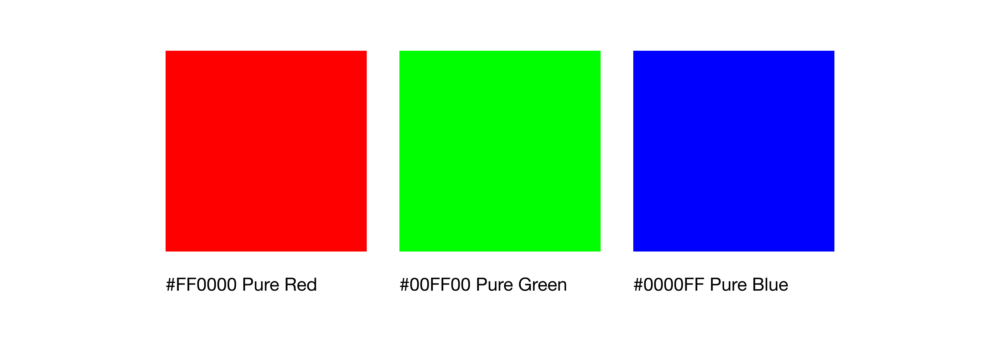

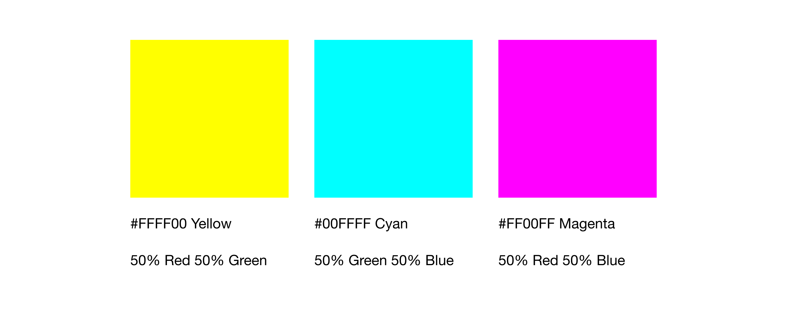

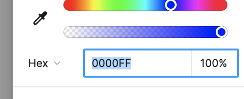

**RGB**

An RGB value specifies the intensity of the red, green, and blue components that together create a specific colour. It is one of the industry standard colour values, used in HTML, CSS, and graphic design software.

**Format**: **`rgb(red,green,blue)`**


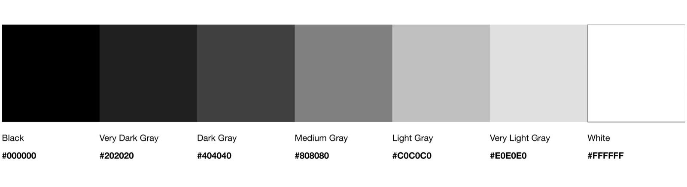

Pure Red: **`rgb(255, 0, 0)`**

Pure Green: **`rgb(0, 255, 0)`**

Pure Blue: **`rgb(0, 0, 255)`**

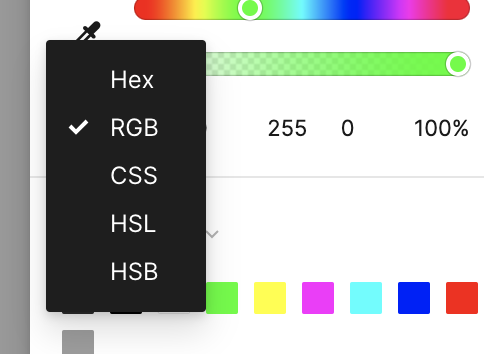

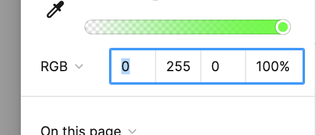

**CMYK**

**Format**: **`cmyk(cyan, magenta, yellow, key)`**

CMYK stands for Cyan, Magenta, Yellow, and Key (Black), and it’s used for print media, never digital. It’s valuabe to know that CMYK is a subtractive color model because it works by subtracting light from white paper, rather than adding light as in the RGB models and it’s important to understand how that additive vs. subtractive colour mixing is responsible for a perceived difference in vibrancy and saturation when using both CMYK and RGB. In other words, **if you can’t figure out why your colours look dull, you’re in CMYK mode.**   

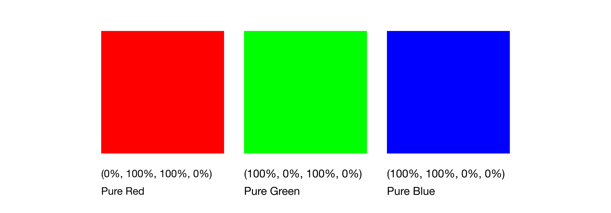

The CMYK equivalent of pure red: rgb(255, 0, 0), is approximately cmyk(0%, 100%, 100%, 0%) because when you mix 100% magenta and 100% yellow in the CMYK colour model, you get the colour red!


**CSS**

Your CSS will take any value but a common format: 
**Format**: **`color:rgba(0, 0, 255, 1)`**

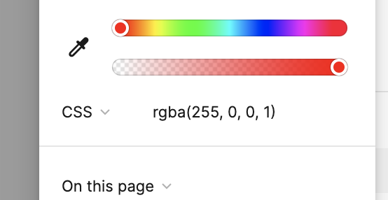

**A** developer can literally take whatever colour you have from your designs and drop it straight into the CSS file using any of the below colour values. 


```jsx
/* Using a Named Color */
color: red;

/* Using Hexadecimal Value */
color: #ff0000;

/* Using RGB */
color: rgb(255, 0, 0);

/* Using RGBA (with alpha channel for transparency) */
color: rgba(255, 0, 0, 0.5);

/* Using HSL (Hue, Saturation, Lightness) */
color: hsl(0, 100%, 50%);

/* Using HSLA (with alpha channel for transparency) */
color: hsla(0, 100%, 50%, 0.5);
```

**HSL**

**Format**: **`hsl(hue,saturation,lightness,transparency)`**

**NOT REALLY USED. GOOD TO KNOW.** 

HSL stands for Hue, Saturation, and Lightness, and it is a colour model that represents colours in terms of, yes you guessed it, their hue, saturation and lightness. 

1. **Hue (H)**: Hue represents the colour itself, ranging from 0 to 360 degrees around the colour wheel. It defines the pure colour without any white or black added. 

2. **Saturation (S)**: Saturation refers to the intensity or purity of the colour. It ranges from 0% (fully desaturated or grayscale) to 100% (fully saturated or vibrant). Higher saturation values indicate a more intense colour while lower values result in a more muted appearance. 

1. **Lightness (L)**: Lightness represents the relative lightness or darkness of the colour regardless of its saturation. It ranges from 0% (black) to 100% (white). A lightness value of 50% corresponds to the color's normal appearance, while values lower than 50% produce darker shades and values higher than 50% result in lighter shades.

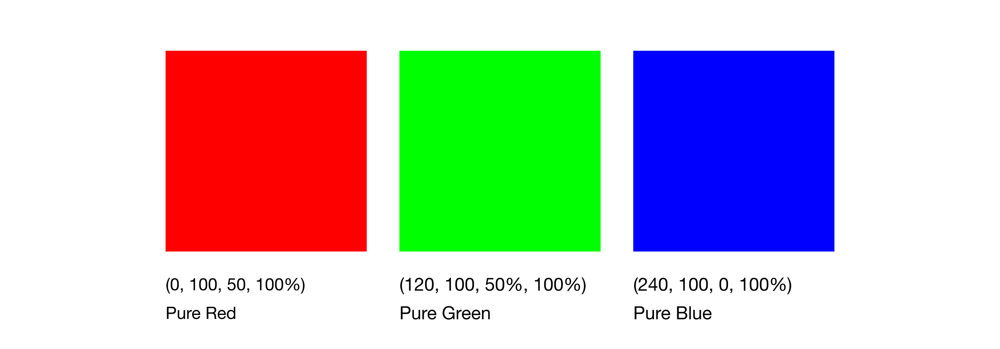

To demonstrate pure red in HSL, you would set the following values:

- **Hue (H)**: 0° (or 360°, as they are equivalent for red)
- **Saturation (S)**: 100% (fully saturated)
- **Lightness (L)**: 50% (normal lightness)

So, in HSL notation, pure red would be represented as **`hsl(0, 100%, 50%)`**. This notation specifies that the color has a hue of 0° (red), a saturation of 100% (fully saturated), and a lightness of 50% (normal lightness).

**Grayscale**

Grayscale images are monochromatic, meaning they consist of only one colour channel, typically representing intensity or brightness. Grayscale images simplify visual information by removing colour distractions and that is why it is frequently used for low fidelity prototyping given it’s ability to remove the distraction of colour. 


**Gradients**

Colour gradients are a gradual transition between two or more colours, creating a smooth blending effect. They are widely used in graphic design, web design, and digital art to add depth, dimension, and visual interest to a design. Gradients can be linear, radial, or involve more complex patterns, and they can transition between any number of colors.

In CSS, it’s represented as:

```jsx
/* CSS example of a linear gradient */
background: radial-gradient(circle, #ff0000, #0000ff); /* Red to Blue */
```

 

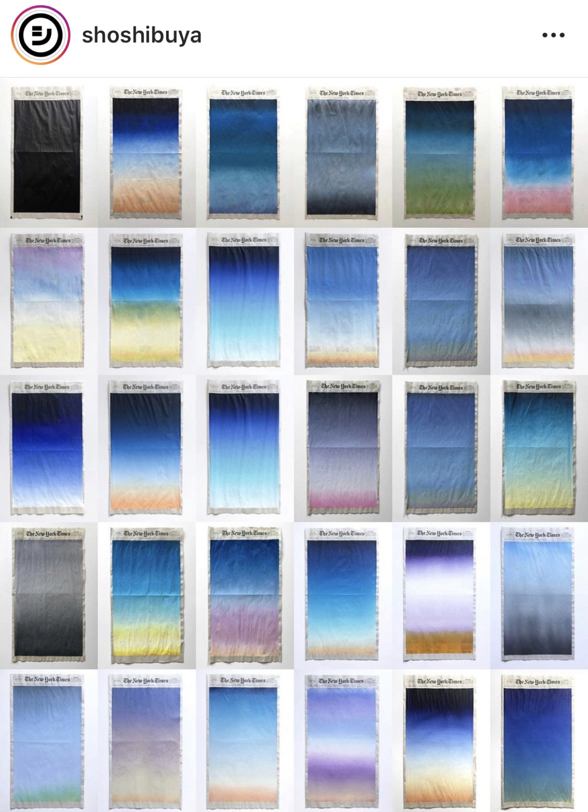

**Japanese artist, Sho Shibuya** wakes up every day between 5am and 6am, reads The New York Times and photographs the sunrise from his window or rooftop. Then has breakfast with his wife before painting the morning's sunrise on the newspaper's front page

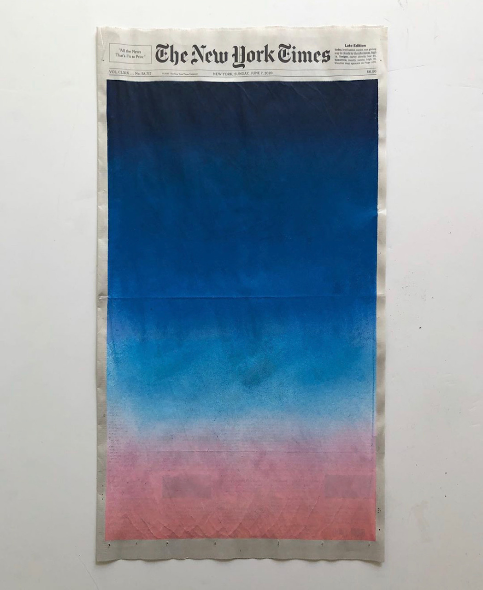

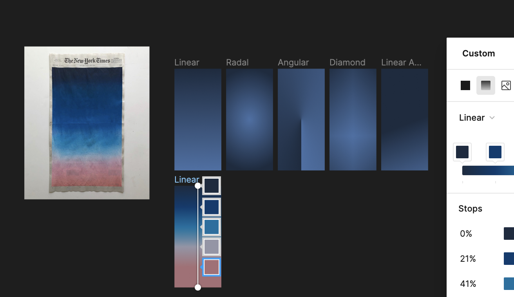

In Figma we can choose to create a linear, radial, Angular, Diamond or Linear Angled gradient. 

[color.adobe.com](https://color.adobe.com/trends)
