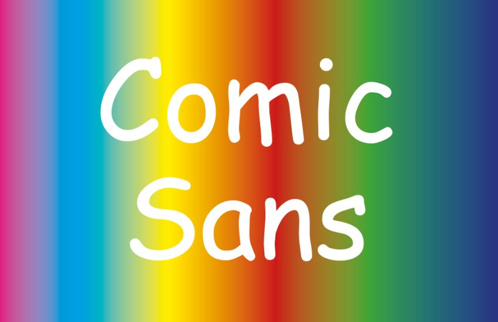
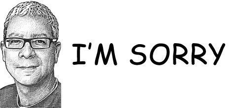
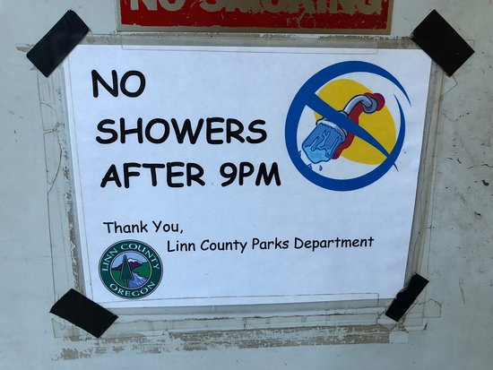
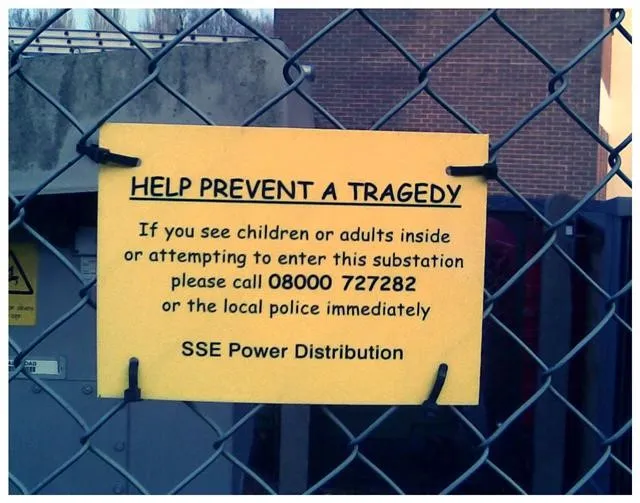

# Comic Sans

> A casual, informal typeface designed to feel friendly, human, and unintimidating rather than formal or authoritative.
> 

**Designed by:**

Vincent Connare

**Foundry:**

Microsoft

**Country:**

🌍 United States

**Year:**

1994 

---

## Intent

- Mimic **comic book text**
- For **on-screen speech bubbles**
- Against stiff fonts like Times New Roman
- Focus on **approachability, warmth, legibility**
- **Casual, playful, unintimidating**

Connare aimed for a *usability fix*, not art.

## Context

- PCs entering homes, schools
- Desktop publishing growing
- Fonts used by non-designers
- No web typographic norms

Typography moved from professional control to mass use, and misuse became visible.

## Type classification

- Sans serif
- Casual / informal / script-influenced

---

## Characterised by

- Irregular stroke widths
- Rounded, uneven letterforms
- Handwritten, comic-inspired shapes
- Loose spacing and informal rhythm
- Childlike, friendly tone

Compared to humanist or grotesque sans-serifs, Comic Sans is intentionally *unsophisticated* and expressive.

---

## Examples in use

- Microsoft Bob
- Early Windows UI and system dialogs
- School newsletters and classroom materials
- Informal flyers, signs, and notices
- Internet memes and parody design

---

## Usage

> Do not use Comic Sans in your UI. Know why it exists, and why it went wrong.

[https://www.youtube.com/watch?v=QGLydRqsASM](https://www.youtube.com/watch?v=QGLydRqsASM)

### Cheat Sheet

| **Neutral** | **Overused** |
| --- | --- |
| Helvetica Neue | Helvetica  |
| Inter | Comic Sans |
| San Francisco | Montserrat |
| Neue Montreal | Raleway |
| General Sans | Lato |
| Neue Haas Grotesk | Arial |
|  | Nunito |
|  | Oswald |
|  | Roboto |
|  | Poppins |

Notice these fonts are all nearly exclusively sans serif fonts because, I am not referencing display or logo fonts. This is only in reference to choosing your general copy and typeface hierarchy.

---

## Why it matters for UX

Comic Sans was a usability fix, friendly text for speech bubbles, that turned into the world's most mocked font because it was used everywhere it didn't belong. The lesson is about context: a typeface is only right or wrong for a job.

## Try it: right font, wrong place (15 minutes)

1. Find one place where Comic Sans works (a children's activity sheet, for example) and one where it fails.
2. Explain what makes the difference.
3. Choose three typefaces from the cheat sheet for a children's learning app, and justify your pick.

## Media

[https://www.youtube.com/watch?v=5l4sCaw71NE](https://www.youtube.com/watch?v=5l4sCaw71NE)

## Resources

[Comic Sans – Wikipedia](https://en.wikipedia.org/wiki/Comic_Sans)

[Google Fonts Knowledge](https://fonts.google.com/knowledge)

## Key takeaways

- Comic Sans (1994) was designed for friendly on-screen speech bubbles.
- Overuse in the wrong contexts made it a symbol of bad typography.
- No typeface is good or bad in itself; it's right or wrong for its context.
