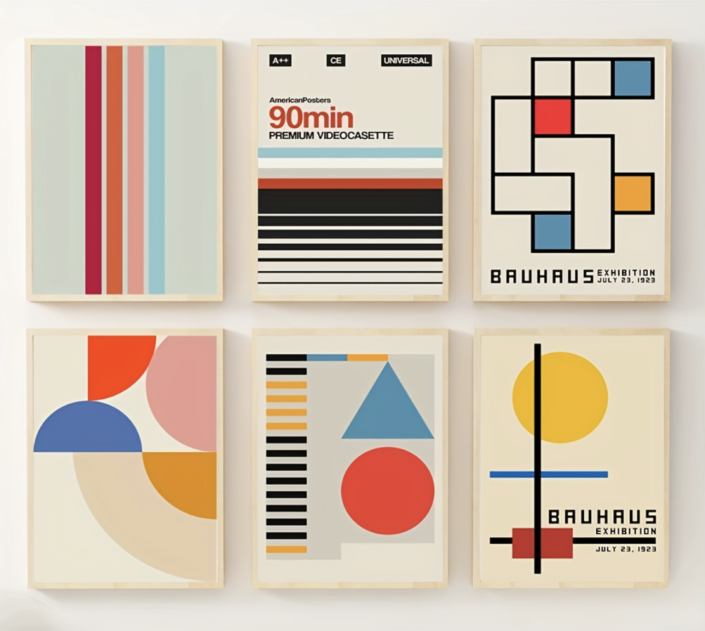
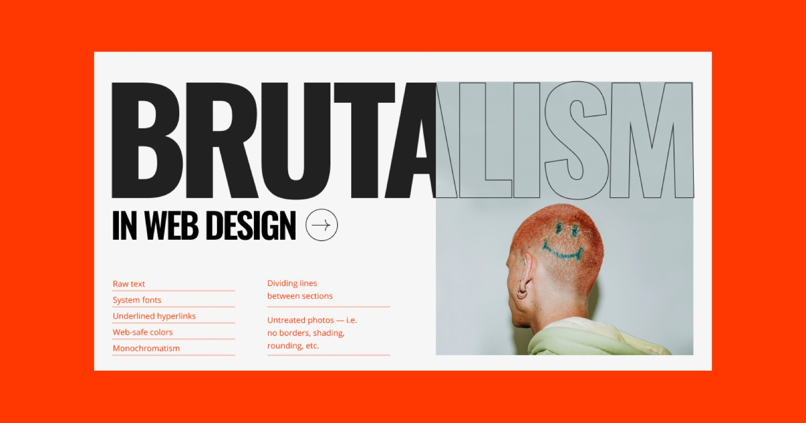
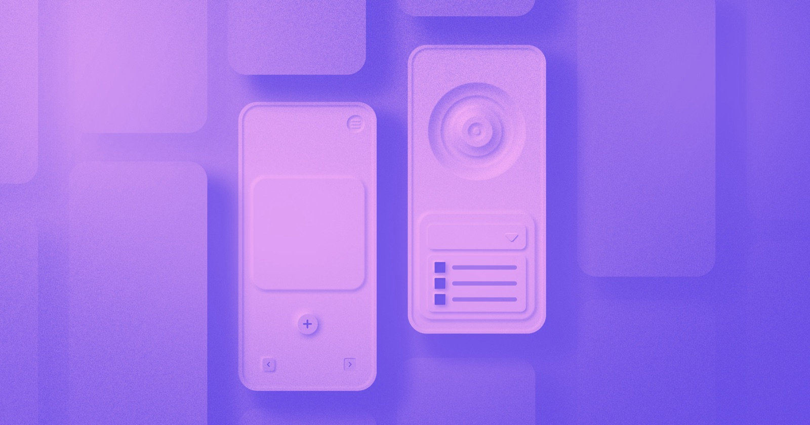
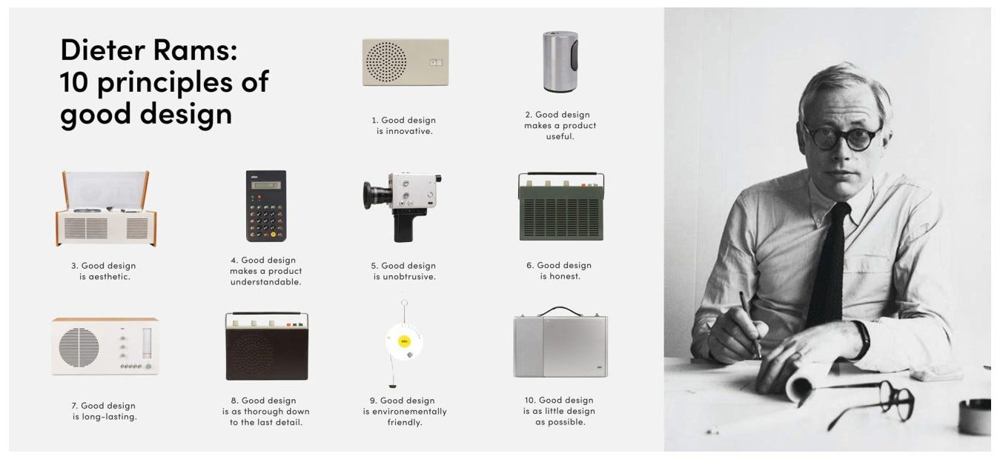
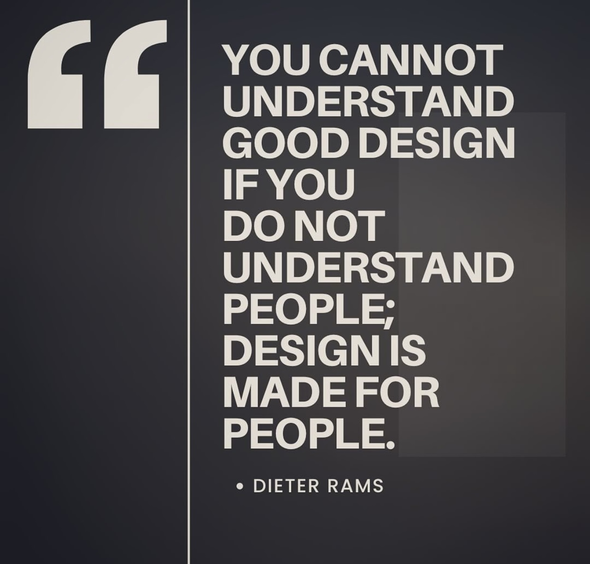

# Design Styles: From Bauhaus to Glassmorphism

Visual styles come and go. Knowing where they came from, and what each one is good and bad at, helps you choose a style on purpose instead of copying whatever is trending.

---

## Bauhaus (1919–1933)

The Bauhaus was a German school of art, architecture and design that preached **functionalism**: an object's form should come from its purpose. Bauhaus designs use simple geometric shapes, primary colours, strong grids and clean sans-serif type, and keep the focus on the content. Almost every modern interface owes it something.

---

## Skeuomorphism (around 2007–2013)

Skeuomorphism makes digital things look like their real-world equivalents: a notes app with yellow lined paper, a calendar bound in leather, a bookshelf of wood. It was everywhere on the early iPhone, because it made something new feel familiar and matched one of Nielsen's heuristics: *match between the system and the real world*.

Critics argue that today's users have learned the language of digital interfaces so well that they no longer need the real-world disguise.

---

## Flat design (from around 2013)

When Apple released iOS 7 in 2013, and Microsoft and Google moved in the same direction, interfaces dropped the textures and shadows for **flat design**: solid colours, simple icons and clean type. It's faster to load and easier to scale, but at its most extreme it can make it hard to tell what's clickable. Google's Material Design brought back subtle shadows for exactly that reason.

---

## Brutalism (from the mid-2010s)

Named after the raw-concrete architecture movement, brutalist web design rejects polish on purpose: raw text, system fonts, underlined links, monochrome palettes and untreated photography. It's honest and memorable, but easy to make hard to use.

---

## Neumorphism (around 2020)

Also called **soft UI**, neumorphism combines flat design with soft inner and outer shadows, so that elements look extruded from the background. It looks tactile and calm, but its low contrast often fails accessibility guidelines.

---

## Glassmorphism (2020s)

Also called **frosted-glass UI**: semi-transparent panels with background blur, floating over colourful backgrounds. It's popular in operating systems and in VR and AR, where layers of content sit over the real world. Keep an eye on text contrast over busy backgrounds.

---

## Neobrutalism (2020s)

An extension of brutalism with high contrast and vibrant colour: thick black outlines, hard shadows, bold type and playful illustrations, with a strong emphasis on content.

---

## Fashion fades

Dieter Rams, whose work at Braun deeply influenced Apple's design, has never trusted trends:

> I hate everything that is driven by fashion. From the beginning it was hating the sixties American way of styling. Especially the cars. They changed their cars every two years to sell new ones. Which has nothing to do with good design.

Dieter Rams

Use styles as tools, not as goals. Choose the one that suits your users, your brand and your content, and make sure it never gets in the way of usability.

---

## Why it matters for UX

A visual style changes how usable and accessible an interface is, not just how it looks: flat design can hide what's clickable, neumorphism can fail contrast checks, glassmorphism can bury text. Knowing the history and trade-offs of each style lets you choose deliberately and defend your choice.

## Try it: one screen, three styles (40 minutes)

1. Take one simple screen from your project, such as a login or a product card.
2. Restyle it three times: skeuomorphic, flat and glassmorphic (or neobrutalist).
3. Check the contrast of the main text and button in each with a contrast checker.
4. Decide which style suits your users and brand best, and write two sentences on why.

## Media

[https://www.youtube.com/watch?v=Y69wOKg6yp4](https://www.youtube.com/watch?v=Y69wOKg6yp4)

[https://www.youtube.com/watch?v=0BTp6w5yhhw](https://www.youtube.com/watch?v=0BTp6w5yhhw)

## Resources

[Bauhaus – Wikipedia](https://en.wikipedia.org/wiki/Bauhaus)

[Contrast Checker – WebAIM](https://webaim.org/resources/contrastchecker/)

## Key takeaways

- Every style has a history and trade-offs: Bauhaus, skeuomorphism, flat, brutalism, neumorphism, glassmorphism, neobrutalism.
- A style affects usability and accessibility, not just looks: always check contrast and clarity.
- Trends fade; choose a style for your users and content, not for fashion.
