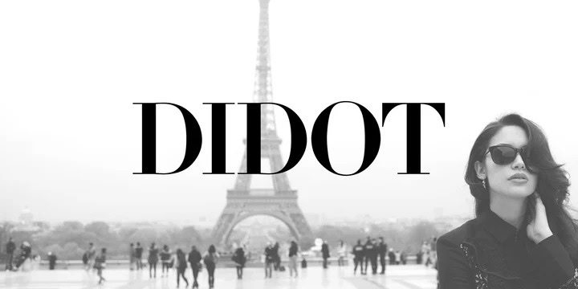
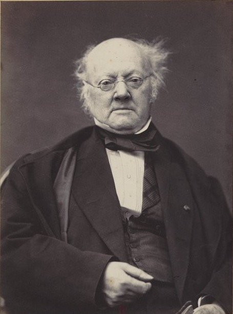
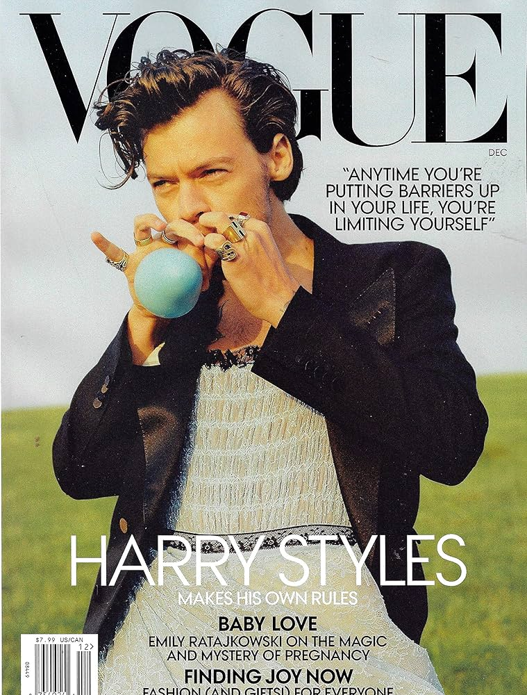
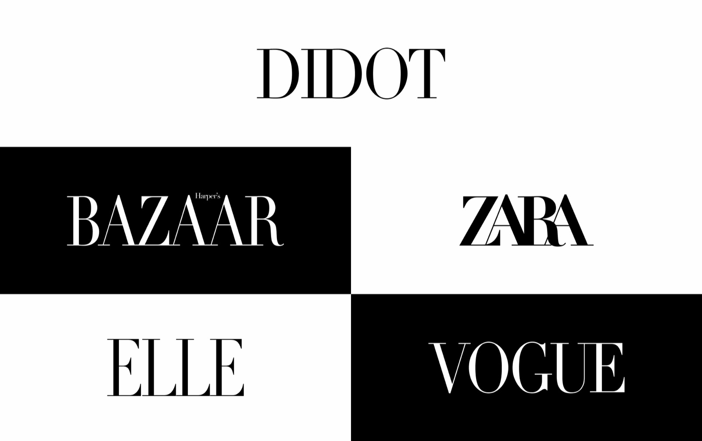

# Didot

**Didot**

**Designed by:**

Firmin Didot

**Foundry:**

Didot Type Foundry

**Country:**

🇫🇷 France

**Year:**

c. 1784–1811 (developed over time)

---

**Intent:**

- Designed to express **elegance, refinement, and rational order**
- Reflect Enlightenment ideals of **clarity and control**
- Push typography toward **extreme contrast and precision**
- Intended for **high-quality printing and display**

---

**What was happening at the time:**

- The **Enlightenment** and rise of rationalism
- Neoclassicism influencing art, fashion, and architecture
- Pre- and post-French Revolution France
- A shift from old-style humanist type toward **modern serif forms**

---

**Type classification:**

- Serif
- Modern serif (Didone)

---

**Characterised by:**

- Extreme contrast between thick and thin strokes
- Hairline, unbracketed serifs
- Vertical stress
- Elegant, narrow proportions
- Feels luxurious, dramatic, and formal

---

**Famous examples in use:**

---

**Why designers still use it:**

- Instantly signals **luxury and sophistication**
- Strong visual impact in display sizes
- Closely associated with fashion and high culture
- Timeless elegance when used carefully

---

**When NOT to use it:**

- Long-form body text
- Small sizes or low-resolution screens
- Informal or friendly contexts
- Environments with poor printing quality

---

**Usage:**

> Use Didot when you want elegance and authority — but only where precision and scale can support it.
>
