# Dynamic Buttons Part Deux

**Contents** 

- Create component set with x7 variants
- Add Colors
- Change Variant Names
- Test on Child
1. Select Parent Component 
    
    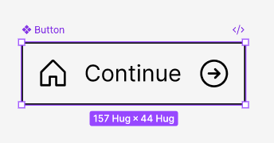
    
2. Click **Add Variant** Button
    
    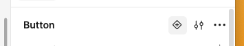
    
3. Make 6 more variants
    
    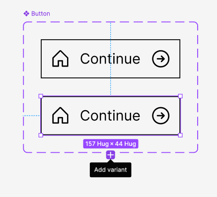
    

1. Colorise **Buttons** using the following colours following HSL Colours 

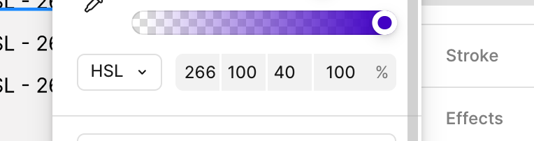

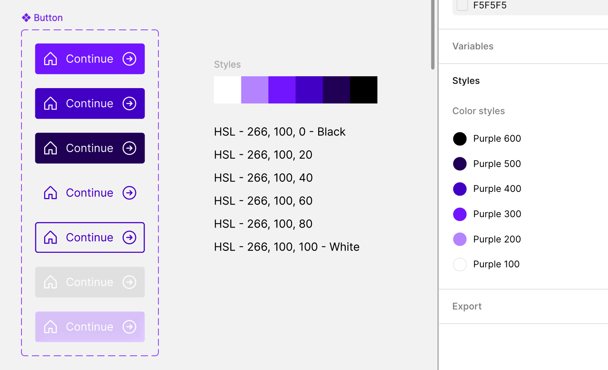

5. Change **Property Name** to Button

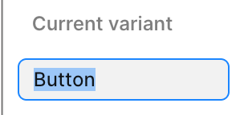

1. Rename variants to the following values

- Default

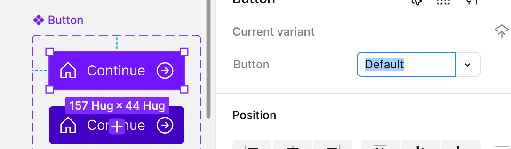

- Hover
    
    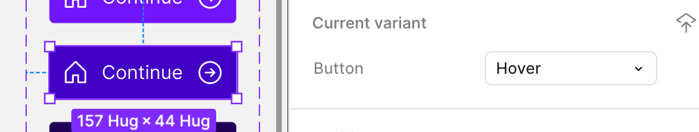
    
- Pressed
    
    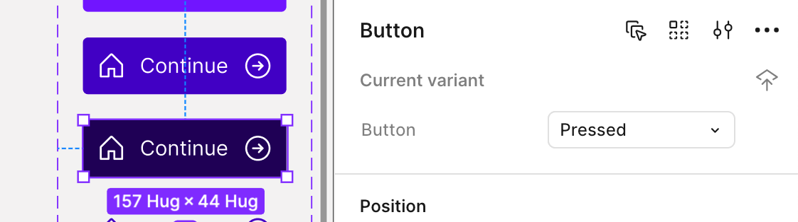
    

- noStroke
    
    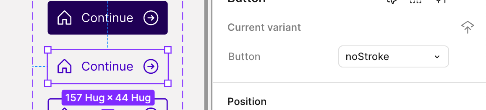
    
- withStroke
    
    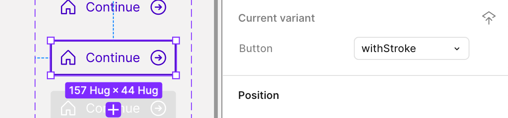
    
- Disabled
    
    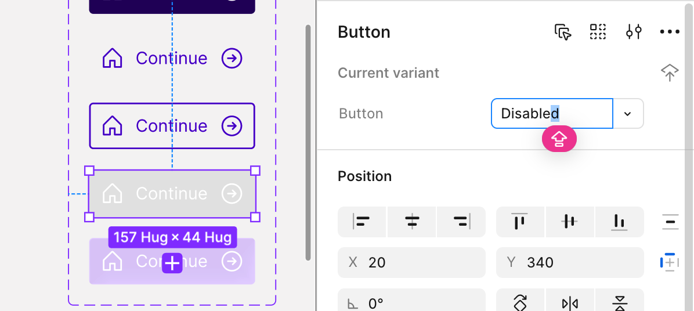
    
- Glass
    
    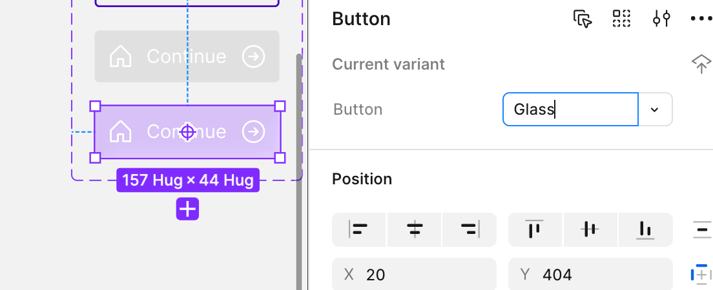
    
    With glass effect, it’s necessary to add ‘effect’, change to ‘Glass’
    

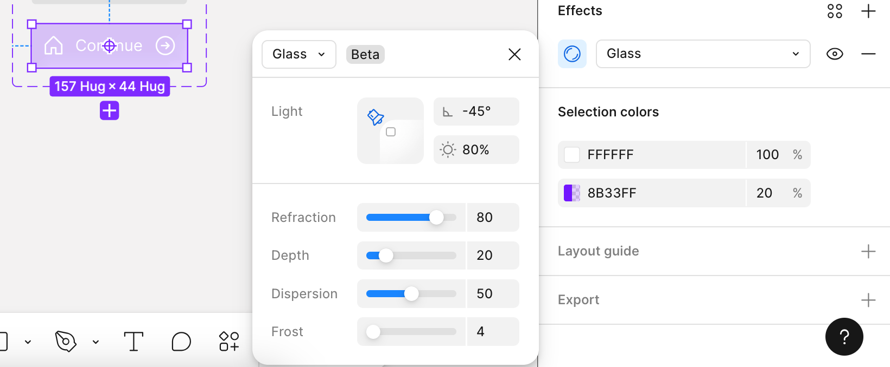

1. Test on Child Element

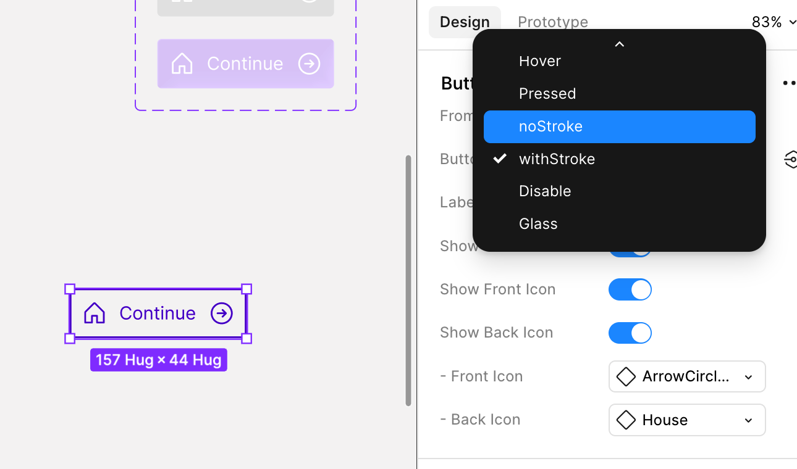

All Done!

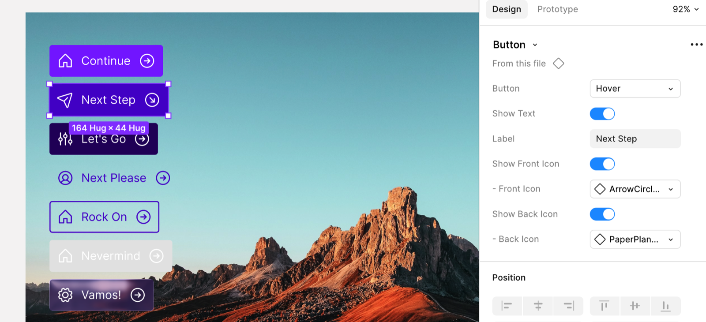
