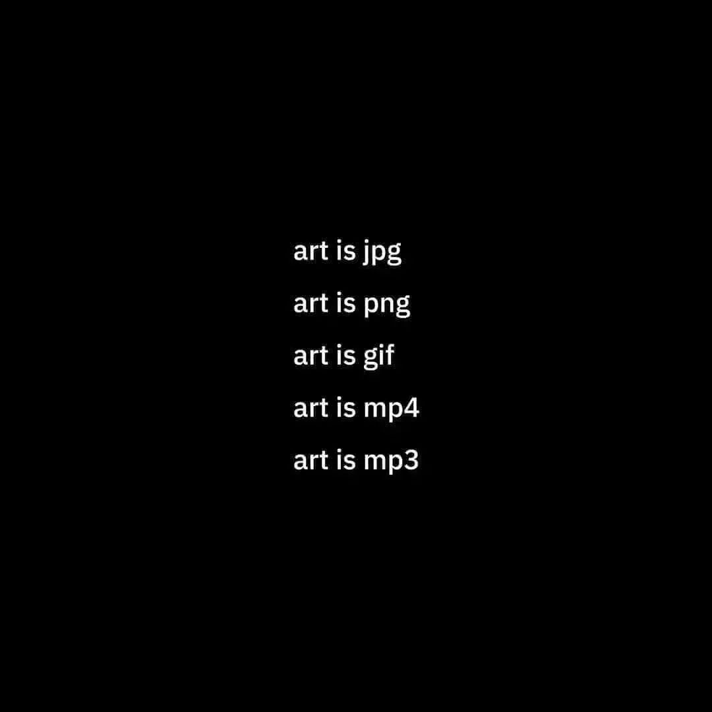
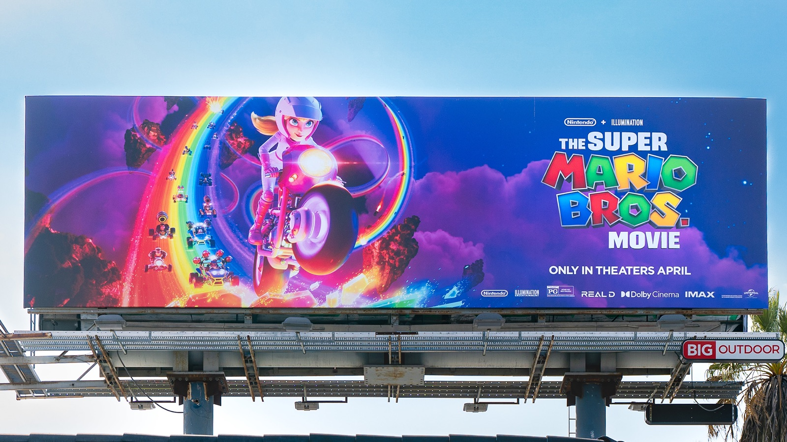

## File Types

## JPG (Joint Photographic Experts Group)

- File Extension: .jpg or .jpeg
    
    
    
- Description: JPEG. popular image format for photographs and complex images. It uses lossy compression, meaning it reduces file size by discarding fine visual detail, which can result in some loss of image quality.
- Pixel Based

## PNG (Portable Network Graphics)

File Extension: .png

Description: PNG is a widely used image format for graphics and images with transparency support. It uses lossless compression, which preserves image quality but may result in larger file sizes compared to JPEG.

- Pixel Based

## GIF (Graphics Interchange Format)

File Extension: .gif

Description: GIF is an image format primarily used for short animations and simple graphics. It supports transparency and is limited to 256 colors, making it less suitable for photographs but ideal for simple animations.

- Pixel Based

## SVG (Scalable Vector Graphic)

- File Extension: .svg
- Description: SVG is a vector graphics format that uses XML-based code to describe images. It's resolution-independent and can be scaled **without loss of quality**. It’s non pixel based and relies on just two colours, stroke and fill with the stroke being the exterior line of the shape and the fill being the internals. SVG files are often used for logos, icons, and other graphics. In essence, SVG is based on the mathematical principles of fill colour and stroke colour. This is why it can be referred to as line art, because it’s a vector.
- Vector Based (becomes picture)
    
    
    

## WEBP (Web Picture)

- File Extension: .webp
- Description: Google created the WebP file format to make online images less bulky. With significantly reduced photo and graphic sizes, websites load faster and give users a better experience.
- Pixel Based
- WebP supports transparency (alpha channel), similar to PNG, allowing images with transparent backgrounds or semi-transparent elements. Both lossy and lossless WebP images can include an alpha channel.

## TIFF (Tagged Image File Format)

- File Extension: .tiff or .tif
- Description: TIFF is super high quality format often used professionally for printing and publishing. It supports lossless compression and can store multiple layers, making it suitable for preserving image quality in various contexts. It’s amazingly powerful but massive. Do not use for web design ever.
- Pixel Based

---

## Why it matters for UX

The wrong file type makes apps slow, logos blurry and transparent backgrounds white. Choosing the right format for each asset is part of handing off a design that performs well for real users on real connections.

## Try it: pick the format (15 minutes)

1. Export the same photo from Figma as JPG, PNG and WebP, and compare the file sizes.
2. Export your logo as PNG and as SVG, then zoom both to 400%.
3. Write a one-line rule for when you'd use each format in your project.

## Media

[https://www.youtube.com/watch?v=JMrVC53-q1g](https://www.youtube.com/watch?v=JMrVC53-q1g)

## Resources

[Image file type and format guide – MDN Web Docs](https://developer.mozilla.org/en-US/docs/Web/Media/Formats/Image_types)

[Choose the right image format – web.dev](https://web.dev/articles/choose-the-right-image-format)

## Key takeaways

- Use SVG for logos and icons: vectors scale without losing quality.
- Use WebP (or JPG) for photos, PNG when you need lossless transparency.
- Smaller files mean faster pages: never put TIFFs on the web.
