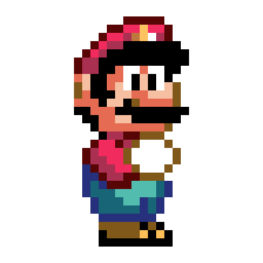
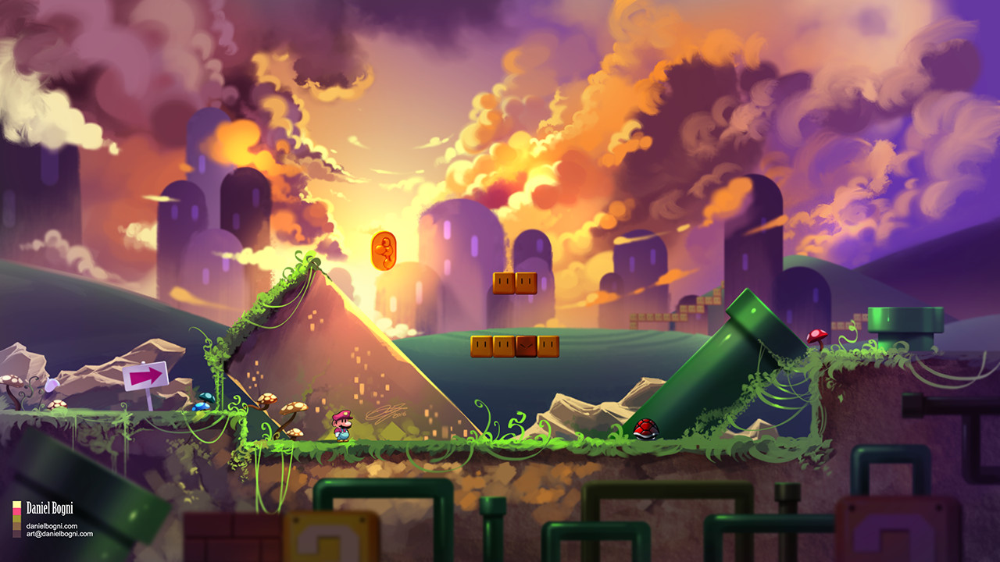
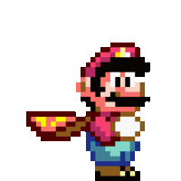
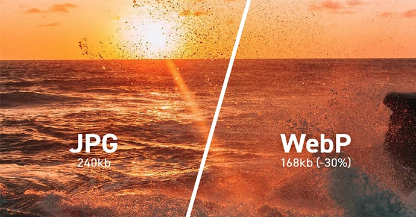

title: File Types
promise: Which image format to use, and when, so your designs stay sharp and your pages load fast.
duration: 15 minutes
topics:
- Pixels versus vectors
- JPG for photos
- PNG for transparency
- GIF for simple animation
- SVG for logos and icons
- WebP for the web
- TIFF for print only
---
@title
# File Types
Pick the right format, and your designs stay sharp and your pages load fast.
---
@split
## Pixels and vectors

**Pixel (raster) images** are grids of coloured squares. Scale them up and they blur or turn blocky.

**Vector images** are drawn with maths: points, lines and fills. Scale them to any size and they stay sharp.
---
@split
## JPG

**For photos and complex images.**

Uses **lossy** compression: it throws away fine detail to make files small.

No transparency.
---
@split
## PNG

**For graphics that need transparency** or sharp edges, such as screenshots and UI elements.

Uses **lossless** compression: perfect quality, but bigger files than JPG.
---
@split
## GIF

**For short, simple animations.**

Limited to **256 colours**, so it's poor for photos.

Supports simple transparency.
---
@cards
## SVG

- **Vector** Drawn with code, so it scales to any size without losing quality
- **Tiny files** Perfect for logos, icons and illustrations
- **Editable** Change colour, stroke and fill in Figma or CSS
- **Not for photos** Photos are pixels, so use JPG or WebP
---
@split
## WebP

Google's format for the web: **smaller files at the same quality**, so pages load faster.

Supports transparency and animation. Use it for photos on websites.
---
@statement
TIFF is huge, lossless and made for professional print.

Never put a TIFF on a website.
---
@text
## The quick guide

| You need… | Use |
| --- | --- |
| A logo or icon | **SVG** |
| A photo on a website | **WebP** (or JPG) |
| A screenshot or graphic with transparency | **PNG** |
| A tiny looping animation | **GIF** |
| A high-quality print file | **TIFF** |
---
@exercise
## Which format?

1. Your app's logo, shown in the header and on a billboard
2. A hero photo for a restaurant's website
3. A screenshot of your prototype for your case study
4. A three-frame loading animation for a chat message
5. A product photo the printers need at 300 dpi
6. A set of 24 navigation icons for your design system
---
@answers
## Check yourself

1. Logo: **SVG**, so it's sharp at any size
2. Hero photo: **WebP** (or JPG), small and fast
3. Prototype screenshot: **PNG**, sharp text and edges
4. Loading animation: **GIF** (or an animated WebP)
5. Print photo: **TIFF**
6. Navigation icons: **SVG**
