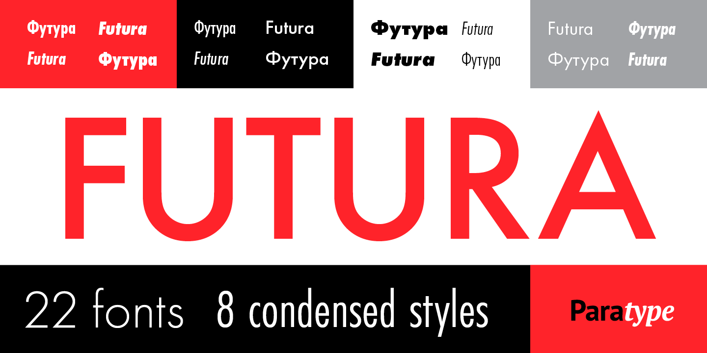
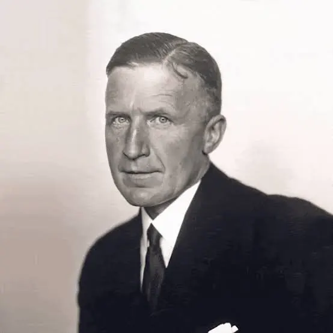
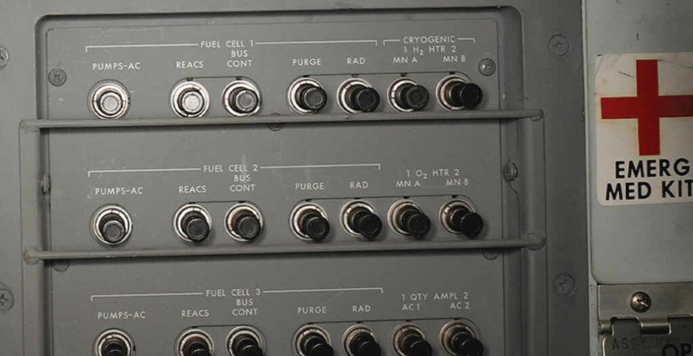
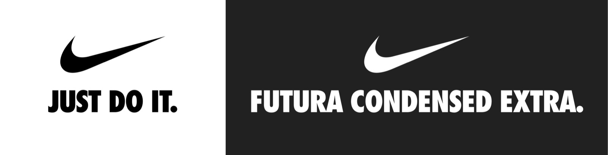
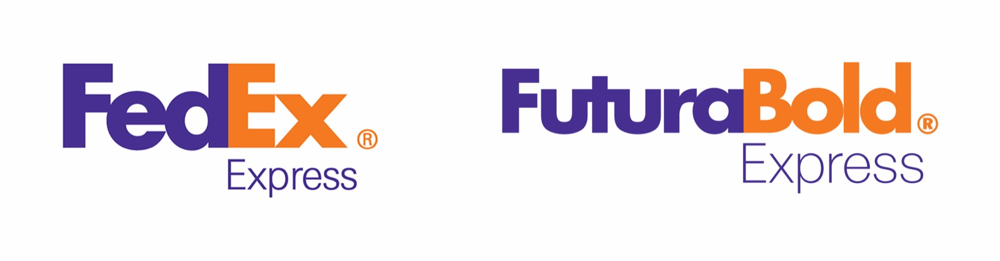
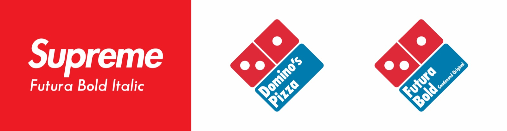

# Futura

> A geometric, optimistic typeface that embodies early modernist faith in progress, reason, and universality.
> 

**Designed by:**

Paul Renner

**Foundry:**

Bauer Type Foundry (Based in Barcelona)

**Country:**

🇩🇪 Germany 

**Year:**

1927

---

**Intent:**

- Designed to represent a **new, modern age**
- Aimed to reject historical ornament and handwriting traditions
- Built from **simple geometric forms** (circle, triangle, square)
- Intended to feel **objective, universal, and forward-looking**

Renner wanted a typeface that felt *inevitable* — not expressive or personal, but rational and timeless.

Futura used on NASA instruments, materials and signage present in the Apollo missions of the 1960’s 

---

**What was happening at the time:**

- Rise of **Modernism** and **functional design**
- Influence of the **Bauhaus movement** (even though Renner wasn’t formally part of it)
- Post–World War I Germany: optimism about technology, industry, and progress
- A push toward **standardisation, clarity, and mass communication**

Typography was shifting from decoration → **function**.

---

**Type classification:**

- Sans-serif
- Geometric sans-serif

---

**Characterised by:**

- Near-perfect circular forms (especially O, o)
- Sharp, clean geometry
- Low stroke contrast
- Tall ascenders and clean verticals
- Feels precise, confident, and slightly cold

Great for analysis: compare the **perfect geometry** to more humanist sans-serifs.

---

**Famous examples in use:**

---

**Why designers still use it:**

- Instantly communicates **modernity and confidence**
- Strong visual identity with minimal styling
- Works exceptionally well for **headlines and branding**

---

**When NOT to use it (great teaching moment):**

- Long-form body text (can feel tiring)
- Interfaces requiring warmth or friendliness
- Situations needing high readability at very small sizes

---

**Usage:**

> Use Futura when you want to communicate progress and confidence — but not warmth or nuance.
>
