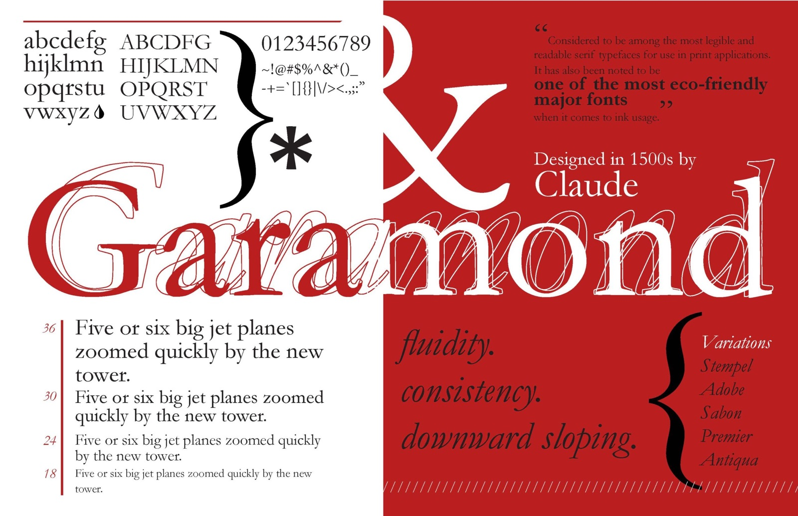

# Garamond

> The embodiment and peak of the classical Renaissance calligraphic tradition.
> 

**Designed by:**

Claude Garamond

**Foundry:**

Originally cut and cast independently in Paris

**Country:**

🇫🇷 France

**Year:**

1530’s

---

## **Intent:**

- Designed to improve the readability and elegance of book typography
- Based on Roman letterforms
- Intended to feel timeless
- Created for long-form reading and scholarly texts

## **What was happening at the time:**

- The **Renaissance** revival of classical knowledge and art
- Renewed interest in Ancient Rome and Greece
- Growth of printing and book culture
- Typography aligned closely with scholarship, religion, and education

Typography served to **preserve and transmit knowledge**, reinforcing cultural authority and intellectual hierarchy.

---

## **Type classification:**

- Serif
- Old-style

---

## **Characterised by:**

- Moderate stroke contrast
- Diagonal stress reflecting broad-nib calligraphy
- Graceful, bracketed serifs
- Open counters and generous proportions
- Elegant rhythm ideal for extended reading
- Feels warm, scholarly, and cultivated

Often contrasted with grotesque sans-serifs, which reject calligraphy and classical proportion entirely.

---

## **Famous examples in use:**

---

## **Why designers still use it:**

- Exceptional readability in long-form text
- Strong association with knowledge and tradition
- Timeless aesthetic that feels authoritative but humane
- Ideal for editorial, books, and formal publishing

---

## **When NOT to use it (teaching note):**

- Modernist or highly contemporary design contexts
- Interfaces requiring extreme clarity at very small sizes
- Projects aiming to feel industrial, neutral, or anti-traditional
- Loud advertising or expressive branding

---

## **Usage:**

> Use Garamond when you want to communicate intellectual authority, tradition, and humanist warmth — but not radical modernity, neutrality, or rebellion.
>
