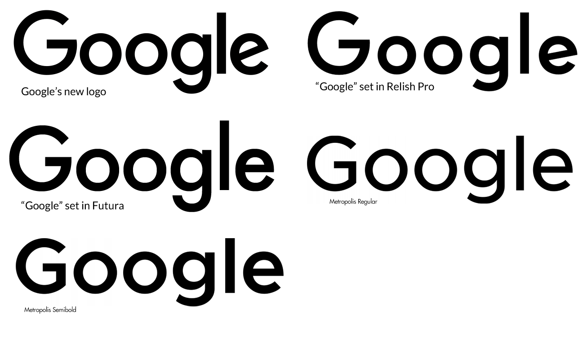

# Google Sans

---

> A modern, neutral, and highly legible sans-serif designed for digital clarity and versatility.
> 

**Designed by:**

Google Typography Team

**Foundry:**

Google

**Country:**

🌍 United States

**Year:**

2011

---

## **Intent:**

- Created as a system font for Google products and Android
- Designed to be neutral, readable, and adaptable across devices
- Balances geometric structure with open, friendly letterforms
- Optimized for digital screens and multiple sizes

Google aimed for a typeface that feels modern and functional without drawing attention to itself.

## **What was happening at the time:**

- Smartphone and tablet use was rapidly growing
- Interfaces required clean, legible fonts for small screens
- Flat design and minimalism influenced typography choices

Typography was shifting toward screen-first, highly functional designs.

---

## **Type classification:**

- Primary: Sans-serif
- Secondary: Neo-grotesque / humanist-influenced

---

## **Characterised by:**

- Open apertures and generous x-height
- Low stroke contrast for clarity
- Neutral, modern, and highly readable
- Designed for scalability across devices

Compared to Helvetica, Google Sans feels warmer, more approachable, and optimized for digital screens.

---

## **Famous examples in use:**

- Google Search, Gmail, Maps, YouTube
- Android OS and Material Design system
- Google marketing and branding materials

---

## **Why designers still use it:**

- Conveys clarity, neutrality, and modern efficiency
- Excellent readability for UI, web, and app design
- Works across multiple platforms and languages

---

## **When NOT to use it (teaching note):**

- Projects needing strong personality or emotion
- Print-heavy, decorative, or highly expressive branding
- Situations where a serif or more distinctive typeface is needed

---

## **Usage:**

> Use this typeface when you want to communicate clarity, neutrality, and modern digital efficiency — but not personality or historical character.
>
