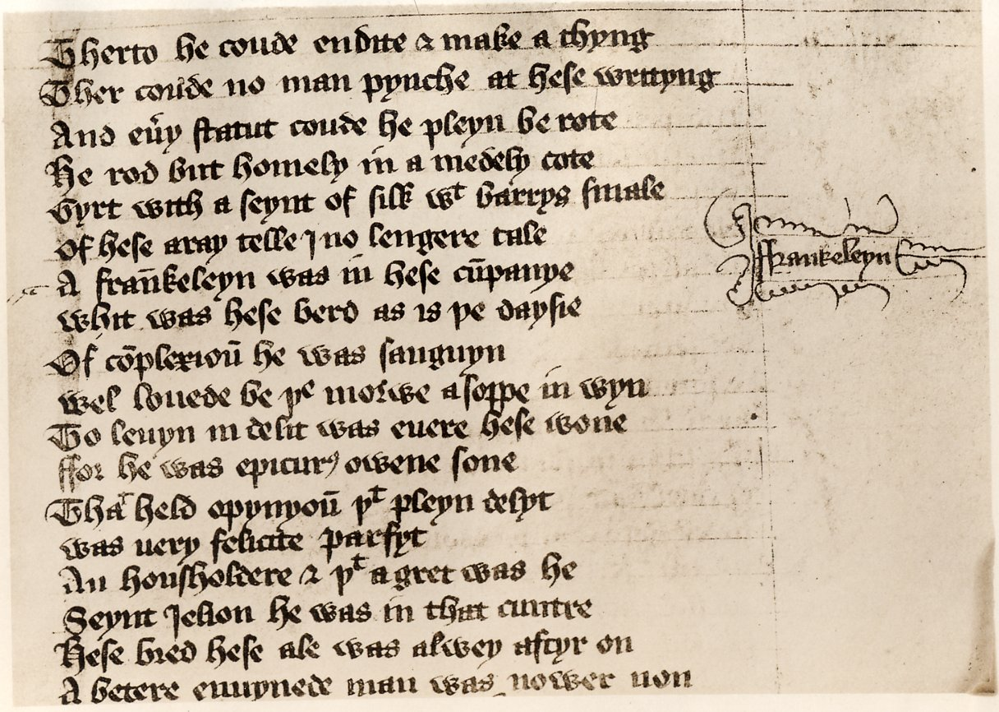
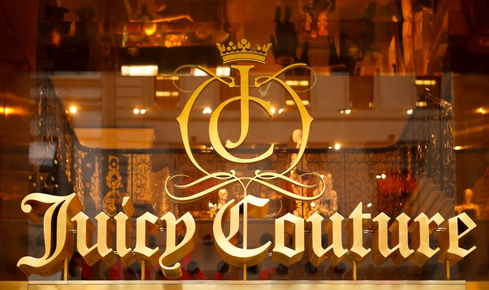

# Gothic (Blackletter)

---

> Gothic Blackletter is significant for its deep historical roots in medieval manuscripts and its role in early printing.
> 

**Designed by:**

Multiple historical designers

Johannes Gutenberg should be mentioned as the inventor of the printing press who formalised Gothic bookhand into Blackletter which was more of a style than an established typeface

**Foundry:**

Various (hand-drawn, later pressed)

**Country:**

🌍 Germany

**Year:**

1100’s AD

---

## Intent

- For readability in manuscripts
- Expressed authority and cultural identity (Western-European-Gothic tradition)
- Loved as functional and decorative

## Context

- Gothic architecture
- Printing press emergence
- Focus on dense, legible columns
- Preference for ornate, formal scripts

---

## Type classification

- Primary: Blackletter
- Secondary: Textura, Fraktur, Rotunda

---

## Characterised by

- Angular, vertical strokes
- Dense, narrow letters
- Decorative serifs and intricate shapes
- Historic, formal tone

---

## Examples in use

- Certificates and diplomas

---

## Why designers still use it

- Conveys tradition and authority
- Decorative, period-accurate style
- Instantly recognisable

---

## When not to use it

- Don’t use it

---

## Usage

> Use when you want tradition and formality — not neutrality or modernity.
>

---

## Why it matters for UX

Blackletter shows how strongly a typeface carries history and meaning: one glance says tradition, ceremony or heavy metal. In UI that association is so strong that it almost always overpowers the content, which is exactly why it's worth studying.

## Try it: read it, then replace it (15 minutes)

1. Set the sentence "Your order has been shipped" in a blackletter font and in a neutral sans-serif.
2. Show both to a classmate and ask how each makes them feel.
3. List three products where blackletter would be the right choice (a brewery, a certificate, a band).

## Media

[https://www.youtube.com/watch?v=lQcO4n-RiOk](https://www.youtube.com/watch?v=lQcO4n-RiOk)

## Resources

[Blackletter – Wikipedia](https://en.wikipedia.org/wiki/Blackletter)

[Google Fonts Knowledge](https://fonts.google.com/knowledge)

## Key takeaways

- Blackletter comes from medieval manuscripts and the first printed books.
- It carries strong associations of tradition, authority and ceremony.
- Keep it for logos and display; never use it for interface text.
