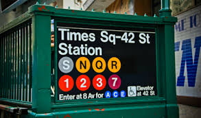
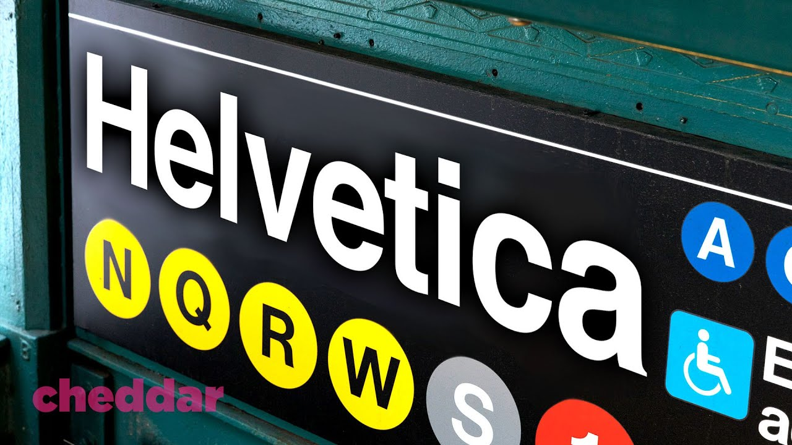
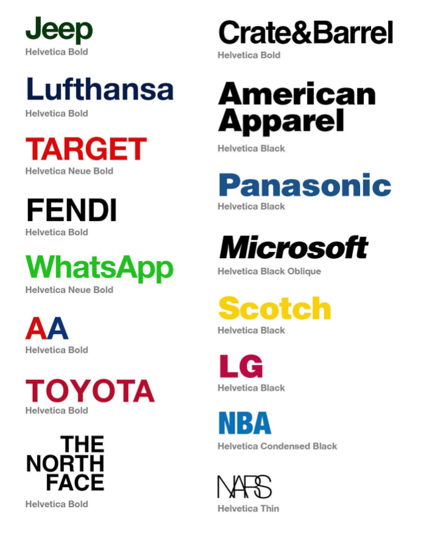

# Helvetica

> A neutral, highly legible typeface designed to disappear behind the message, prioritising clarity, order, and universality over expression.
> 

**Designed by:**

Eduard Hoffmann and Max Miedinger

**Foundry:**

Haas Type Foundry

**Country:**

🇨🇭 Switzerland

**Year:**

1957

---

## Intent

- Designed to be **neutral and objective**
- Created for maximum **clarity and readability**
- Aimed to work across many contexts without drawing attention to itself
- Intended as a truly **universal typeface** for modern communication

The goal was not to express personality, but to let the content speak without stylistic interference.

---

## Context

- Rise of the **International Typographic Style (Swiss Style)**
- Emphasis on grids, order, and rational design systems
- Post–World War II desire for neutrality and clarity
- Growth of corporate identity and mass communication

Typography shifted toward **function, neutrality, and consistency**.

---

## Type classification

- Sans-serif
- Neo-grotesque sans-serif

---

## Characterised by

- Uniform stroke weight
- Tight letter spacing
- Closed apertures (e, a, c)
- Strong horizontal and vertical terminals
- Clean, compact, and controlled appearance
- Feels neutral, authoritative, and efficient

Often compared to more humanist sans-serifs, which feel warmer and more open.

---

## Examples in use

## Why designers still use it

- Extremely **versatile and reliable**
- Conveys professionalism and authority
- Works well across print, signage, and branding
- Instantly recognisable yet unobtrusive

---

## When not to use it

- Projects needing strong personality or warmth
- Long body text at small sizes (closed apertures can reduce readability)
- Situations where a more expressive or human tone is required

---

## Usage

> Use Helvetica when you want to communicate neutrality, clarity, and authority — but not emotion, warmth, or individuality.
>

---

## Why it matters for UX

Helvetica is the face of neutrality: it lets the content speak and has shaped corporate and interface design for decades. Understanding its strengths (order, clarity) and weaknesses (closed apertures at small sizes) explains why newer UI fonts like San Francisco and Inter exist.

## Try it: the neutrality test (15 minutes)

1. Find three brand logos set in Helvetica (American Airlines, Lufthansa, Jeep, Toyota and many more).
2. Swap one into a typeface with strong personality, such as Futura or Didot.
3. Write down how the brand's personality changed.

## Media

[https://www.youtube.com/watch?v=X80kSDxF4rg](https://www.youtube.com/watch?v=X80kSDxF4rg)

## Resources

[Helvetica – Wikipedia](https://en.wikipedia.org/wiki/Helvetica)

[Google Fonts Knowledge](https://fonts.google.com/knowledge)

## Key takeaways

- Helvetica (1957) is a neo-grotesque designed to be neutral and universal.
- It defined Swiss Style, corporate identity and early digital interfaces.
- Its closed apertures make it less readable at small sizes than modern UI fonts.
