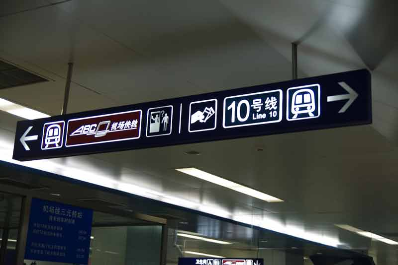
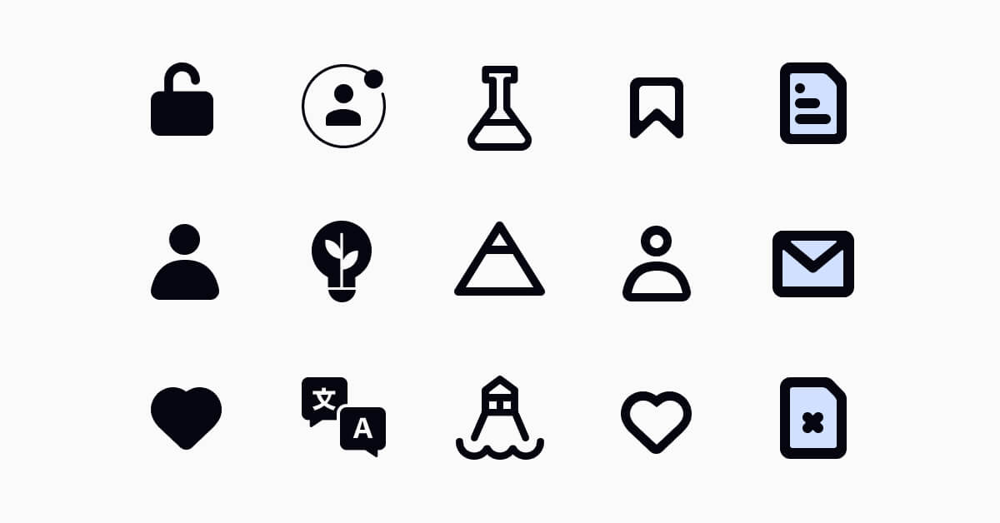
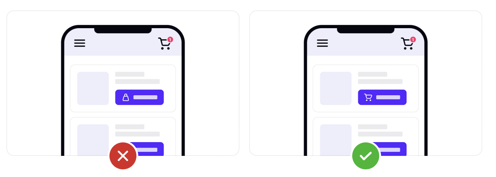
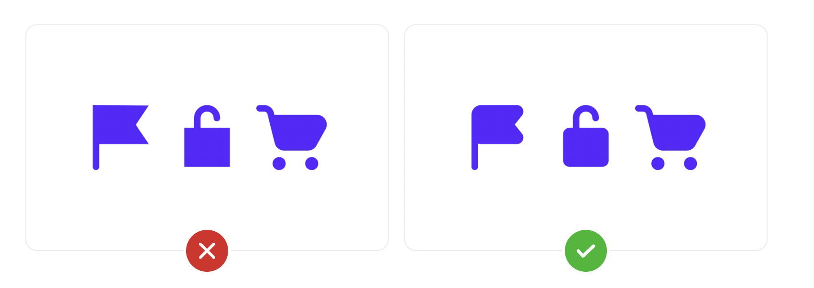
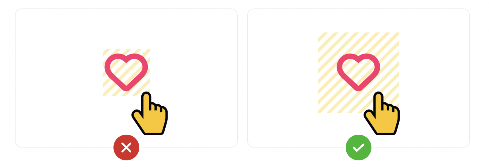

title: Icons
promise: How to choose, style and size icons so people understand them at a glance.
duration: 20 minutes
topics:
- Why icons work, and when they don't
- Icon styles: filled, outlined, 3D and hand-drawn
- Nine rules for using icons well
- Touch targets and sizing
---
@title
# Icons
Immediate visual cues, if people understand them.
---
@split
## Icons cross languages

Good icons work across **countries and cultures**, and save space on small screens.

But an icon nobody understands is worse than a word.
---
@cards
## Four styles

- **Filled** Solid shapes. Bold and easy to spot
- **Outlined** Thin strokes. Light and minimal
- **3D** Textures, shadows and gradients that imitate real objects
- **Hand-drawn** Imperfect and personal. Creative and informal
---
@image
## Filled and outlined

*Many apps use outlined icons for "off" and filled icons for "on" in navigation.*
---
@split
## One icon, one meaning

Don't use the same icon for different things, or different icons for the same thing.

If the header shows a **cart**, don't use a **bag** elsewhere.
---
@split
## Label what isn't obvious

Only a few icons are universal: home, search, close.

**When in doubt, add a label**: one to three words, ideally a verb.
---
@split
## Consistent geometry

Rounded with rounded, sharp with sharp.

Take every icon **from the same family**.
---
@split
## Touch targets

The tappable area should be bigger than the icon.

**At least 44 × 44 pt** on iOS and **48 × 48 dp** on Android (Material Design).
---
@split
## Balanced size

Shapes have different **visual weight**: a solid square looks bigger than a star at the same size.

Adjust them until they **look** equal.
---
@cards
## The rules in one slide

- **Simple** Fewer details, especially at small sizes
- **Consistent** One family, one style, one meaning each
- **Labelled** When the meaning isn't universal
- **Contained** Same-size containers to align them
- **Tappable** 44–48 px targets
- **Coloured with care** One colour for active, one for the rest
---
@exercise
## Spot the mistakes

A banking app's bottom navigation has five icons:

1. **Home** is filled, and the other four are outlined, even when you're on another tab
2. A magnifying glass means **search** on one screen and **zoom** on another
3. Each icon is 20 × 20 px, with no extra tap area
4. "Pay a friend" is a custom icon of two coins and an arrow, with no label
5. Two icons have sharp corners; three are rounded

Which rule does each break, and how would you fix it?
---
@answers
## Check yourself

1. **Consistent colour and state**: fill only the active tab
2. **One icon, one meaning**: use a separate zoom icon
3. **Touch targets**: make each at least 44–48 px
4. **Label what isn't obvious**: add "Pay"
5. **Consistent geometry**: take all five from one family
