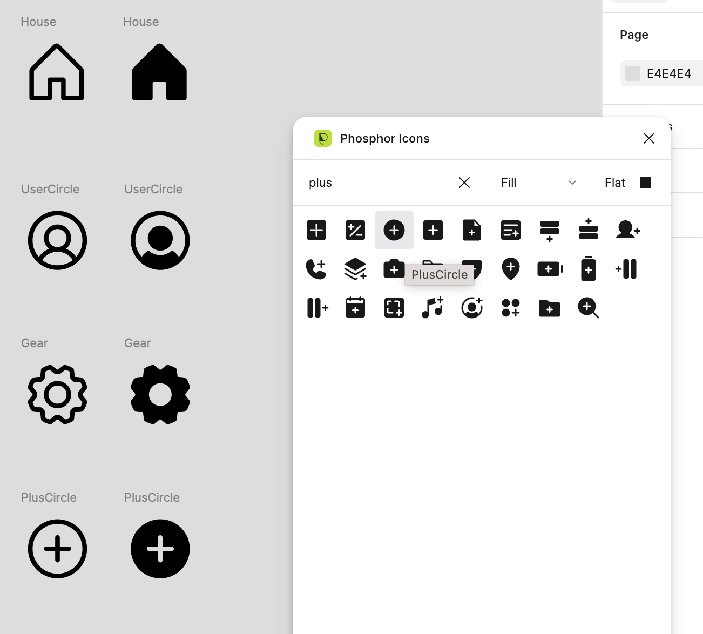
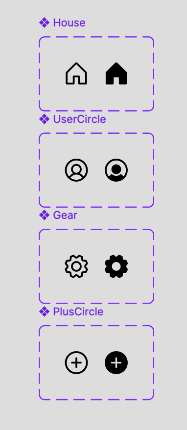
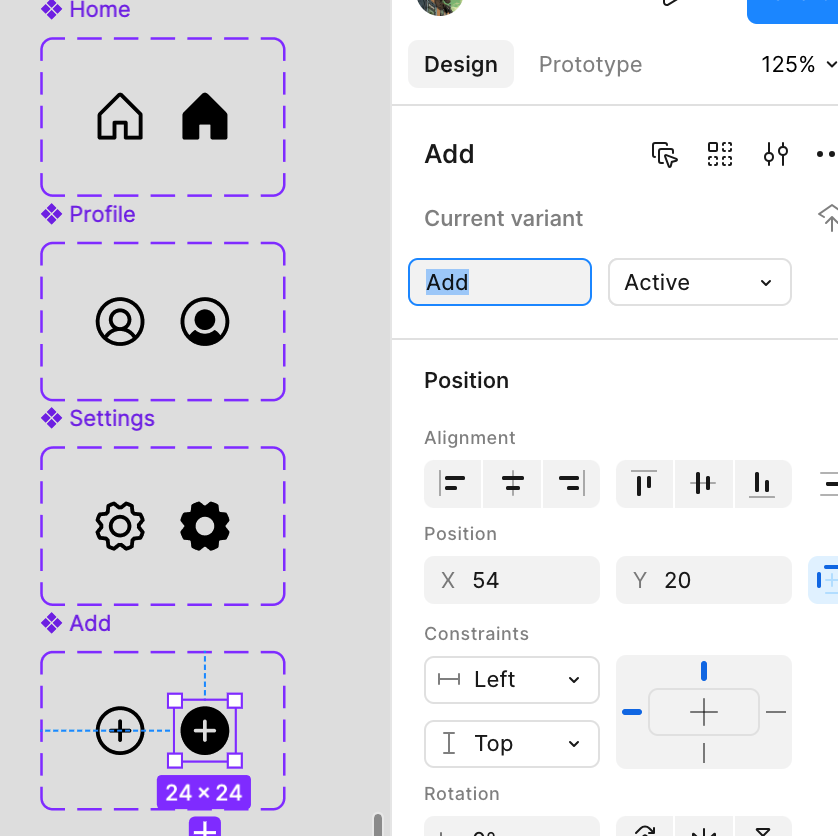
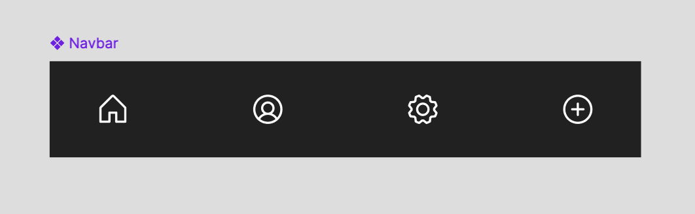
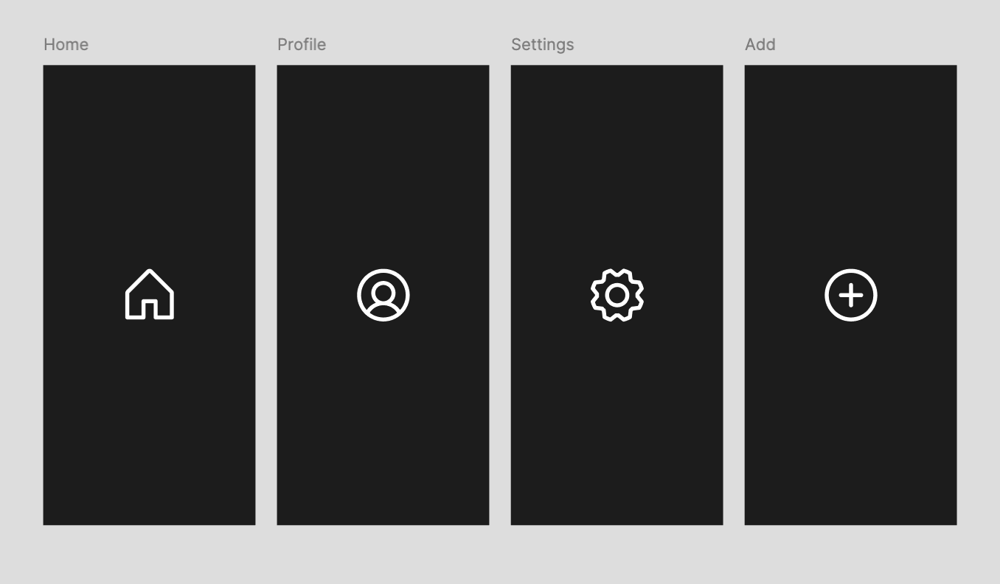
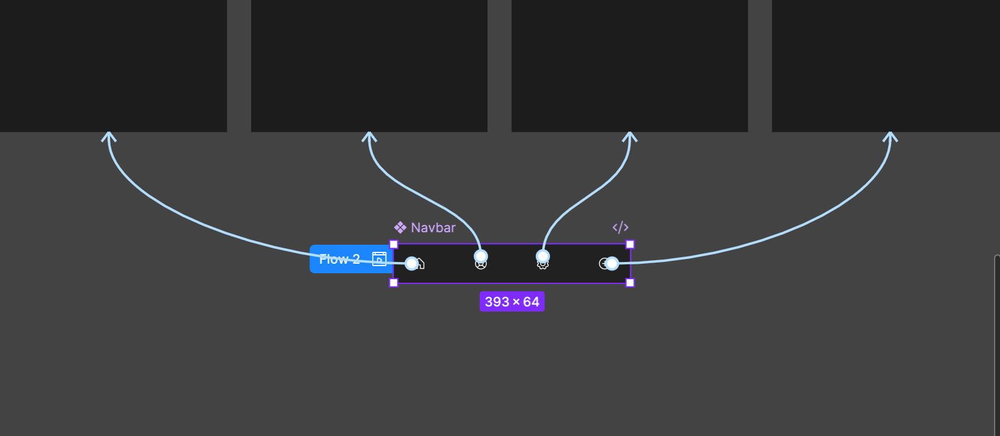
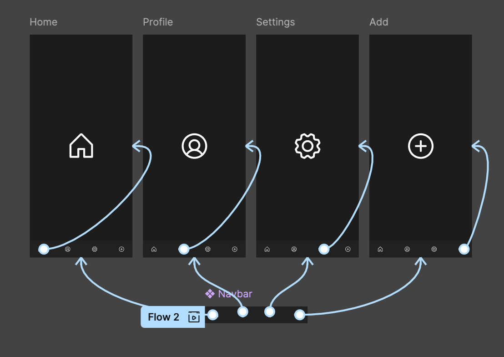
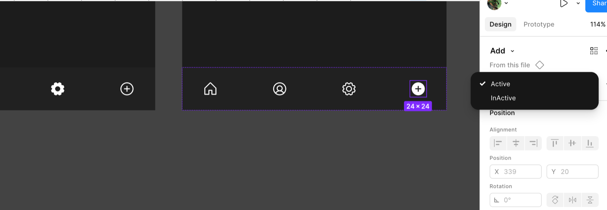
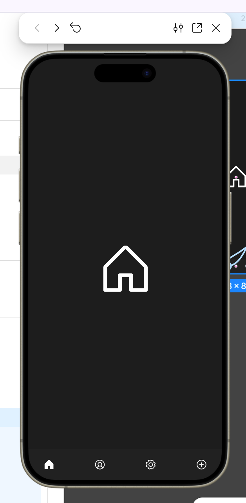
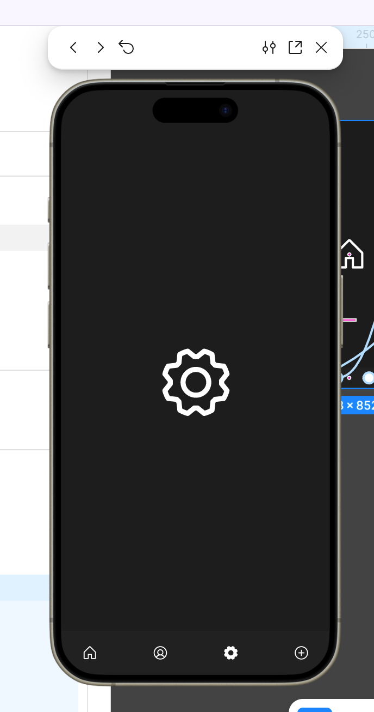

# Navbar

## What you'll build

A bottom navigation bar whose icons switch between an outline (off) and a filled (on) state, linked to four screens in a working prototype.

## Before you start

- You've finished [Beginner’s Guide to Components](beginners-guide-to-components.html)
- The Phosphor Icons plugin
- About 45 minutes

## Let's go

1. Import 4 sets of icons comprised of a **regular** and a **fill** icons from Phosphor Icons
    
    
    

2. Turn those sets into 4 ‘component sets’

1. Change the names and values
    
    
    

| **Icon Set Name** | **Instance 1 (Regular)** | **Instance 2 (Fill)** |
| --- | --- | --- |
| Home | Off | On |
| Profile | Off | On |
| Settings | Off | On |
| Add | Off | On |

1. Make the following **Navbar** component

    
    
    

5. Make the following 4 full frame screens

6. Switch to prototype mode and from each of the elements inside the navbar, drag out an ‘OnClick’ connectors. 

7. Copy the parent NavBar and paste the children into the page 

1. Switch the InActive states to Active on the relevant page

9. Switch to prototype mode and test the Navbar

## Well done!

You can now:

- Build icon component sets with on and off variants
- Make a navbar component from icon instances
- Prototype a navbar that shows the active page

**Next:** [Dynamic Buttons Part One](dynamic-buttons-part-one.html)
