# Number Variables

## What you'll build

A full set of number variables (page sizes, content areas, buttons, gaps and radius) measured from a frame that fits your own phone, so your layouts are built from tokens, not guesses.

## Before you start

- You've finished [Color Variables](color-variables.html)
- The Figma app on your phone, to test
- A spreadsheet or note to record your measurements
- About 1 hour

## Let's go

So for this exercise, it's important that you download the **Figma app from the app store** and you get used to exclusively working in Frames as opposed to shape layers. The reason for this is because you **cannot add auto-layout** to shape layers. So things begin by setting up a frame that fits perfectly onto your phone. Let’s go! 

1. Create a new frame that will fit your own phone! 

1. Look at the Height and Width Properties. Take note of **Width** Value and **Height** Value
    
    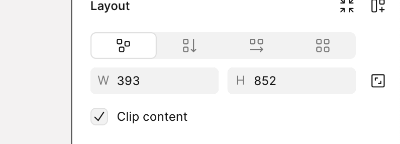
    

1. Create Number Variable
    
    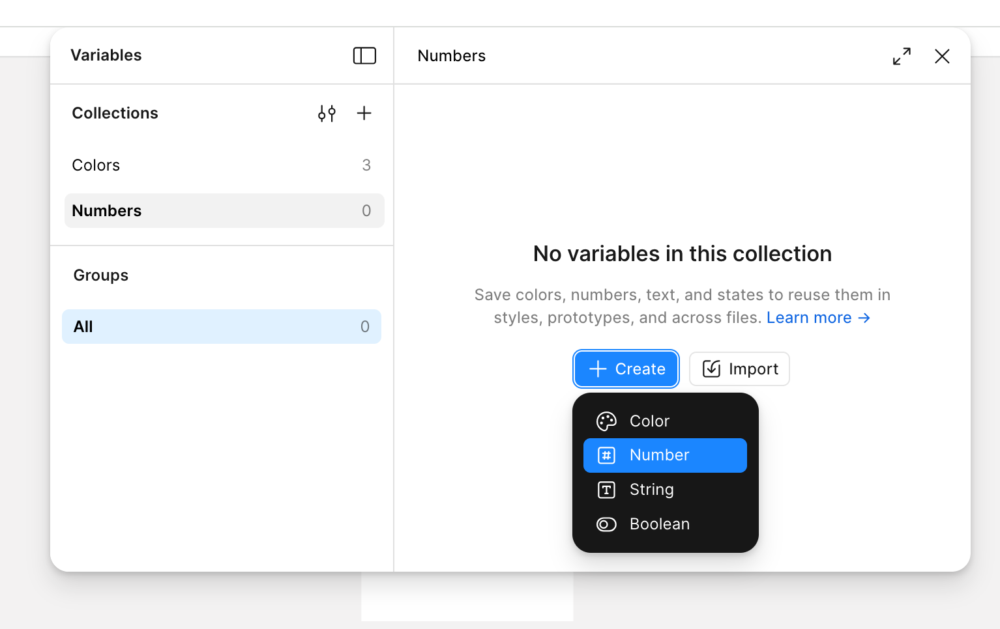
    

1. Input **Full Width** and **Full Height** values

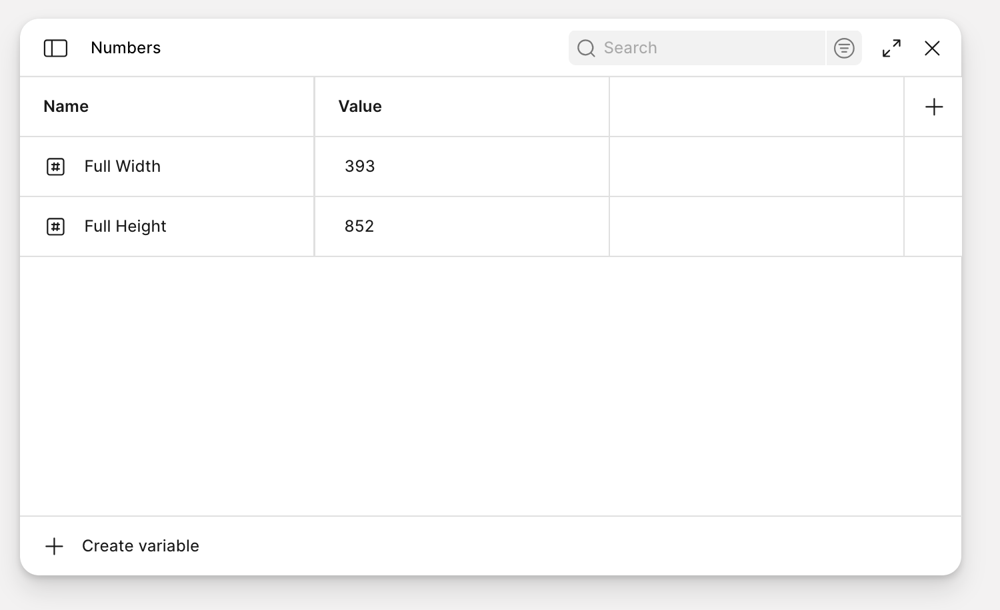

As of 2026, Figma doesn’t allow you to create and switch Height and Width modes on the same variable. Hopefully this will change. 

1. Apply a one column grid to that frame with the following measurements applied: `16px Gutter / 16px Margin`
    
    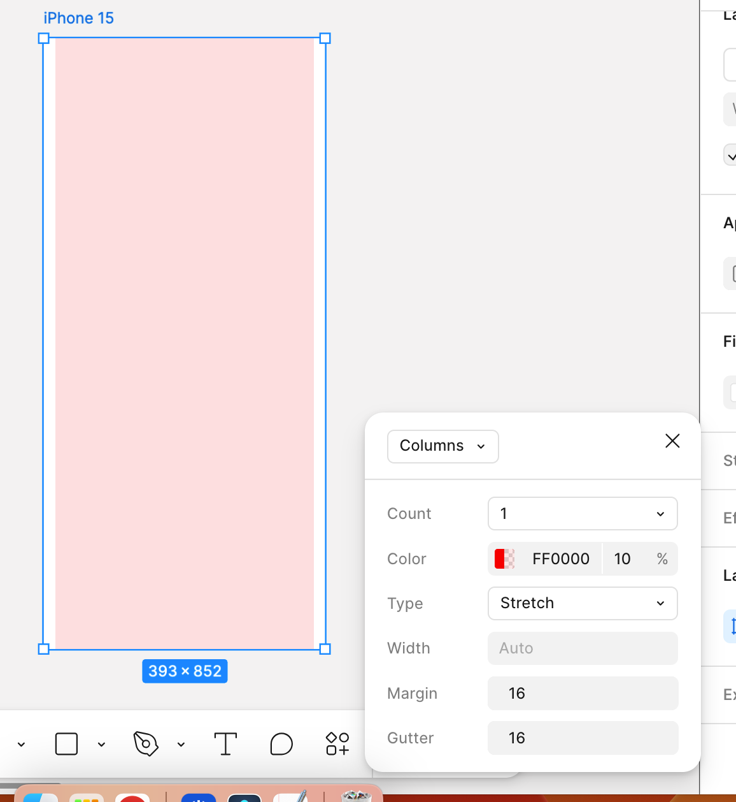
    

 

1. Measure the inner content area using a perfect square. This will be your **first Content Area**
    
    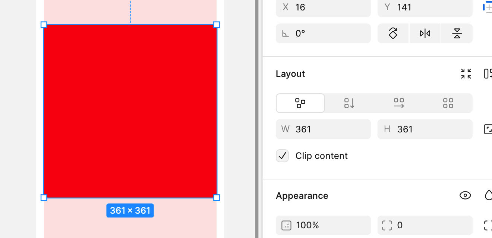
    
    Now we will need to record that value in a spreadsheet (or a note).
    

1. Enter those variables into the spreadsheet.

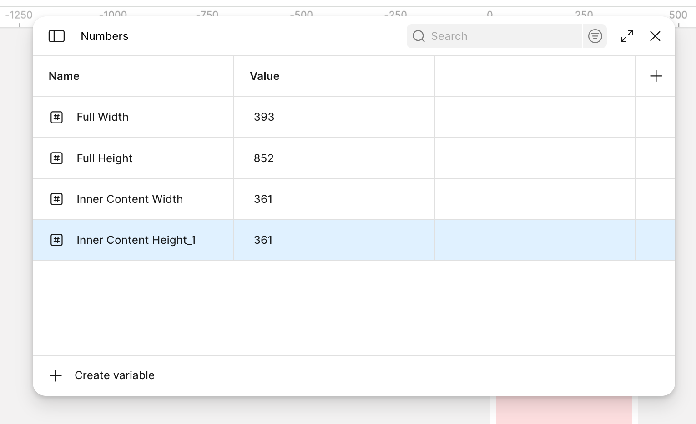

- Use quick maths and make more Template Areas. You’ll need to record the following numbers: 

- **Content Area 1 Width**
    - **Content Area 1 Height**
    - Content Area 2 Width
    
    - Content Area 2 Height
    
    - **Content Area 3 Width**
    - **Content Area 3 Height**
    - Content Area 4 Width
    
    - Content Area 4 Height
    
    - **Content Area 5 Width**
    - **Content Area 5 Height**
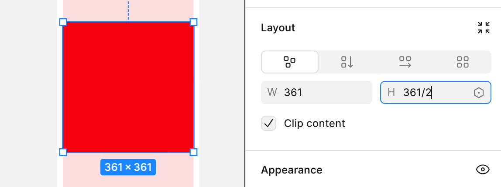

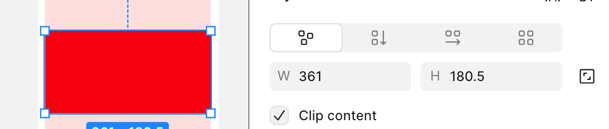

1. Save those Variables
    
    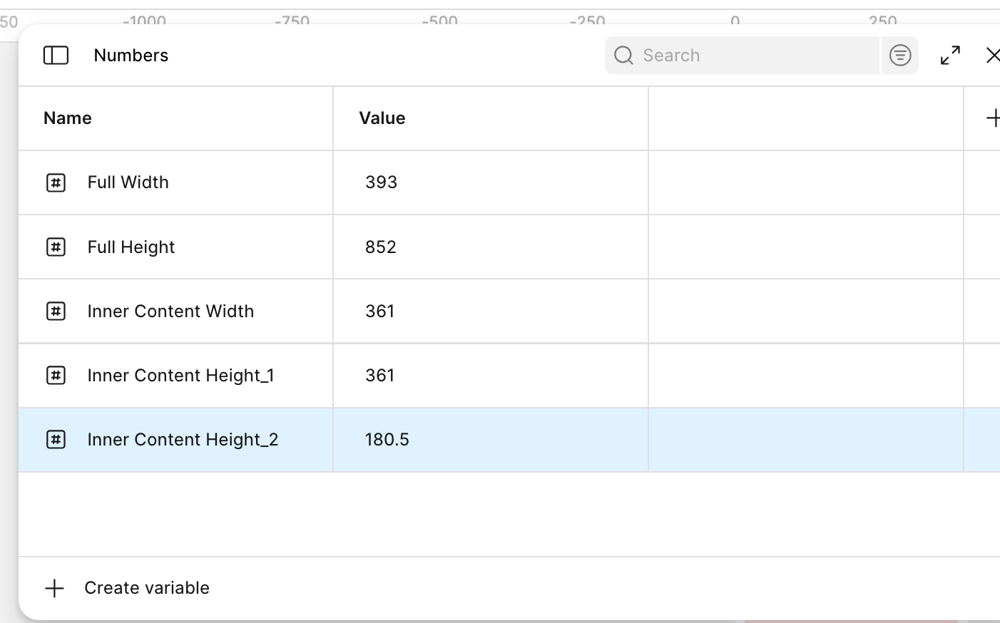
    

1. Create third template area. Take note of dimensions. Enter Variables 
    
    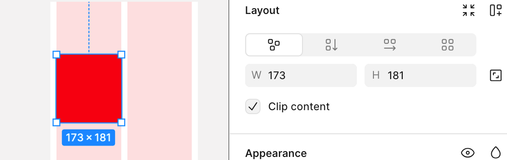
    

1. Finish All Variables:

- Global Settings
- Pages
- Content Areas
- Buttons
- Gaps
- Radius
    
    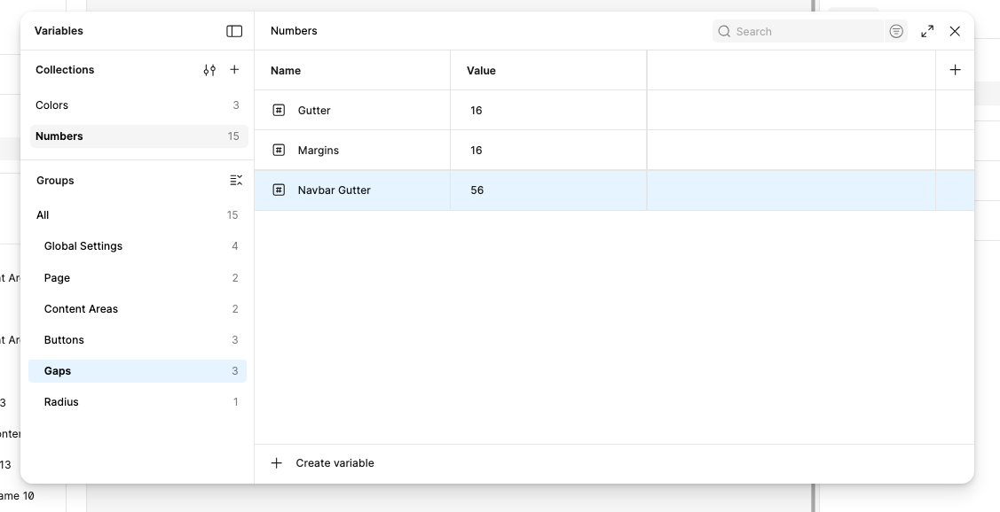
    

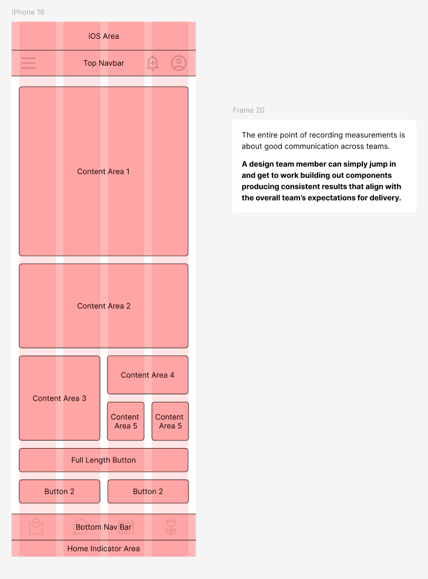

1. For sure, the hardest thing to understand is the content areas as there will be five of them but some of them share similar properties, namely the width. 
    
    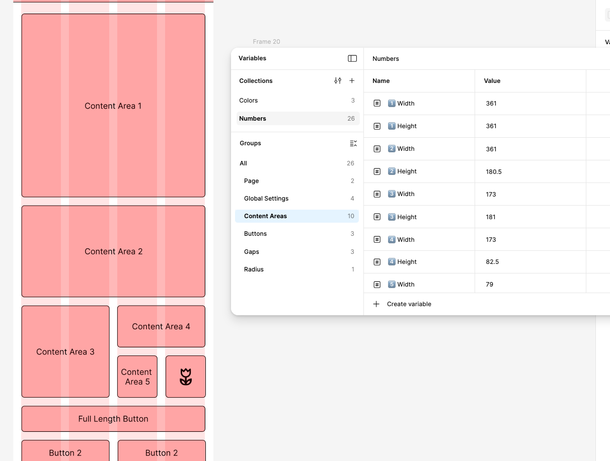
    

1. Lastly, run some tests on the mobile, add some variables

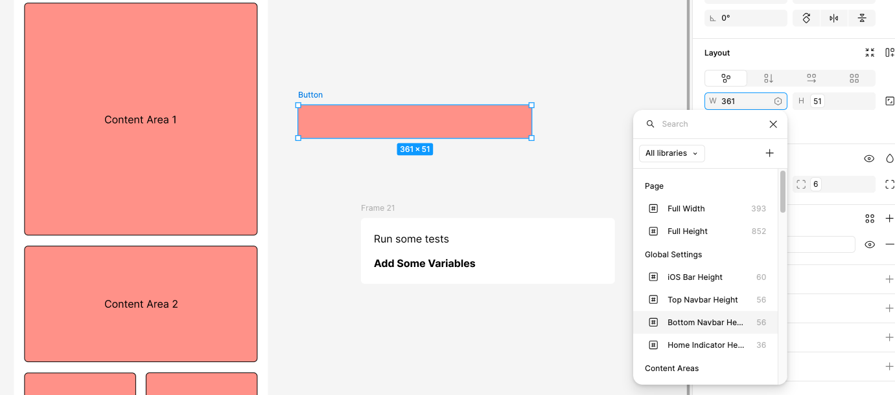

## Well done!

You can now:

- Create number variables for sizes, gaps and radius
- Measure content areas on a grid and record them
- Apply number variables to frames and test them on your phone

**Next:** [String Variables](string-variables.html)
