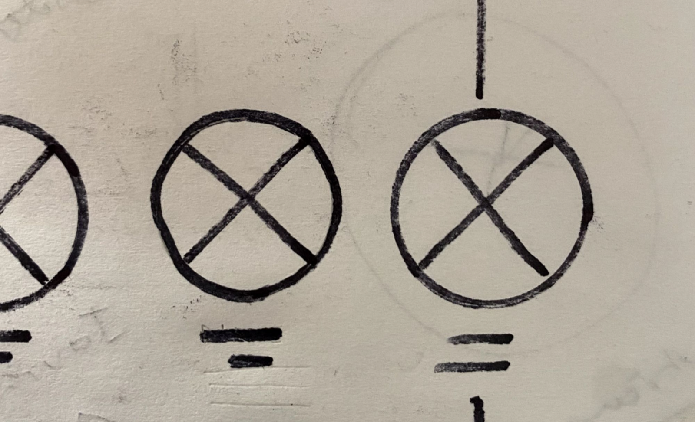
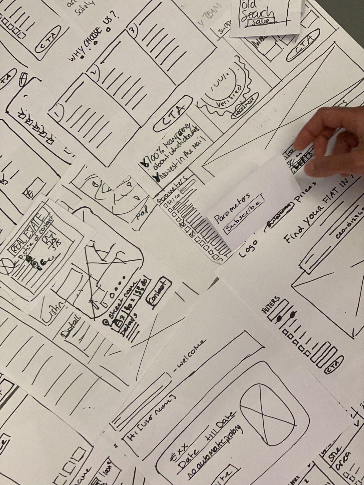
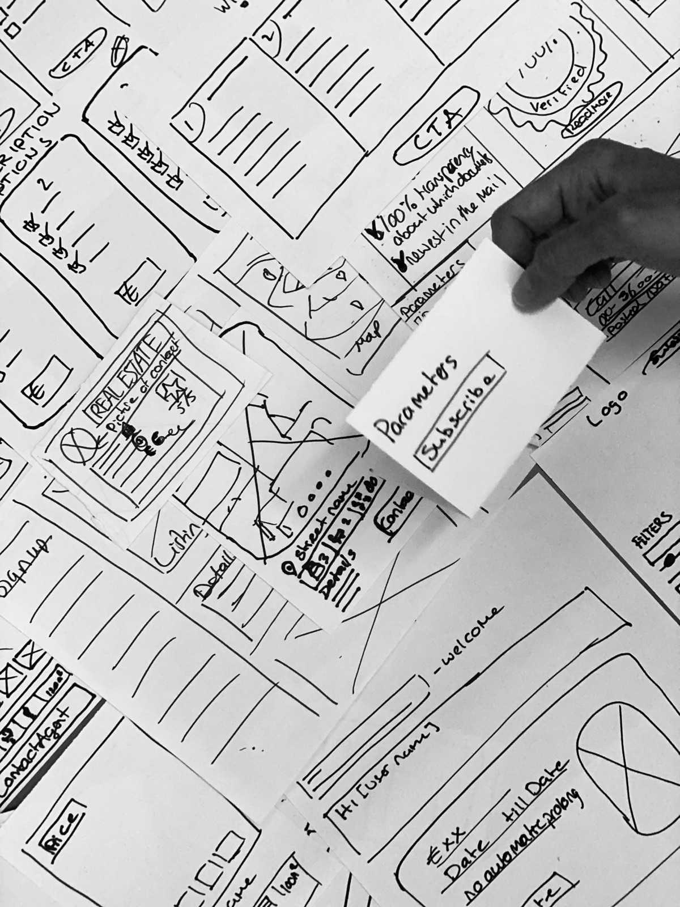
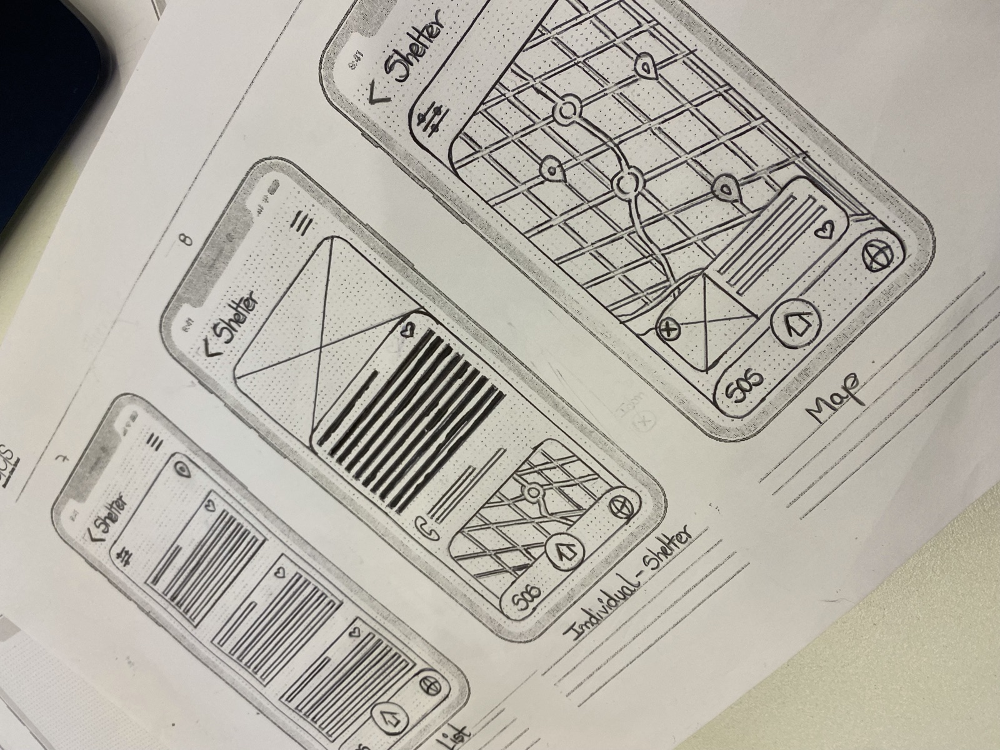
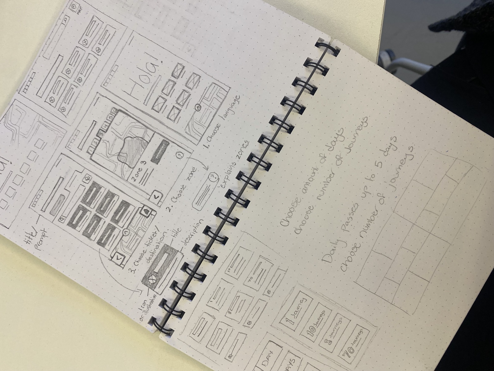
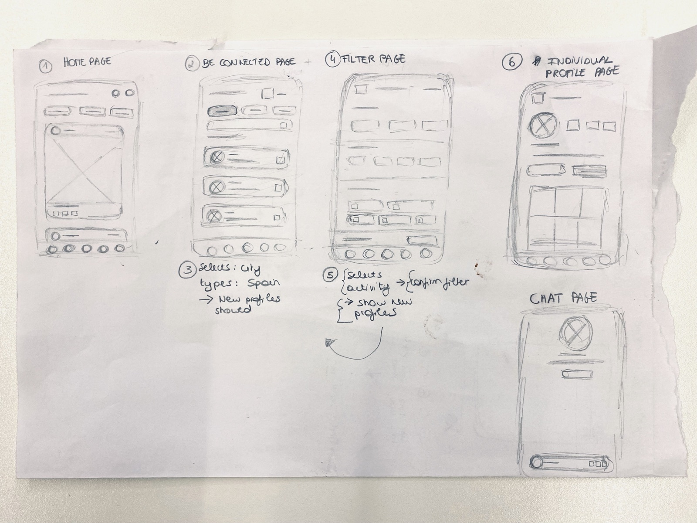
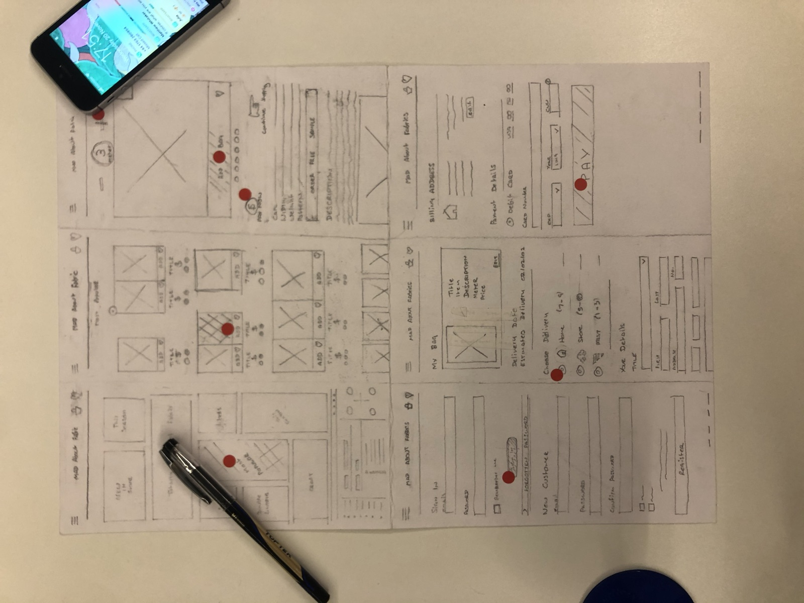
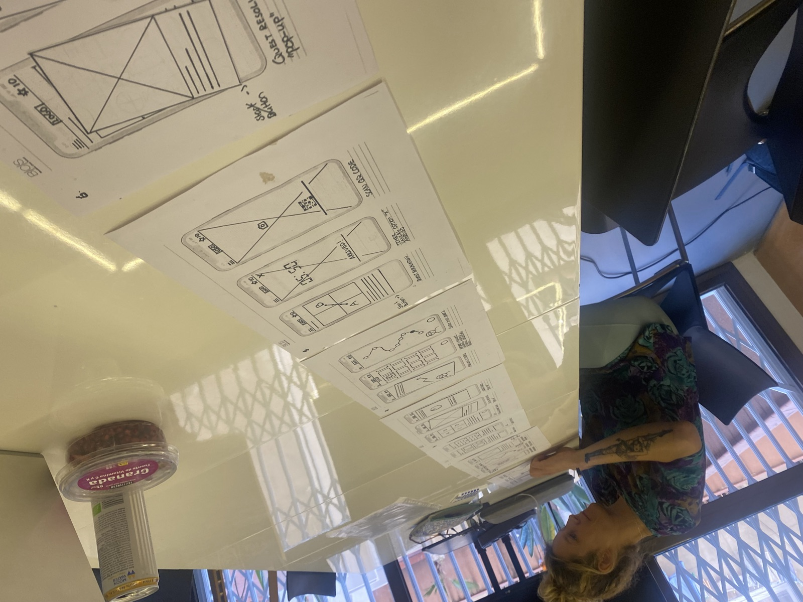
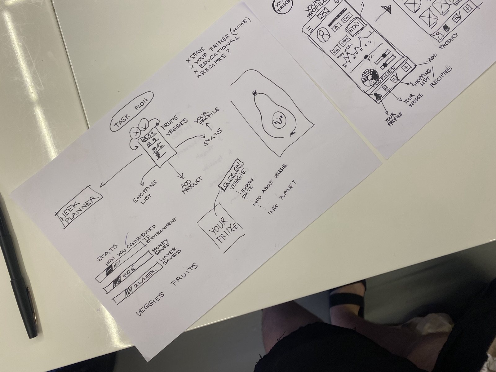

# Paper Wireframes Tips

Paper Wireframes allows you to slow down and really think through the UI before jumping into Figma. 

Each designer should develop their own independent workflow and gain confidence in that method over time. Where some designers generally prefer to use text, others will prefer shape. Ultimately the most important thing is that the concept art is interpretable by a wider team and what you are trying to represent speaks clearly within the UI.  

Once you have your finished wireframes in pencil, it adds intensity to go over the lines with a sharpie pen.

In the example below we have a card presented in 3 ways different ways. Each card has a photo, a title and a description. 

In the first example, I have used a square with an X through it to represent a picture, the title is represented with a half line and the description is represented with two lines and a half line. The second example reflects the same thing with the difference being I have added text for the title.The third example has the picture represented with two triangles and a line. 

If you notice I started in pencil and went over in pen, because we all make mistakes! 

The above example, is a representation of a profile. I’ve overlapped this element over the right of the frame to give the impression of a slide. 

When it comes to iconography, use universally recognisable, unambiguous iconography. By this I suggest using only those icons that require practically no interpretation and avoid icons which are difficult to interpret. 

Whilst we can go as far as to run an icon usability text, generally, we should avoid icons that could mislead the user. Instead, for drawing= simply use circles to represent icons. Given the fact icon placements frequently change it’s always good to limit your icons: 

1. home 

2. hamburger 

3. close 

4. like 

5. forward arrow 

6. back arrow

Ultimately, no matter what, always aim keep your work consistent, on the grid, interpretable and minimalist with as little cognitive load as possible.

 

