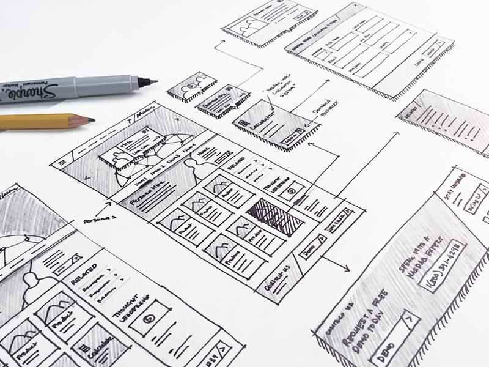
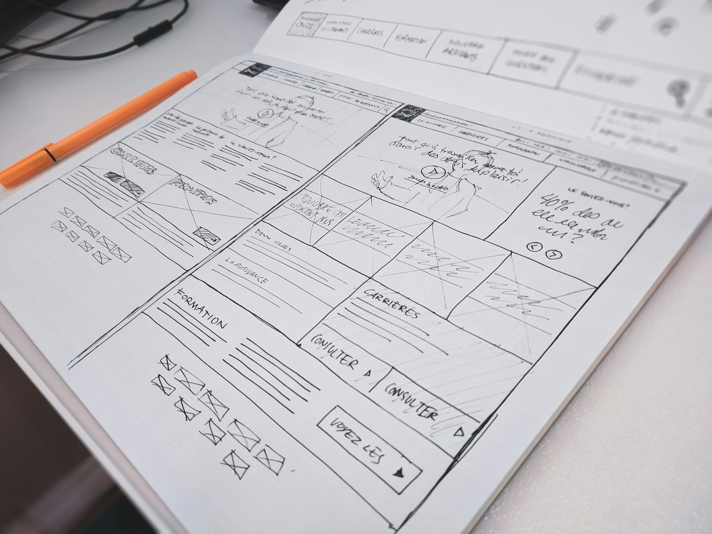
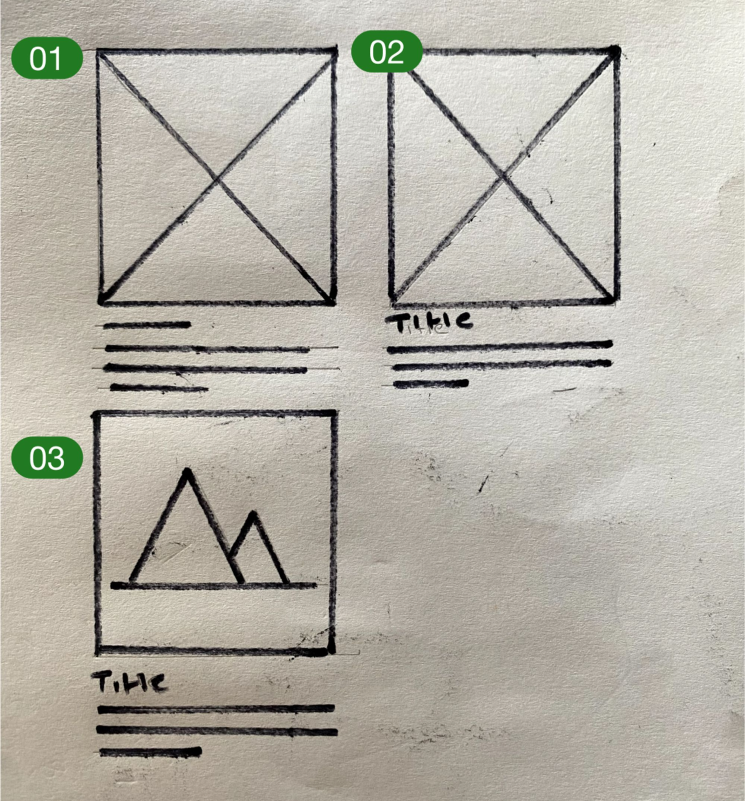
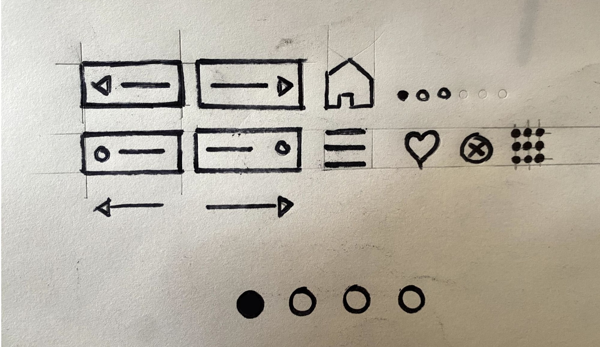
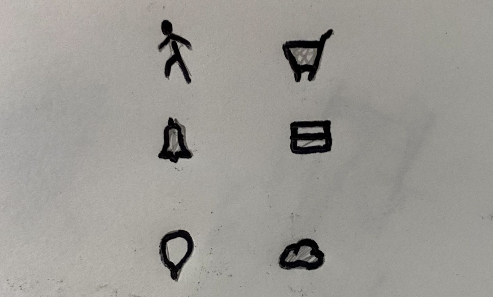
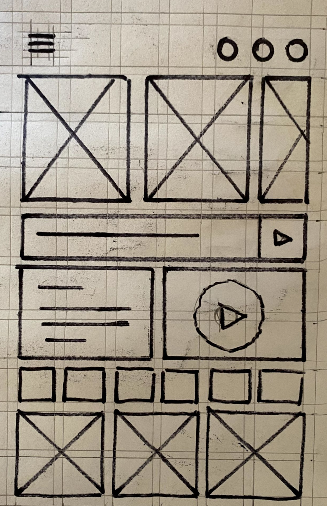
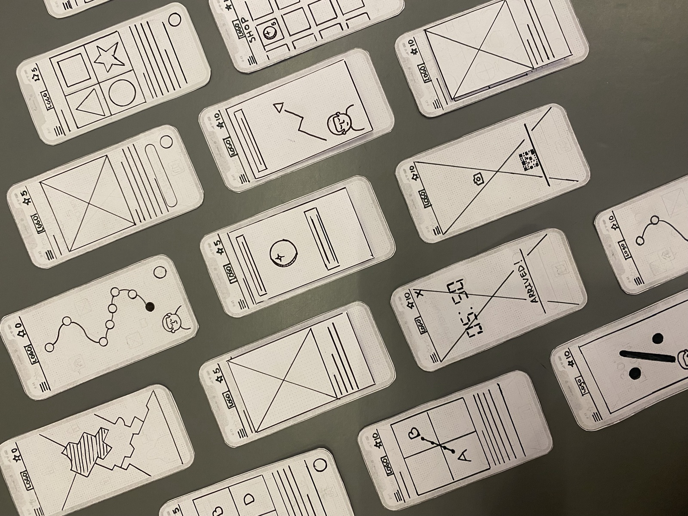
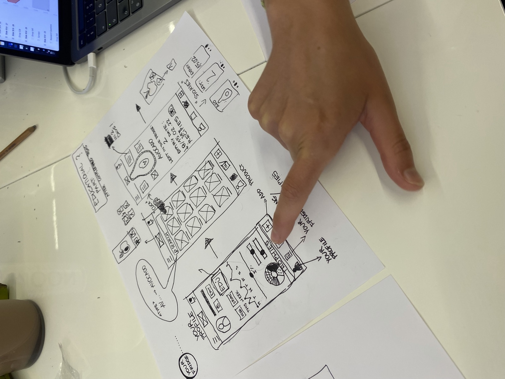

title: Paper Wireframes
promise: A shared drawing language for sketching screens on paper, so you think through the UI before you open Figma.
duration: 20 minutes
topics:
- Why start on paper
- Pencil first, then pen
- Drawing images, text and cards
- Keeping icons simple
- Real examples from past students
---
@title
# Paper Wireframes
Slow down and think through the UI before you open Figma.
---
@split
## Why paper?

It's **fast and cheap**: throwing away a sketch costs nothing.

You focus on **layout and flow**, not colour and fonts.

You can test it with users as a paper prototype.
---
@statement
Find your own way of drawing, but make sure your whole team can read it.
---
@split
## Pencil first, then pen

Sketch in **pencil**, because we all make mistakes.

When you're happy, go over the final lines in **pen** or Sharpie to make them stand out.
---
@split
## Drawing a card

- **Image:** a box with an X, or a mountain
- **Title:** a short thick line, or real words
- **Text:** two lines and a half line
---
@split
## Common elements

Agree a symbol for each element (buttons, inputs, arrows, menus, page dots) and use it every time.
---
@split
## Keep icons simple

Only use icons nobody can misread: home, menu, close, like, back and forward.

**When in doubt, draw a circle.**
---
@image
## On the grid

*Grid paper keeps your sketches aligned and to scale. Download it from Resources.*
---
@image
## From past students

*Lay screens out in order to see the whole flow at once.*
---
@image
## Testing on paper

*Ask someone to "tap" through your sketches while you swap the screens.*
---
@exercise
## Sketch a flow

**Bici** is a bike-share app for Barcelona. In **15 minutes**, sketch three screens:

1. **Find a bike** on a map near you
2. **Unlock it** by scanning the code on the bike
3. **End your ride** and see the cost

Use grid paper, pencil first then pen, and the drawing conventions from this presentation.
---
@answers
## Check your sketches

- Is there **one clear goal** on each screen?
- Did you use the **same symbol** for the same element every time?
- Would a classmate understand every icon **without asking**?
- Does each screen show **how you get to the next**?
- Is it **on the grid**, simple and uncluttered?

Swap with a classmate and ask them to tap through it.
