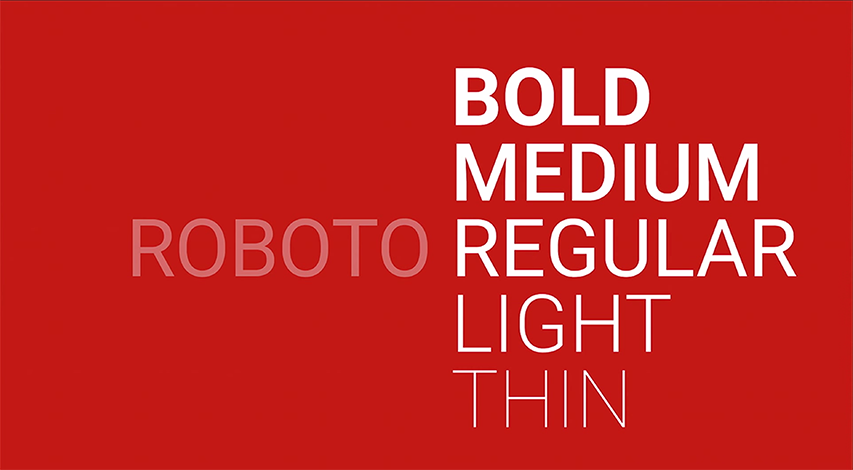
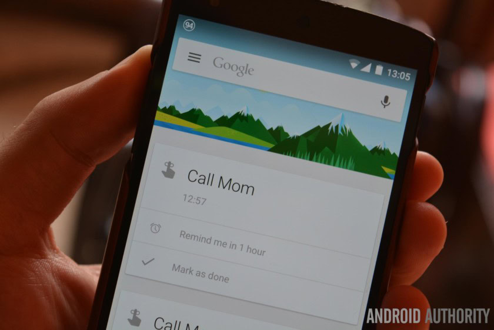

# Roboto

---

> A clean, neutral, and highly functional typeface designed to feel modern, friendly, and invisible while supporting digital interfaces.
> 

**Designed by:**

Christian Robertson

**Foundry:**

Google

**Country:**

🌍 United States

**Year:**

2011

---

## Intent

- Designed as Google’s system typeface for Android
- Meant to replace more mechanical neo-grotesques with something warmer and more human
- Balances geometric structure with open, friendly curves
- Optimised for on-screen readability across many devices and sizes

## Context

- Rapid growth of smartphones and responsive digital interfaces
- Increased need for typefaces optimized for screens, not print
- Shift toward flat design and minimal UI aesthetics
- Google developing a cohesive visual language (Material Design)

## Type classification

- Primary: Sans-serif
- Secondary: Neo-grotesque

---

## Characterised by

- Clean, modern proportions
- Neutral, unobtrusive tone

Compared to classic grotesques like Helvetica, Roboto feels warmer, more open, and better suited to digital environments.

---

## Examples in use

- Android operating system
- Google Search, Gmail, Maps, and YouTube (for many years)
- Material Design interfaces
- Countless mobile apps and websites

---

## Why designers still use it

- Instantly communicates clarity, neutrality, and modernity
- Extremely versatile across weights, sizes, and platforms
- Excellent readability on screens
- Reliable default choice for UI, UX, and digital products

Commonly used in app design, web interfaces, dashboards, and tech branding.

---

## When not to use it

- Projects requiring strong personality or emotional expression
- Luxury, heritage, or editorial designs needing character
- Situations where typographic distinctiveness is critical
- Long-form print typography where a serif may perform better

---

## Usage

> Use this typeface when you want to communicate clarity, neutrality, and modern efficiency — but not personality, emotion, or historical character.
>

---

## Why it matters for UX

Roboto is the typeface of Android and Material Design, so millions of your users read it every day. Knowing it, and knowing it is overused, helps you decide between a familiar, safe default and a typeface that gives your product its own voice.

## Try it: Roboto versus a challenger (15 minutes)

1. Design one card (title, body, button) in Roboto using Material's type scale.
2. Duplicate it and swap Roboto for Inter or another neutral sans from the cheat sheet.
3. Compare them at 100% zoom on your phone and note the differences in width, warmth and readability.

## Media

[https://www.youtube.com/watch?v=6WxACOHm0_g](https://www.youtube.com/watch?v=6WxACOHm0_g)

## Resources

[Roboto – Google Fonts](https://fonts.google.com/specimen/Roboto)

[Typography – Material Design 3](https://m3.material.io/styles/typography/overview)

## Key takeaways

- Roboto (2011) is Google's system typeface for Android and Material Design.
- It's neutral, readable and free, a safe default for UI.
- Because it's everywhere, it gives a product little personality of its own.
