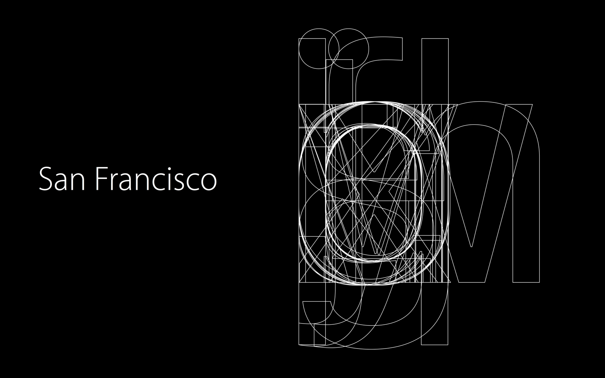
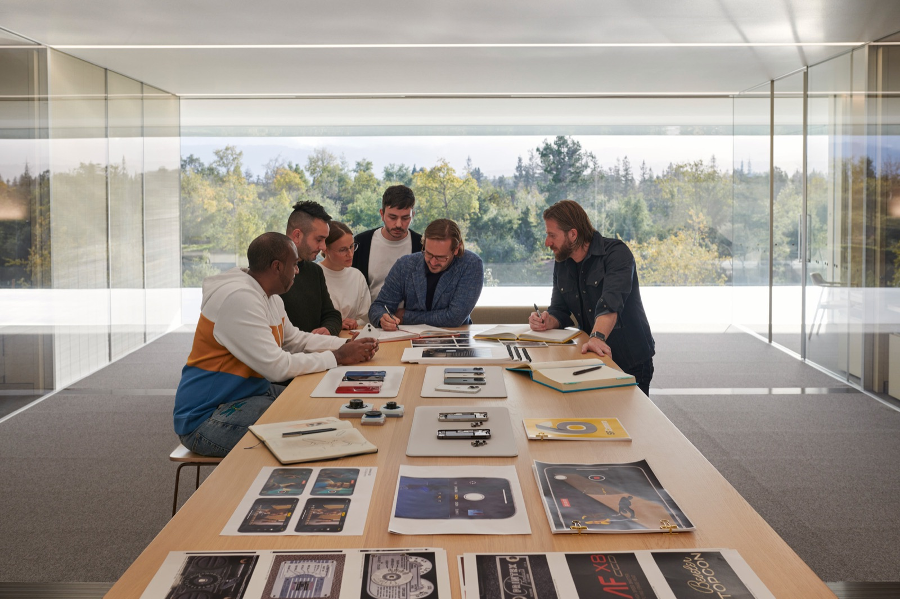
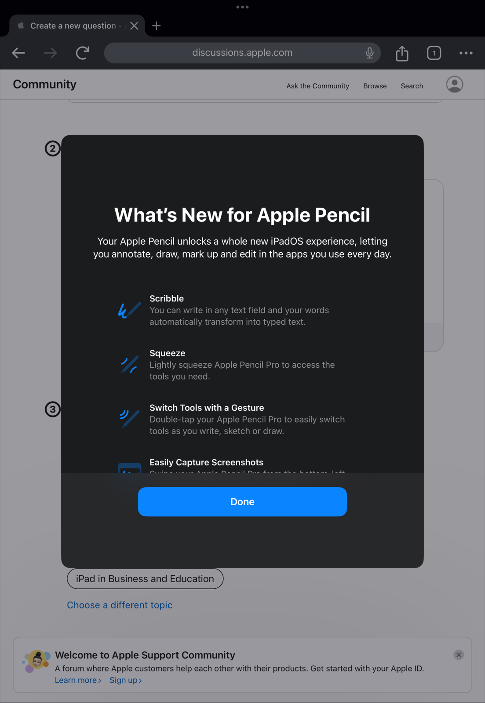

# San Francisco

---

> A neutral, highly legible system typeface built for clarity, precision, and seamless digital use.
> 

**Designed by:**
Apple Designers

**Foundry:**

Apple Inc.

**Country:**

🌍 United States

**Year:**

2015

---

## Intent

- Designed as Apple’s system typeface
- Replaced Helvetica Neue for better screen performance
- Optimized for readability across sizes and devices
- Meant to feel unobtrusive, modern, and reliable

Apple aimed to create a typeface that prioritizes usability over expression.

---

*Used across iOS, macOS, watchOS, and Apple system interfaces*

---

## Context

- Rise of high-resolution screens
- Growth of mobile-first UI design
- Increased focus on accessibility and system typography

Typography was becoming performance-driven and screen-optimized.

---

## Type classification

- Primary: Sans-serif
- Secondary: Neo-grotesque / humanist

---

## Characterised by

- Large x-height and open apertures
- Subtle curves and low contrast
- Optical sizes for different text scales
- Clean, calm, and highly readable

More open and flexible than Helvetica Neue.

---

## Examples in use

- Apple operating systems
- Apple system apps
- Apple Watch interface

---

## Why designers still use it

- Communicates clarity and trust
- Excellent for UI and UX
- Scales well across screens

Common in app and system design.

---

## When not to use it

- Expressive or character-driven branding
- Editorial or print-heavy work
- Non-Apple platforms where it feels out of place

---

## Usage

> Use this typeface when you want to communicate clarity and usability — but not personality or emotion.
>

---

## Why it matters for UX

San Francisco is the typeface iPhone users read all day, and it's designed for the screen: optical sizes, wide spacing at small sizes and tight at large. Designing for iOS with SF makes your app feel native; studying it teaches you what a UI typeface needs.

## Try it: design it native (20 minutes)

1. Download SF Pro from Apple's fonts page and install it.
2. Recreate one iOS settings screen in Figma using SF Pro Text for body and SF Pro Display for titles.
3. Compare letter spacing at 13px and at 34px, and note what changes.

## Media

[https://www.youtube.com/watch?v=HMwnn9iEjok](https://www.youtube.com/watch?v=HMwnn9iEjok)

## Resources

[Fonts – Apple Developer](https://developer.apple.com/fonts/)

[San Francisco – Wikipedia](https://en.wikipedia.org/wiki/San_Francisco_(sans-serif_typeface))

## Key takeaways

- San Francisco (2015) is Apple's system typeface, replacing Helvetica Neue.
- It has optical sizes (Text and Display) tuned for different scales.
- Use it to make iOS designs feel native; it's licensed for Apple platforms.
