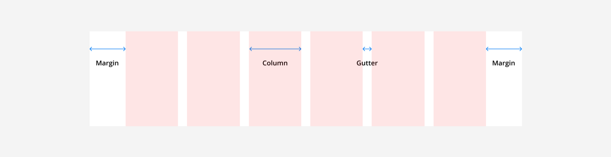
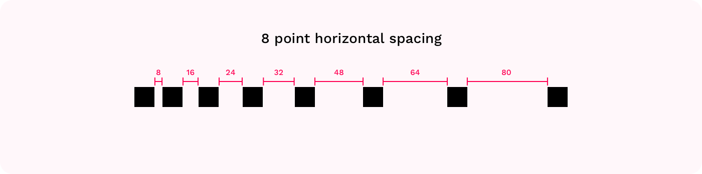
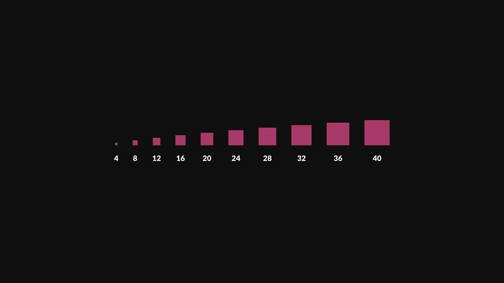

title: Spacing & Grids
promise: Where grids came from, how column grids work on screens, and why designers measure in multiples of 8.
duration: 15 minutes
topics:
- A short history of grids
- Why interfaces need grids
- Grid anatomy: columns, gutters and margins
- The 8-point system
---
@title
# Spacing & Grids
The invisible structure behind every clean layout.
---
@cards
## Grids are old

- **Ancient scrolls** Scribes drew guide lines to keep text straight, and the Dead Sea Scrolls already use columns
- **Around 1454** The Gutenberg Bible, the first major book printed with movable type in Europe, uses a two-column grid
- **Newspapers** Broadsheets use many narrow columns so small text stays easy to read
---
@statement
Grids give a layout structure, and give developers a framework to build it the same way on every device.
---
@split
## Columns make layouts responsive

Content snaps to **columns**, so the same design can reflow from desktop to tablet to phone.

A common pattern: **12 columns** on desktop, **8** on tablet, **4** on mobile.
---
@split
## Grid anatomy

- **Columns:** where content sits
- **Gutters:** the gaps between columns
- **Margins:** the space at the edges of the screen
---
@split
## The 8-point system

Use **multiples of 8** for every size, padding, margin and gap: 8, 16, 24, 32, 40, 48…

Use 4 for the smallest adjustments, such as icon padding.
---
@cards
## Why 8?

- **Consistent** Everything follows the same rule, so the UI looks orderly
- **Faster decisions** No more debating 12 or 13 pixels
- **Easy hand-off** Developers can read and repeat the spacing
- **Fits screens** Most screen sizes divide by 8 on at least one side
---
@split
## A spacing scale

Save your scale as **number variables** in Figma (`space-8`, `space-16`, `space-24`…) and use them everywhere.
---
@exercise
## Snap to the grid

1. A developer measured these gaps in your design: **10, 13, 22, 30 and 45 px**. Round each to the nearest multiple of 8.
2. An iPhone 16 frame is **393 px** wide. You add a 4-column grid with **16 px** margins and **16 px** gutters. How wide is each column?
---
@answers
## Check yourself

1. 10 → **8**, 13 → **16**, 22 → **24**, 30 → **32**, 45 → **48**
2. 393 − 2 × 16 (margins) − 3 × 16 (gutters) = 313. Divided by 4 columns = **78.25 px**. Figma works this out for you when you set the grid to *Stretch*.
