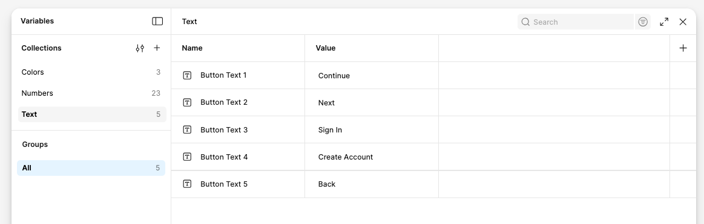
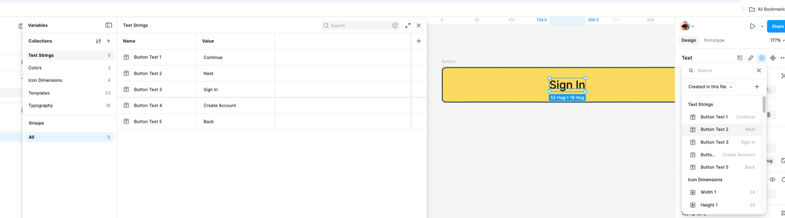
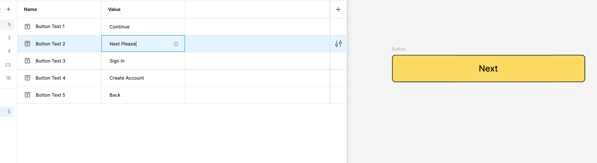
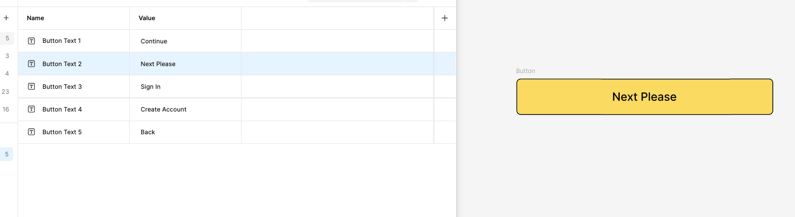

# String Variables

## What you'll build

A Copy collection of string variables that holds your interface text, so you can change a word once and update it on every screen.

## Before you start

- You've finished [Number Variables](number-variables.html)
- About 15 minutes

## Let's go

1. Open **Variables**, make a new collection called **Copy** and create the following **String** variables

1. Select a text layer, click the **Apply variable** icon in the Typography panel and assign the string variable to it

1. Change the string's value in the **Variables** table, and watch every text layer that uses it update

1. Voilà! One change, every screen updated.

## Well done!

You can now:

- Create string variables in a collection
- Apply a string variable to a text layer
- Update text across a whole file from the Variables table

**Next:** [Variable Modes](variable-modes.html)
