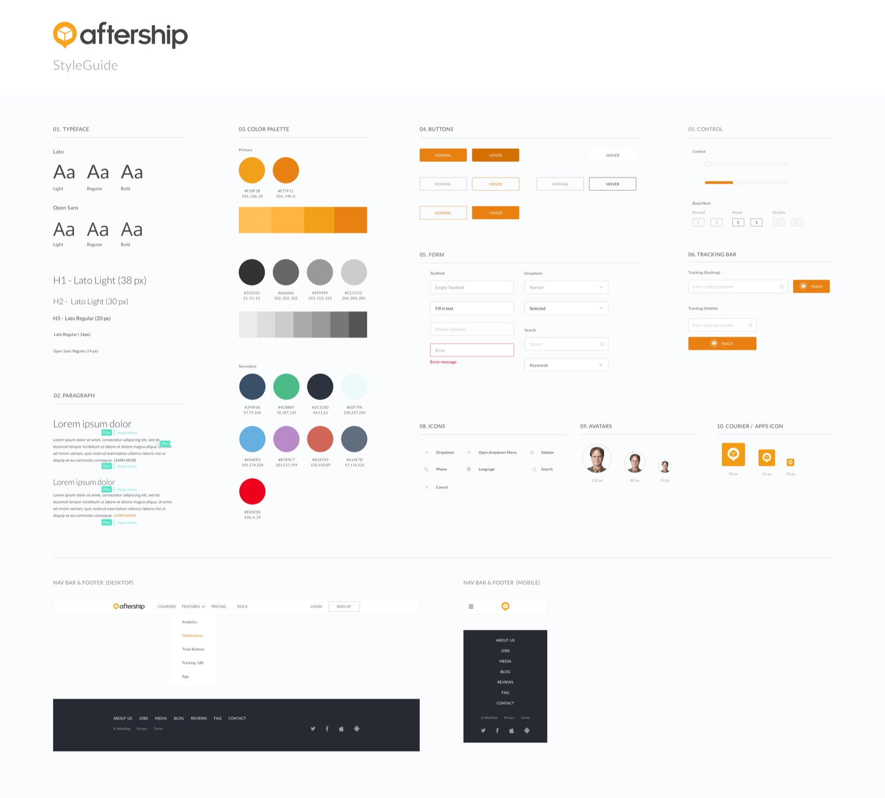
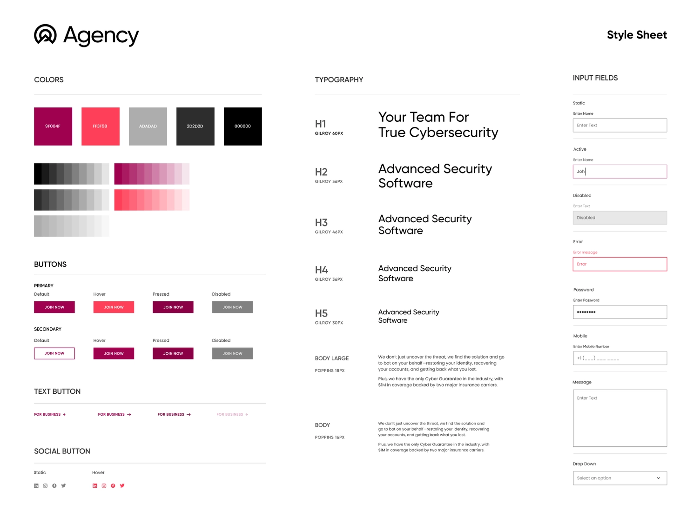
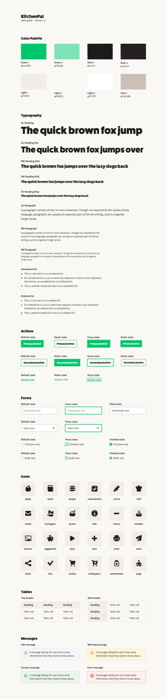

title: Style Guides
promise: What a style tile or style guide is, what goes in it, and how it keeps every screen consistent.
duration: 15 minutes
topics:
- What a style guide is, and why teams use one
- What goes in it
- Real examples
- Style guides in Figma
---
@title
# Style Guides
Decide the look once, then use it everywhere.
---
@statement
A style guide (or style tile) is a one-page summary of a product's visual language.

It shows the decisions before anyone dives into high-fidelity screens.
---
@cards
## Why teams use one

- **Agree early** Show stakeholders two or three directions before you design every screen
- **Stay consistent** Every designer uses the same colours, type and components
- **Move faster** Decisions are already made, so screens come together quickly
---
@cards
## What goes in it

- **Logo** and brand keywords
- **Colour** with HEX values and what each colour is for
- **Typography** typefaces, sizes and when to use each
- **Imagery** photo style and treatment
- **Icons and illustration** one style, one family
- **Components** buttons, inputs and their states
---
@image
## Example: Aftership

*Colour, type and components side by side, each with its purpose.*
---
@image
## Example: a security brand

*Every button and input state is designed once, here, not on each screen.*
---
@split
## Style guides in Figma

Turn your style guide into **styles and variables**: colour, text, effect and grid.

Change a style once and **every screen updates**.

Set it up **before** you design in high fidelity.
---
@exercise
## Make a style tile

**Mar i Muntanya** is a new Barcelona school that teaches beginners to surf and hike. Their customers are 25–40, a bit nervous, and want to feel safe and excited.

In 20 minutes, on one Figma frame:

1. Write three brand keywords
2. Pick a palette of five colours, with a job for each
3. Choose one heading and one body typeface
4. Design one primary button in three states
5. Choose an icon style and one sample photo
---
@answers
## One possible tile

1. Keywords: **safe, outdoorsy, joyful**
2. Palette: deep sea blue (primary), sand (background), pine green (secondary), sunset orange (call to action), charcoal (text)
3. Type: a friendly rounded sans for headings, a highly readable sans for body
4. Button: default, hover and disabled, with a contrast check
5. Icons: rounded outline; photos: real beginners, natural light

Yours will be different. Check that every choice supports the keywords.
