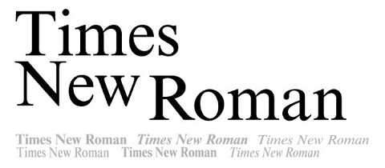
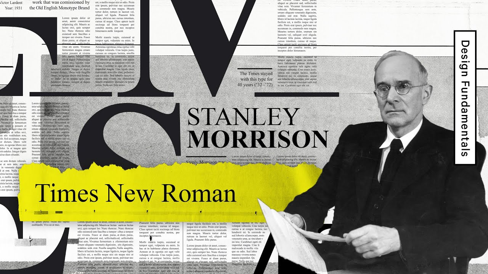
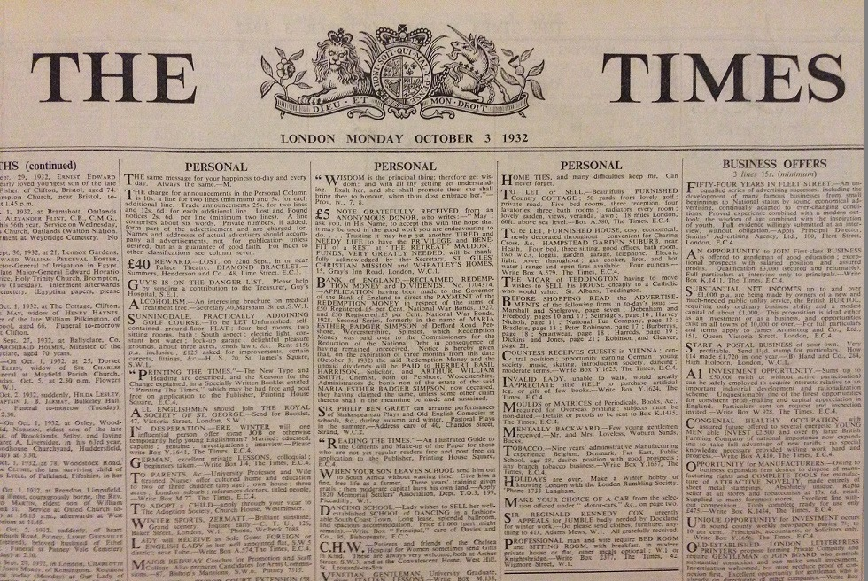

# Times New Roman

> A transitional serif typeface that embodies institutional authority, editorial objectivity, and the quiet standardisation of knowledge.
> 

---

**Designed by:**

Stanley Morison 

**Foundry:**

The Times (London) / Monotype

**Country:**

🇬🇧 United Kingdom

**Year:**

1931

---

**Intent:**

- Designed for **newspaper readability**
- Optimised for **efficient use of space**
- Meant to feel **authoritative, neutral, and professional**
- Created to perform well under **poor printing conditions**

---

**What was happening at the time:**

- Growth of **mass media and daily newspapers**
- Need for typefaces that balanced **clarity and economy**
- Interwar period Britain: emphasis on **tradition, order, and credibility**
- Typography focused on **function over expression**

---

**Type classification:**

- Serif
- Transitional serif

---

**Characterised by:**

- High contrast between thick and thin strokes
- Narrow letterforms (space-efficient)
- Sharp, bracketed serifs
- Relatively large x-height
- Feels formal, serious, and conservative

---

**Famous examples in use:**

- *The Times* newspaper (historic use)
- Academic papers and journals
- Books, reports, and legal documents
- Default system font in Microsoft Word (for decades)

---

**Why designers still use it:**

- Extremely readable in long-form text
- Familiar and widely available
- Conveys authority and credibility
- Performs reliably in print

---

**When NOT to use it:**

- Branding that needs a strong or unique personality
- Contemporary or experimental design
- Large headlines (can feel stiff or dated)
- Situations where neutrality feels impersonal

---

**Usage:**

> Use Times New Roman when clarity and credibility matter more than personality.
>
