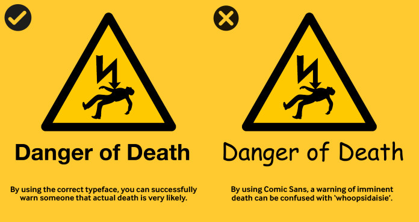

# Typeface

Typeface influences how meaning is constructed and interpreted in design. Thoughtful typographic choices contribute to clearer, more deliberate visual communication.

| Important Terms | What it is | What it controls | Example |
| --- | --- | --- | --- |
| Typeface | The design of the letterforms | Visual style of characters | Inter, Helvetica, Garamond |
| Font | A specific version of a typeface | Weight, style, size | Inter Bold 16px |
| Typography | The practice of using type | Readability, tone, layout | Choosing Inter, spacing, sizes |
| Font hierarchy | Visual ranking of text | What users read first | H1 > H2 > Body > Caption |
| Font family | A group of related fonts within the same typeface | Consistency across weights and styles | Ultralight, light, Regular, Bold, Italic, Condensed |

| Major Typeface Classifications | Key Traits / Features | Emotional / Visual Tone | Common Uses / Notes | Examples |
| --- | --- | --- | --- | --- |
| **Serif** | Small lines/strokes at ends of letters, variable contrast | Traditional, formal, readable | Books, print, editorial, long-form text | Times New Roman, Garamond |
| **Slab Serif** | Thick, block-like serifs, low contrast | Bold, strong, modern-traditional | Posters, branding, headlines, display | Rockwell, Clarendon |
| **Sans-Serif** | No serifs, clean lines, often uniform strokes | Neutral, modern, minimal | UI, digital interfaces, signage, branding | Helvetica, Arial, Roboto |
| **~~Humanist Sans~~** | Calligraphic influence, open apertures, varied widths | Warm, approachable, readable | UI, print, signage where friendliness is needed | Gill Sans, Frutiger, Calibri |
| **Neo-Grotesque** | Clean, mechanical, low contrast, less personality | Neutral, technical, precise | Corporate branding, UI, technical documents | Helvetica, Akzidenz-Grotesk |
| **Geometric Sans** | Based on geometric shapes (circles, squares), symmetrical | Modern, minimalist, rigid | Logos, display, tech branding | Futura, Gotham |
| **Display / Decorative** | Highly stylized, artistic, unique forms | Expressive, decorative, attention-grabbing | Posters, branding, headings, short text | Papyrus, Comic Sans, Lobster |
| **Script / Handwriting** | Imitates handwriting, cursive connections | Elegant, personal, informal | Invitations, logos, greeting cards | Brush Script, Pacifico |
| **Monospaced / Fixed-width** | Every character same width | Technical, retro, coding-friendly | Code editors, terminals, typewriter-style designs | Courier, Consolas, SF Mono |
| **Blackletter / Gothic** | Dense, ornate, medieval-inspired strokes | Historic, formal, decorative | Certificates, logos, historical reproduction | Fraktur, Old English Text |

## The typefaces

Each of these typefaces changed what type could say. Read them in order and you read the history of typography, from the medieval scriptorium to the screen in your pocket.

[Gothic (Blackletter)](gothic-blackletter.html)

[Garamond](garamond.html)

[Didot](didot.html)

[Caslon Egyptian](caslon-egyptian.html)

[Futura](futura.html)

[Times New Roman](times-new-roman.html)

[Helvetica](helvetica.html)

[Roboto](roboto.html)

[San Francisco](san-francisco.html)

[Google Sans](google-sans.html)

[Comic Sans](comic-sans.html)

---

## Why it matters for UX

Type is most of what users look at: interfaces are made of words. The typeface you choose sets the tone before anyone reads a word, and the hierarchy you build with it decides what they read first. Knowing the classifications lets you choose on purpose instead of by habit.

## Try it: build a type hierarchy (30 minutes)

1. Pick one sans-serif from the cheat sheet on the Comic Sans page, and one serif or display face to pair with it.
2. In Figma, create text styles for H1, H2, H3, body and caption.
3. Set the same short article in your styles, then swap only the typeface and compare how the tone changes.
4. Write two sentences on which version fits a banking app, and which a festival app.

## Media

[https://www.youtube.com/watch?v=wOgIkxAfJsk](https://www.youtube.com/watch?v=wOgIkxAfJsk)

[https://www.youtube.com/watch?v=mEAmAFgzQd4](https://www.youtube.com/watch?v=mEAmAFgzQd4)

## Resources

[Google Fonts Knowledge](https://fonts.google.com/knowledge)

[Typography – Material Design 3](https://m3.material.io/styles/typography/overview)

## Key takeaways

- A typeface is the design; a font is one version of it (weight, style, size).
- Each classification carries a tone: serif feels traditional, sans-serif neutral, display expressive.
- Hierarchy, built with size, weight and spacing, decides what users read first.
