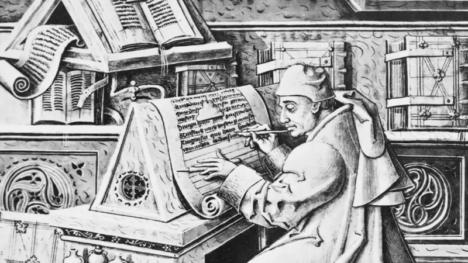
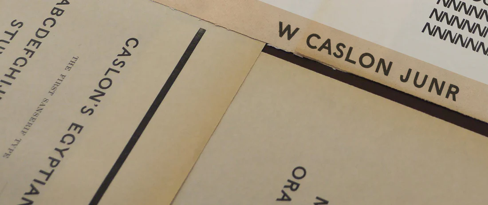
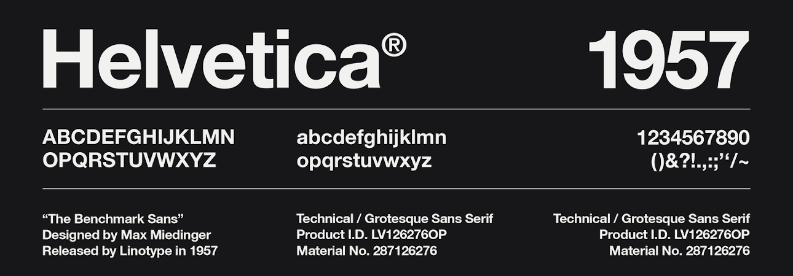

title: Typeface
promise: The words every designer uses for type, the main families of typeface, and eleven typefaces that changed what type could say.
duration: 25 minutes
topics:
- Typeface, font and typography
- The main classifications: serif, sans-serif, display and more
- Eleven typefaces, from Blackletter to San Francisco
- Choosing type on purpose
---
@title
# Typeface
Type sets the tone before anyone reads a word.
---
@cards
## Know the words

- **Typeface** The design of the letters: *Helvetica*
- **Font** One version of it: *Helvetica Bold 16 px*
- **Font family** All the weights and styles: light, regular, bold, italic…
- **Typography** The practice of arranging type: size, spacing, layout
- **Hierarchy** The visual ranking of text: H1 › H2 › body › caption
---
@cards
## The main families

- **Serif** Small strokes at the ends of letters. Traditional, readable in print
- **Sans-serif** No serifs, clean lines. Neutral and modern: the language of UI
- **Display** Expressive and decorative. Headlines and logos only
- **Script** Imitates handwriting. Personal, elegant, hard to read at length
- **Monospaced** Every letter the same width. Code and technical text
- **Blackletter** Dense medieval strokes. Historic and ceremonial
---
@section
## Eleven typefaces
From the medieval scriptorium to the phone in your pocket.
---
@split
## Gothic (Blackletter)

**Medieval Europe, 1100s onwards.** Gutenberg used it for the first printed books.

Says **tradition and ceremony**: diplomas, beer labels, heavy metal.

Keep it for logos, never for interface text.
---
@split
## Garamond

**France, 1530s.** The classic old-style serif, made for books.

Moderate contrast and open shapes make it **comfortable for long reading**.

Says knowledge and tradition.
---
@split
## Didot

**France, around 1784–1811.** A "modern" serif with **extreme contrast** and hairline serifs.

Says **luxury and fashion**: think magazine covers.

Use it large; the hairlines vanish at small sizes.
---
@split
## Caslon Egyptian

**England, 1816.** One of the **first sans-serifs** ever made.

Blunt and practical, built for posters and signs in the Industrial Revolution.

Critics called sans-serifs "grotesque". The name stuck.
---
@split
## Futura

**Germany, 1927.** A **geometric** sans built from circles, triangles and squares.

Says **progress and confidence**. It went to the Moon on the Apollo 11 plaque.

Great for headlines, tiring for long text.
---
@split
## Times New Roman

**UK, 1931.** Designed for *The Times* newspaper: narrow letters that **save space** and stay readable.

Says **authority and credibility**, but as an old default it can look unconsidered.
---
@split
## Helvetica

**Switzerland, 1957.** The neo-grotesque designed to be **neutral**, letting the message speak.

Defined Swiss Style and decades of corporate logos.

Its closed shapes are harder to read at small sizes on screen.
---
@split
## Roboto

**Google, 2011.** The system font of **Android** and Material Design.

Neutral, readable and free: a safe default for UI.

So common that it gives a product little personality.
---
@split
## San Francisco

**Apple, 2015.** Replaced Helvetica Neue across Apple's systems.

Has **optical sizes**, Text and Display, tuned for small and large type on screen.

Use it to make iOS designs feel native.
---
@split
## Google Sans

**Google, 2015.** Grew out of **Product Sans**, drawn for the new Google logo.

A friendly geometric sans that carries the brand into Google's apps.
---
@split
## Comic Sans

**Microsoft, 1994.** Designed by Vincent Connare for friendly **speech bubbles** on screen.

Used everywhere it didn't belong, it became the world's most mocked font.

The lesson: a typeface is only right or wrong **for its context**.
---
@statement
Choose type on purpose: for your users, your brand and the job the words have to do.
---
@exercise
## Match the typeface

Which of the eleven would you choose for each, and why?

1. A luxury perfume brand's magazine advert
2. A long-read news app
3. A banking app that should feel native on iPhone
4. A heavy metal festival poster
5. A space tourism start-up's logo
6. A simple Android utility app
---
@answers
## One good answer

1. **Didot**: luxury and elegance at large sizes
2. **Times New Roman** or **Garamond**: comfortable long reading
3. **San Francisco**: native, clear and trusted on iOS
4. **Gothic (Blackletter)**: dark, dramatic and historic
5. **Futura**: progress and confidence, and it went to the Moon
6. **Roboto**: neutral and native on Android

There's more than one right answer. What matters is your reason.
