# Typography

# T**ypeface Styles**

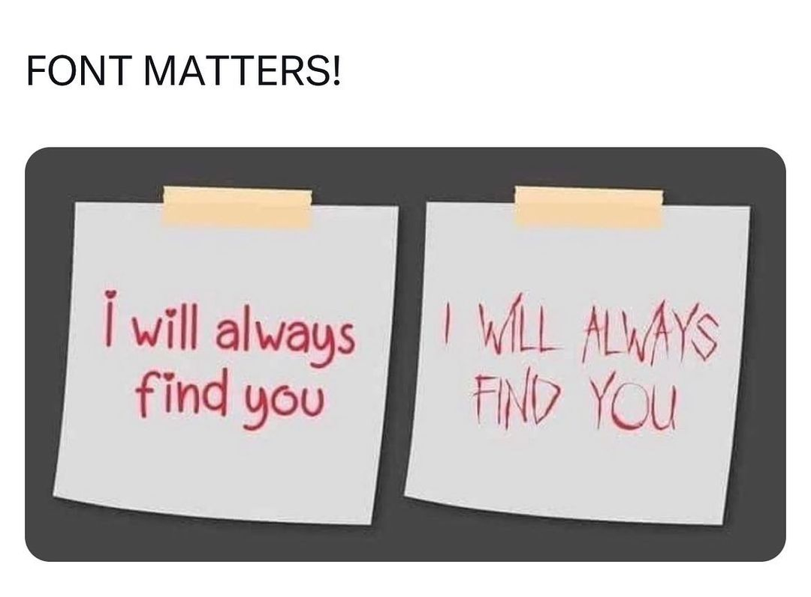

Typefaces are generally classified based on appearance into one of five basic groups: serifs, sans-serifs, decorative, script (handwritting) and monospaced styles. While they come in different styles and shapes, they also suit certain purposes.

# **Serif**

Serif typefaces have small decorative lines added as embellishment to the basic form of a character. In other words, they include the small extra stroke found at the end of the main vertical and horizontal strokes of some letters.

Popular serif fonts include Times Roman, Courier, New Century Schoolbook, and Palatino. EB Garamond (below) is an elegant example of a serif font from Google Fonts.

EB Garamond sample from 100 Days of Fonts project by designer Do-Hee Kim.

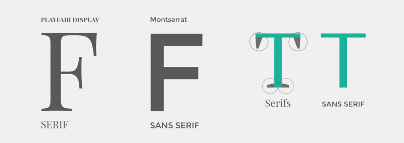

# **Sans-serif**

Sans-serif typefaces do not have serifs (those small lines at the ends of characters). Popular sans serif fonts include Open Sans, Avant Garde, Arial, and Geneva.

Helvetica, designed by Max Miedinger in 1957, is perhaps the most recognizable sans-serif typeface. Many brands, such as American Apparel, choose Helvetica for its clean, modern, and neutral look.

Helvetica (or Neue Haas Grotesk)

# **Monospaced**

Monospaced typefaces were originally created to meet the mechanical requirements for typewriters and their name derives from the fact that each letter takes up the same width of space. Even the empty spaces between words are the same width as all of the letters themselves.

We commonly see examples of monospaced typefaces used to display computer code because it includes compressed syntax, which is actually more legible when in a monospaced font. Generally, compared to proportional fonts, monospaced fonts are actually harder to read. Courier, for instance, is a classic example of a monospaced typeface.

Courier font sample from Typewolf.

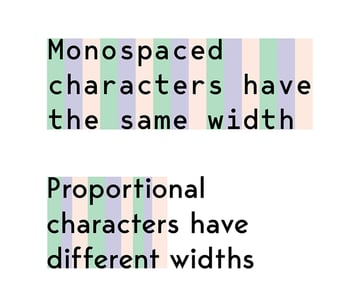

# **Script (or Handwriting)**

Script typefaces are generally reminiscent of calligraphy, having a unique, handwritten quality. They are often used for headlines or short, expressive texts like those often found on headings, logos, wedding invitations, t-shirts, letterheads, or signage.

They range from classic, flowing scripts for elegant designs, to light-hearted typefaces with rounded forms for a fresh, energetic look. They can offer a nice contrast and personality to more neutral fonts used so often today.

# Display

A **display typeface** is a typeface that is intended for use in **display type** at large sizes for titles, headings, quotes and other eye-catching elements, rather than for extended passages of body text.

Display typefaces will often have more eccentric and variable designs than the simple, relatively restrained typefaces generally used for body text

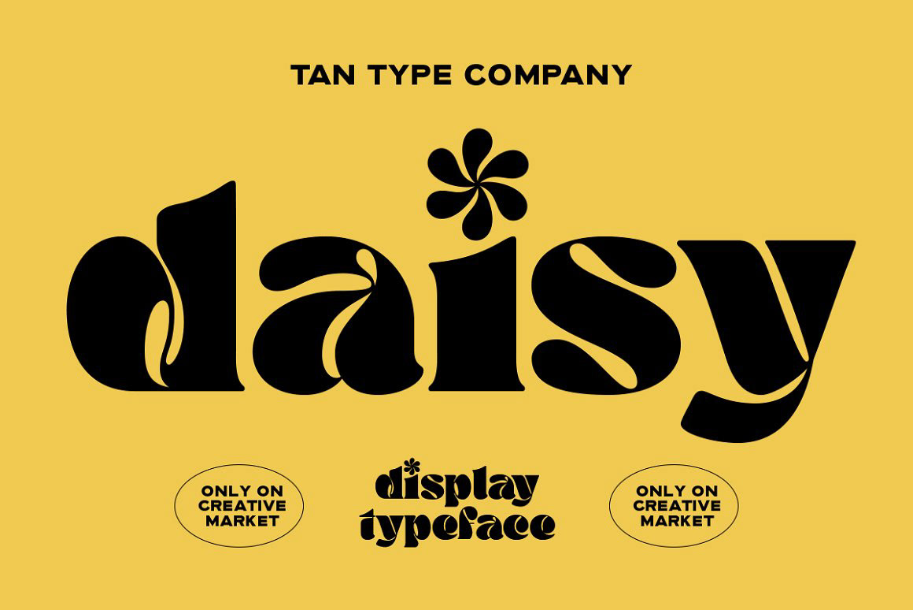

---

## Anatomy of a typeface

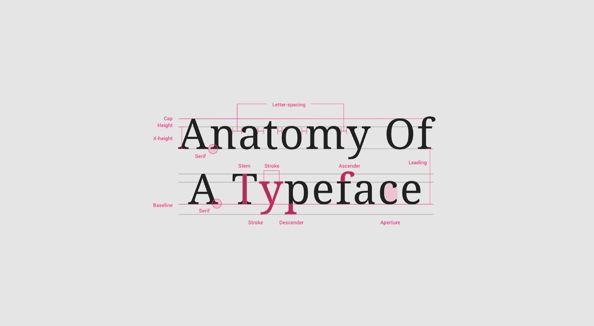

# 🛠️ Using Google Fonts

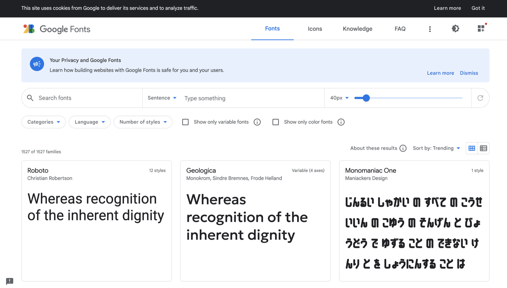

Google Fonts is a library of 1500+ open source font families. Its a super resource. Let’s get comfortable using it to find, install and use new fonts in Figma.

[https://fonts.google.com/](https://fonts.google.com/)

---

## Font groups Feelings and Emotions

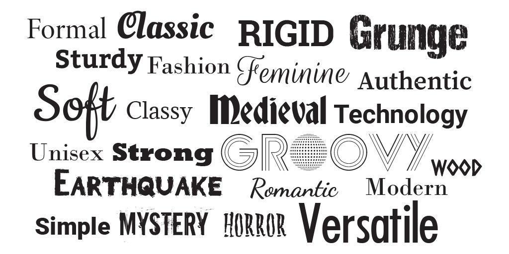

Different typefaces can convey very different feelings and emotions

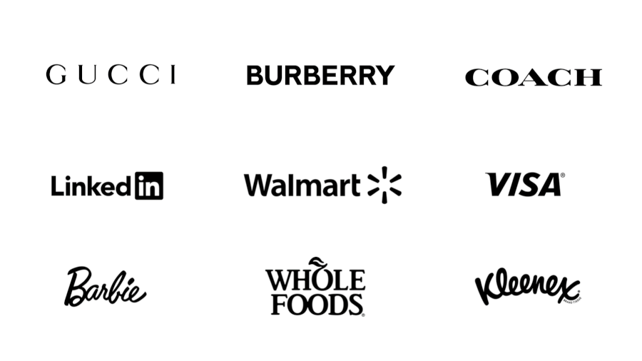

Big brands utilise different typefaces to convey and emotion that is aligned with their brand

| **Category** | **Emotions and Feelings** |
| --- | --- |
| Serif | Tradition, elegance, professionalism, authority |
| Sans Serif | Modernity, simplicity, clarity, objectivity |
| Monospaced | Stability, reliability, retro, technical |
| Script | Elegance, creativity, sophistication, personal |
| Decorative | Playfulness, uniqueness, novelty, creativity |

***Example:***

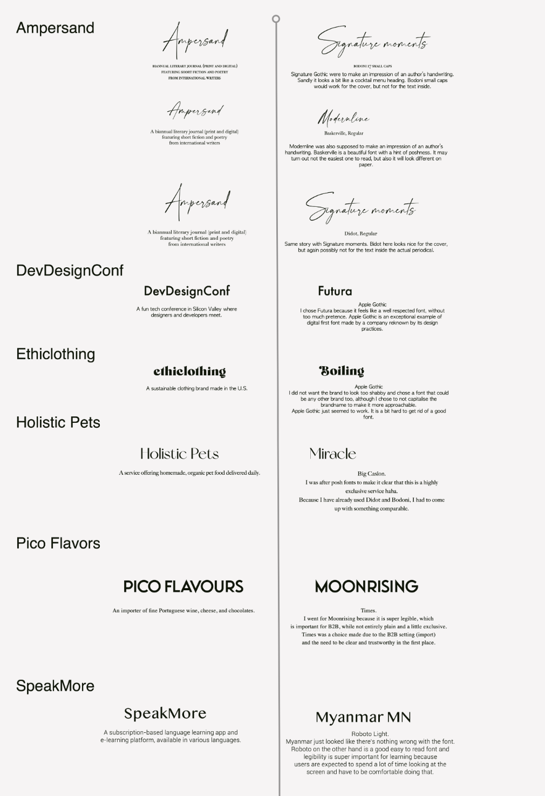

## Typescale

Creating a typescale in UI design is important for several reasons:

1. **Consistency**: A well-defined typescale ensures consistency in typography throughout the user interface. It establishes a set of harmonious font sizes that can be used consistently across different elements such as headings, subheadings, body text, buttons, and other UI components. Consistency in typography contributes to a cohesive and visually appealing design.
2. **Hierarchy and Readability**: A typescale helps establish a visual hierarchy in the UI by using different font sizes for different levels of information. It allows designers to prioritize and emphasize important content by using larger font sizes for headings or titles, while using smaller font sizes for less significant elements. This hierarchy aids users in quickly understanding the structure and importance of the information presented, enhancing readability and comprehension.
3. **Efficiency and Workflow**: By establishing a typescale at the beginning of a design project, designers can save time and streamline their workflow. It provides a set of predefined font sizes that can be used consistently, reducing the need to make ad hoc decisions about typography for each element. This efficiency allows designers to focus on other aspects of the design process and maintain a cohesive visual language throughout the UI.

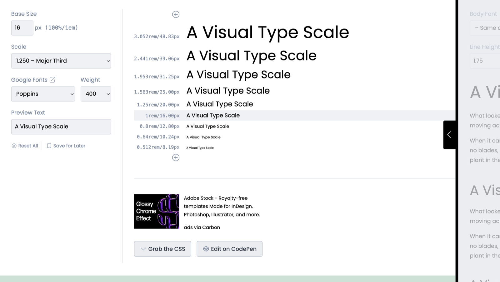

## Google Typescale

[https://m2.material.io/design/typography/the-type-system.html#type-scale](https://m2.material.io/design/typography/the-type-system.html#type-scale)

---

## Tips on using Typography

### **Using the same typographic scale across web and mobile**

After spending ages figuring out the right type scale, it’s natural to want to just go live and see your type scale in all its glory on your website. But then you discover that your beautifully proportioned font looks out of place or too big on a mobile interface. That H1 title filling up the entire mobile screen is not a pleasing sight. After finalizing the type scale for desktop, it’s worth the little extra effort to consider how they will look in mobile interfaces. You can adopt the same type across web and mobile, by replacing H1’s where H2’s would have appeared and so on if visibility on search engines (SEO) is not a priority. But since search engines like Google look for H1 titles to understand the main context of a page it makes sense to create a scale for mobile as well.

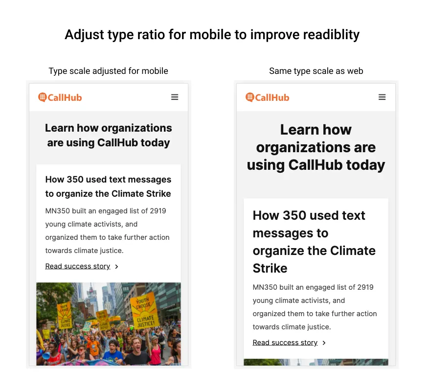

### **Treating the same font sizes across different font types equally**

If a certain type scale has been working well for you, that doesn’t mean you can interchange the typeface and expect it to work the same way. Eg. Inter at 12px is fairly readable in sentence case. But 12px Roboto, not as much. You might have to change Roboto 12px to UPPERCASE to keep it readable.

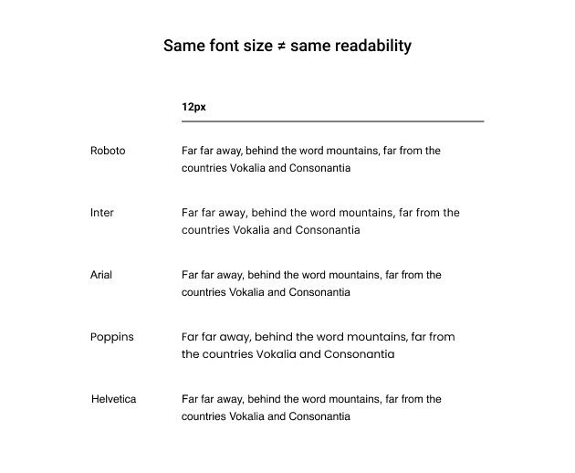

### Line length

Line length describes the width of the content. For longer body text, the recommended line length is between 40 to 60 characters.

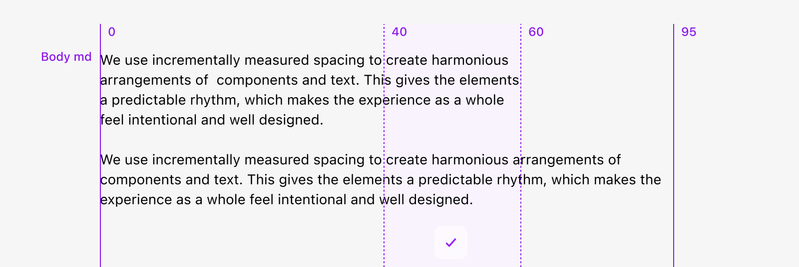
