# Variable Modes

## What you'll build

An interactive product page where hovering over a colour swatch switches the shoe to that colour, using variable modes and a Set variable mode interaction.

## Before you start

- You've finished [String Variables](string-variables.html)
- The shoe images (download them in step 1)
- About 45 minutes

## Let's go

1. Create a component set with 5 product images inside
    
    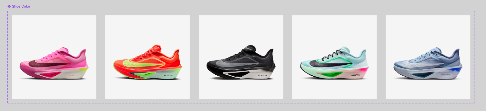
    
    [Shoe Collection.zip](Shoe_Collection.zip)
    

1. Name the component set
    
    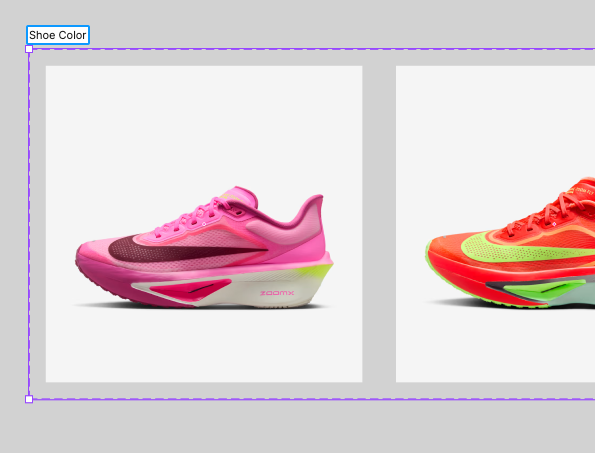
    

1. Set the **name** and **values** for each component 
    
    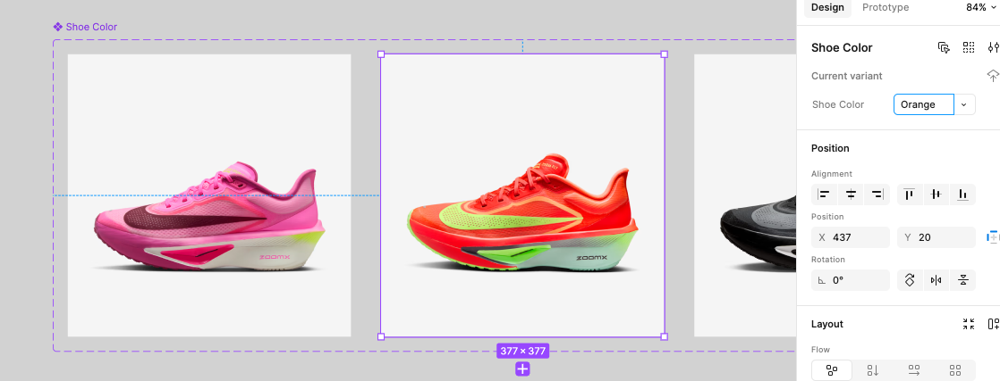
    

1. **Create** 5 colour swatches for each colour. 
    
    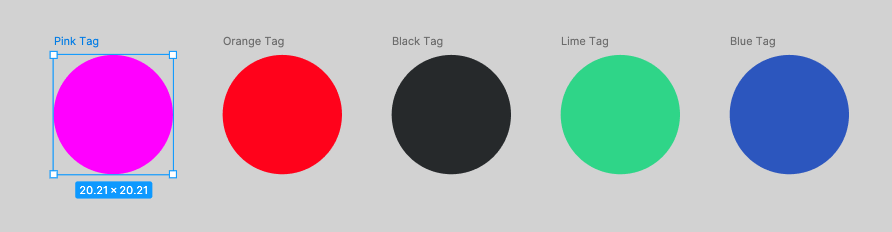
    

1. Create multiple components 
    
    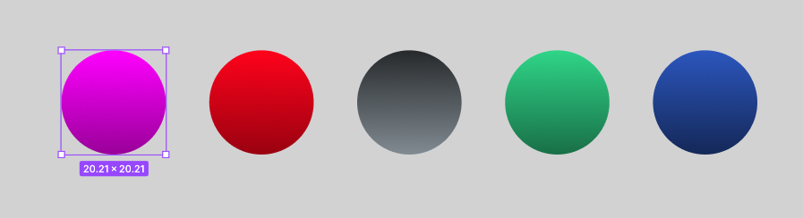
    

1. Create some sort of design that you are happy with (optional)
    
    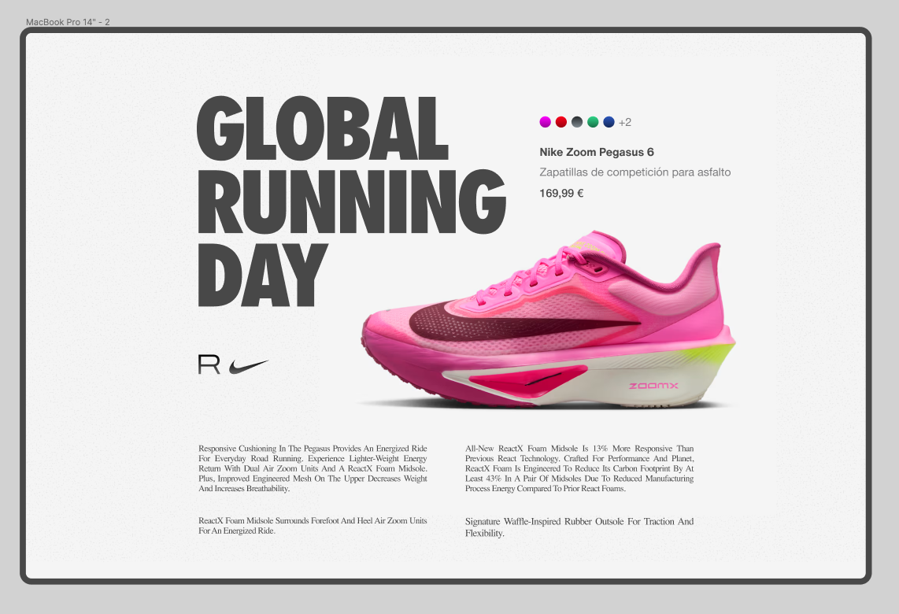
    

7. Create a variable collection with the following modes. **Make sure it is a string!** 

| **Name** | **Shoe Colour (Default)** | **Shoe Colour (Orange)** | **Shoe Colour (Black)** | **Shoe Colour (Lime)** | **Shoe Colour (Blue)** |
| --- | --- | --- | --- | --- | --- |
| Shoe Color | Pink | Orange | Black | Lime  | Blue |

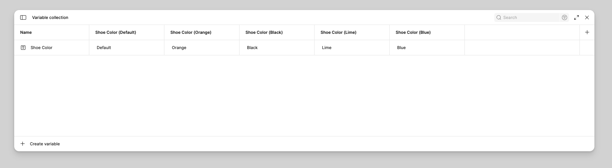

8. Switch to prototype mode, select the first colour swatch, click the add action

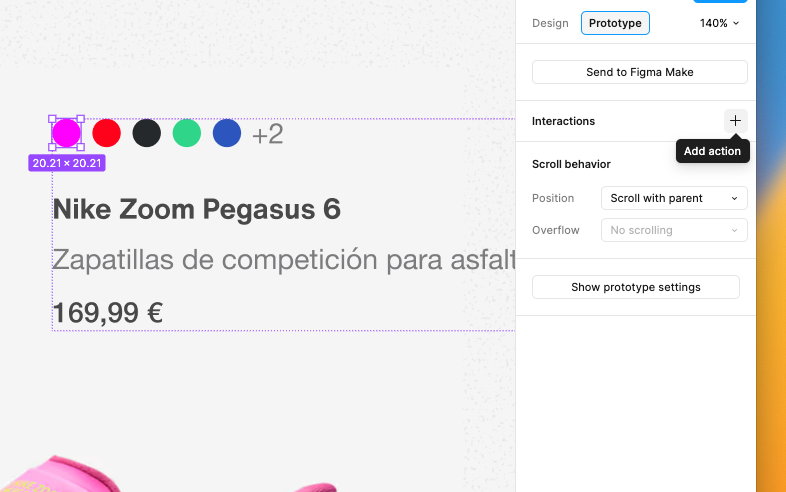

1. Create the following interaction design
    
    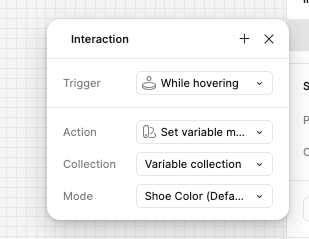
    

While hovering → 

Action: **Set variable mode**
Collection: **Variable Collection**
Mode: **Shoe Colour (*insert the correct colour*)**

1. IMPORTANT! Attach the child instance to the variable to get them talking 
    
    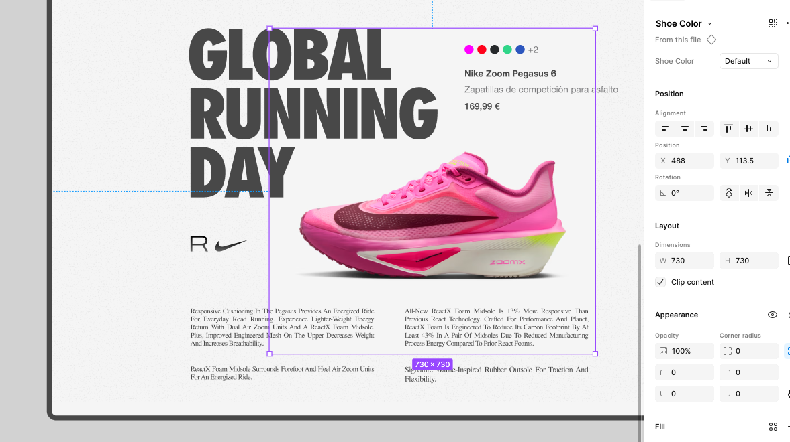
    

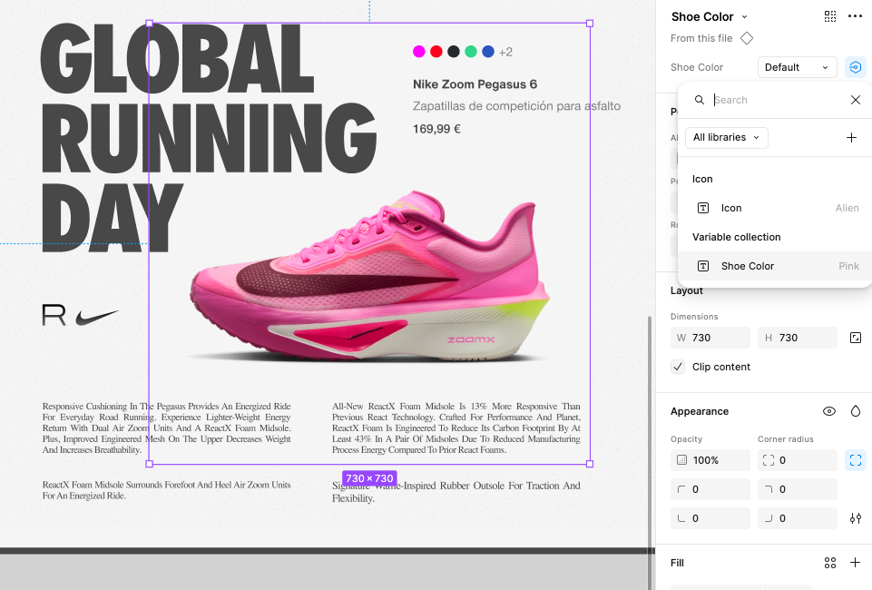

[https://embed.figma.com/proto/pi4ilR8QSufcObFDMI60UU/Untitled?node-id=9-92&t=pO67wR4NyYRGOZMj-1&embed-host=notion&footer=false&theme=system](https://embed.figma.com/proto/pi4ilR8QSufcObFDMI60UU/Untitled?node-id=9-92&t=pO67wR4NyYRGOZMj-1&embed-host=notion&footer=false&theme=system)

## Well done!

You can now:

- Create a variable collection with several modes
- Link component variants to a string variable
- Switch modes in a prototype with the Set variable mode action

That's the last Figma lesson. Mark it complete to reach the Figma Advanced milestone.
