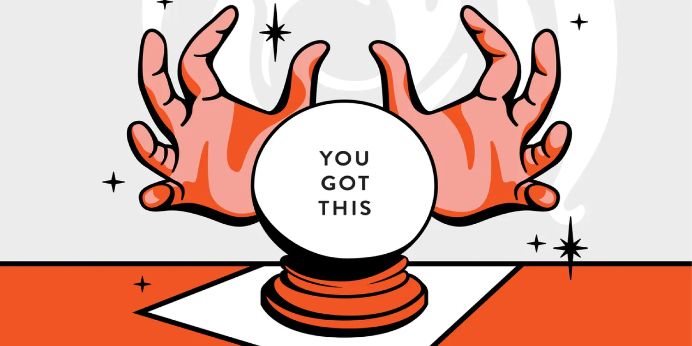

# 05. Bias: Barnum Effect

The Barnum effect, also known as the Forer effect, is a psychological phenomenon where individuals believe that general and vague descriptions about their personality or characteristics specifically apply to them, even though they are actually applicable to a wide range of people. The effect is named after the famous showman P.T. Barnum, who was known for his ability to entertain and captivate audiences.

## How it works

[https://m.youtube.com/watch?v=NBXRzdzFnHk&pp=ygUhZmFsc2UgY29uc2Vuc3VzIGVmZmVjdCBleHBlcmltZW50](https://m.youtube.com/watch?v=NBXRzdzFnHk&pp=ygUhZmFsc2UgY29uc2Vuc3VzIGVmZmVjdCBleHBlcmltZW50)

---

The Barnum effect is often observed in personality assessments, horoscopes, fortune telling, and other similar contexts. People tend to accept and identify with descriptions that are presented as personalized or tailored to them, even when the statements are quite general and could apply to many individuals. This effect occurs because individuals tend to interpret and selectively focus on the parts of the description that match their self-perception while ignoring the parts that do not.

---

---

For example, if someone reads a horoscope or receives a personality assessment that includes statements like "You have a strong desire to be liked by others, but you also value your independence," many people might identify with this description because it contains elements that are relatable to most individuals. People often overlook the fact that these statements could apply to almost anyone and mistakenly perceive them as highly accurate and specific to their unique personality.

---

The Barnum effect is a cognitive bias that highlights the human tendency to seek validation, accept positive feedback, and find meaning in vague or general statements. It serves as a reminder to critically evaluate and approach personality assessments or generalized descriptions with skepticism, considering the broad applicability of such statements.

---

## Why it matters for UX

Vague, flattering descriptions feel personal. Personalisation features, quizzes and "made for you" recommendations can lean on the Barnum effect instead of real relevance. It also matters in research: a persona full of generic statements ("wants a simple, fast experience") fits everyone and helps no one.

## Try it: spot it in the wild (20 minutes)

1. Read one of your personas, or a sample persona online.
2. Highlight every statement that could apply to almost anyone.
3. Replace each one with a specific detail backed by your research.

## Media

[https://www.youtube.com/watch?v=NBXRzdzFnHk](https://www.youtube.com/watch?v=NBXRzdzFnHk)

## Resources

[Barnum Effect – The Decision Lab](https://thedecisionlab.com/biases/barnum-effect)

[What are Cognitive Biases? – Interaction Design Foundation](https://www.interaction-design.org/literature/topics/cognitive-biases)

## Key takeaways

- Vague statements feel personal because we fill in the details ourselves.
- Real personalisation must be based on real data about the user.
- Generic personas fit everyone and help no one: be specific.
