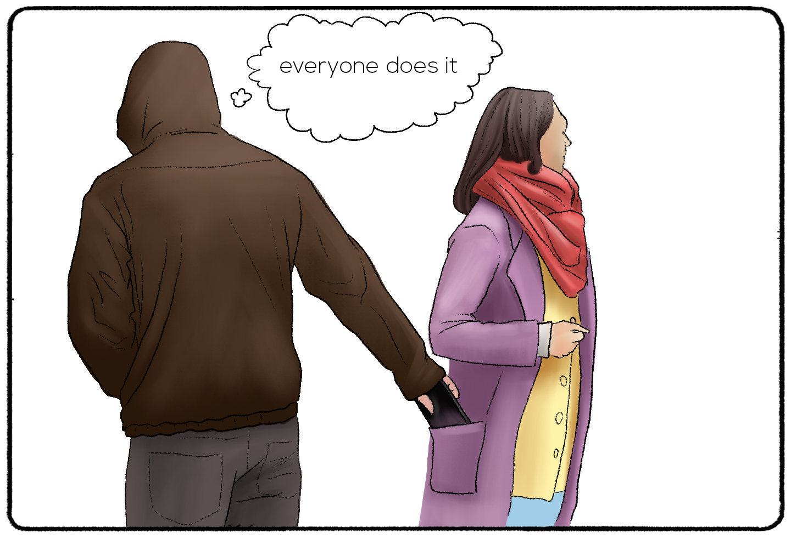
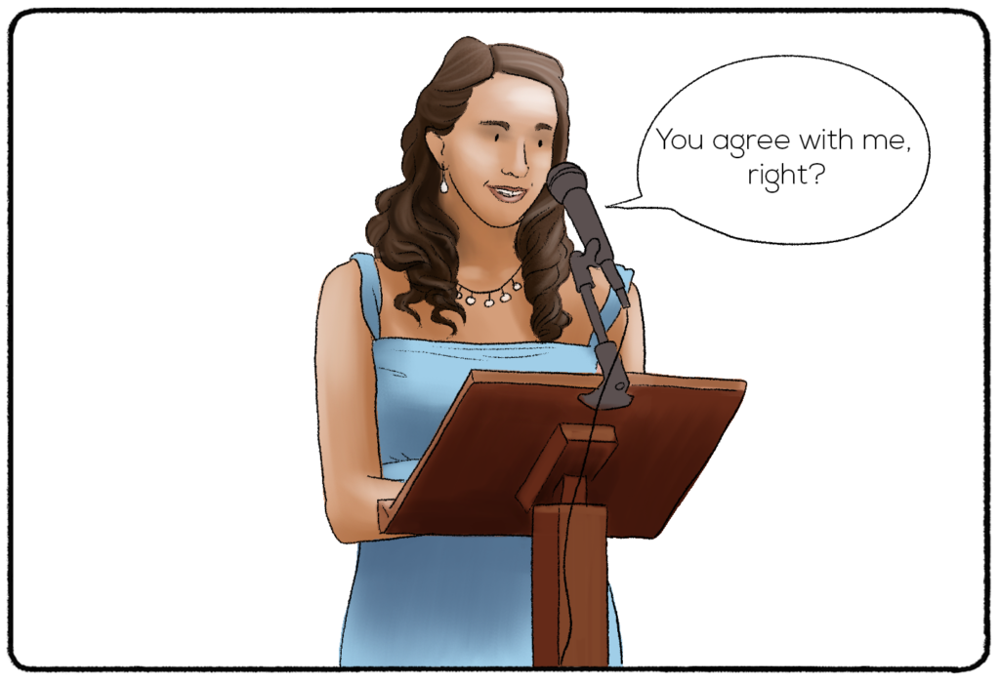

# 06. Bias: False Consensus Effect

The false-consensus effect is a cognitive bias where individuals tend to overestimate the extent to which their opinions, beliefs, preferences, or behaviors are shared by others. In other words, people tend to believe that their own attitudes and behaviors are more common or "normal" than they actually are

## How it works

---

The false-consensus effect arises from our natural tendency to assume that others are similar to us, both in terms of their thoughts and actions. We use our own perspective as a reference point and project it onto others, assuming that they must think and act in a similar way. This bias can be influenced by various factors, including social context, personal experiences, and the desire for social validation.

---

For example, imagine a person who strongly supports a particular political candidate. Due to the false-consensus effect, that person might assume that the majority of people also share their views. They might be surprised or even confused when they encounter individuals with different political beliefs, as they had assumed their own perspective was more widely held.

---

The false-consensus effect can have important implications in various aspects of life. It can lead to misunderstandings, conflicts, and a lack of understanding or appreciation for diverse perspectives. It can also reinforce stereotypes and contribute to the formation of echo chambers, where individuals surround themselves with like-minded people and are less exposed to alternative viewpoints.

---

Recognizing and understanding the false-consensus effect can help individuals become more open-minded, considerate of others' perspectives, and willing to engage in constructive dialogue. It encourages people to question their assumptions and seek out diverse opinions, fostering better communication and empathy in social interactions.

---

## Why it matters for UX

This is the bias behind the most important rule in UX: you are not the user. Designers assume users think, know and want what they do, and design for themselves. The only cure is to test with real users who are not you.

## Try it: spot it in the wild (20 minutes)

1. Write down how you think users will complete one task in your project.
2. Watch two people who are not designers try the same task.
3. List every difference between your prediction and what they did.

## Media

[https://www.youtube.com/watch?v=TewiUcN35Yo](https://www.youtube.com/watch?v=TewiUcN35Yo)

## Resources

[The False-Consensus Effect – Nielsen Norman Group](https://www.nngroup.com/articles/false-consensus/)

[False Consensus Effect – The Decision Lab](https://thedecisionlab.com/biases/false-consensus-effect)

## Key takeaways

- We overestimate how much others share our opinions and habits.
- You are not the user: your preferences are not evidence.
- Test with real users to replace assumptions with observation.
