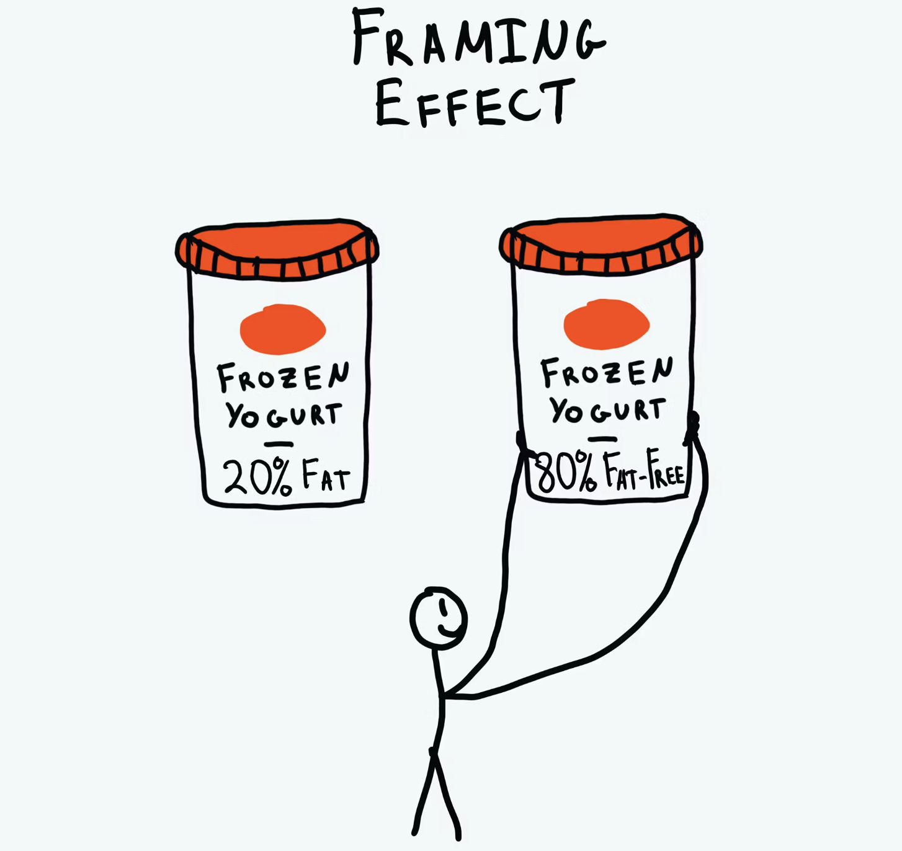

# 07. Bias: Framing Effect

Framing bias in research refers to a cognitive bias where the presentation or wording of information can influence the way people perceive and respond to that information. The framing of a question, statement, or hypothesis can shape people's understanding and decision-making by emphasizing certain aspects or providing a particular context. This bias highlights the importance of how information is presented and underscores the potential impact it can have on individuals' interpretations and responses. Researchers must be aware of framing bias and strive to minimize its influence to ensure more objective and unbiased results.

## How it works

For example, people prefer a treatment described as having a "90% survival rate" to one with a "10% mortality rate", although they are the same. A yoghurt that is "80% fat-free" sounds healthier than one with "20% fat". In interfaces, "Save 20%" and "Don't miss out" frame the same discount as a gain or a loss.

---

## Why it matters for UX

How you word a choice changes the choice: "95% success" and "5% failure" are the same fact. In interfaces, framing shapes button labels, pricing and consent screens. In research, the way you word a question shapes the answer you get. Frame clearly and neutrally, and never to trick.

## Try it: spot it in the wild (20 minutes)

1. Find a cookie banner or subscription cancel screen.
2. Write down how each option is framed (words, colour, size).
3. Rewrite it so both options are framed equally, and compare.

## Media

[https://www.youtube.com/watch?v=8xVZ-qtW258](https://www.youtube.com/watch?v=8xVZ-qtW258)

## Resources

[Framing Effect – The Decision Lab](https://thedecisionlab.com/biases/framing-effect)

[Prospect Theory and Loss Aversion – Nielsen Norman Group](https://www.nngroup.com/articles/prospect-theory/)

## Key takeaways

- The same information framed differently leads to different decisions.
- Gain and loss framing changes behaviour; use it honestly.
- Word research questions neutrally so you don't steer the answers.
