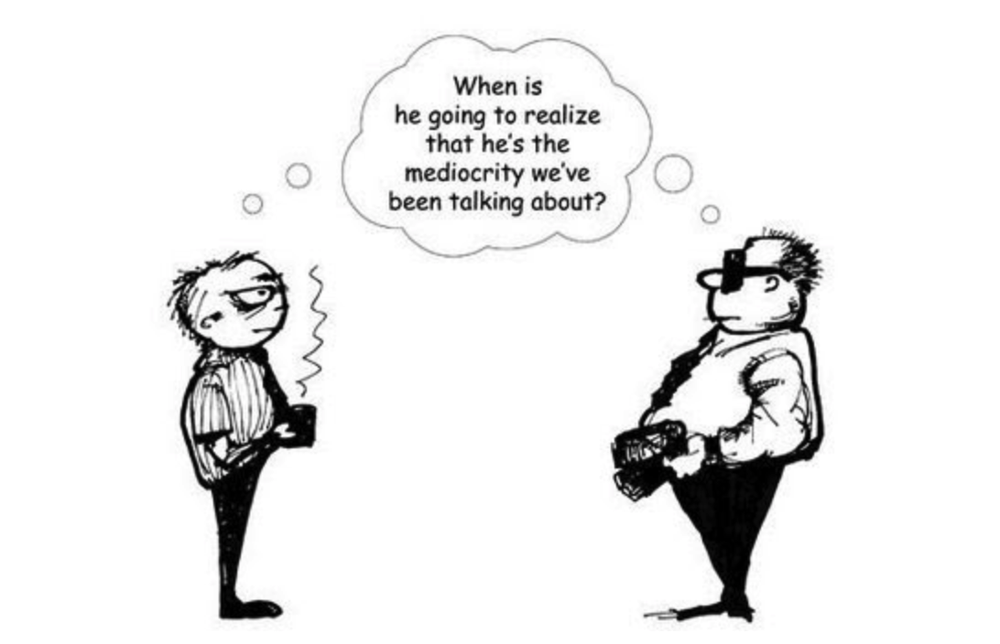

# 08. Bias: Overconfidence Bias

Overconfidence bias is a cognitive bias in which individuals tend to have an unwarranted and excessive belief in their own abilities, knowledge, or judgments. It involves overestimating one's own skills, accuracy, or performance beyond what is objectively supported by evidence.

## How it works

Individuals affected by overconfidence bias often exhibit high levels of self-assurance and believe they are better than others in various domains, such as intelligence, decision-making, or specific skills. They tend to have an inflated sense of their own capabilities, leading them to take on more risks, make overly optimistic predictions, or engage in overambitious projects.

---

For example, a person may overestimate their driving abilities and engage in risky behavior while behind the wheel, believing that accidents are less likely to happen to them compared to others. In the realm of investing, overconfidence bias can lead individuals to make excessive trades, believe they can consistently beat the market, or underestimate the potential risks involved.

---

---

Overconfidence bias can have both positive and negative consequences. On the positive side, it can contribute to self-confidence, motivation, and persistence in pursuing goals. However, it can also lead to poor decision-making, failure to adequately consider alternative perspectives or information, and a reluctance to seek feedback or advice from others.

---

To counteract overconfidence bias, it's important to cultivate self-awareness and humility. This involves acknowledging the limitations of one's own knowledge and expertise, seeking out diverse opinions and feedback, and actively challenging one's own assumptions and beliefs. By promoting a more realistic and balanced view of one's abilities, individuals can make better-informed decisions and reduce the potential negative impacts of overconfidence bias.

---

## Why it matters for UX

Designers are often sure their solution is obvious, until the first usability test. Overconfidence leads to skipping research, ignoring feedback and shipping untested ideas. Treat every design as a hypothesis, and let the test decide.

## Try it: spot it in the wild (20 minutes)

1. Before your next usability test, predict how many participants will complete the task, and where they will get stuck.
2. Run the test.
3. Compare your predictions with what happened, and note how confident you were for each.

## Media

[https://www.youtube.com/watch?v=RCA0yxdedNU](https://www.youtube.com/watch?v=RCA0yxdedNU)

## Resources

[Overconfidence effect – Wikipedia](https://en.wikipedia.org/wiki/Overconfidence_effect)

[Why You Only Need to Test with 5 Users – Nielsen Norman Group](https://www.nngroup.com/articles/why-you-only-need-to-test-with-5-users/)

## Key takeaways

- We believe our skills and judgements are better than they are.
- Treat every design as a hypothesis to test, not a fact.
- Seek feedback early; small tests catch big mistakes.
