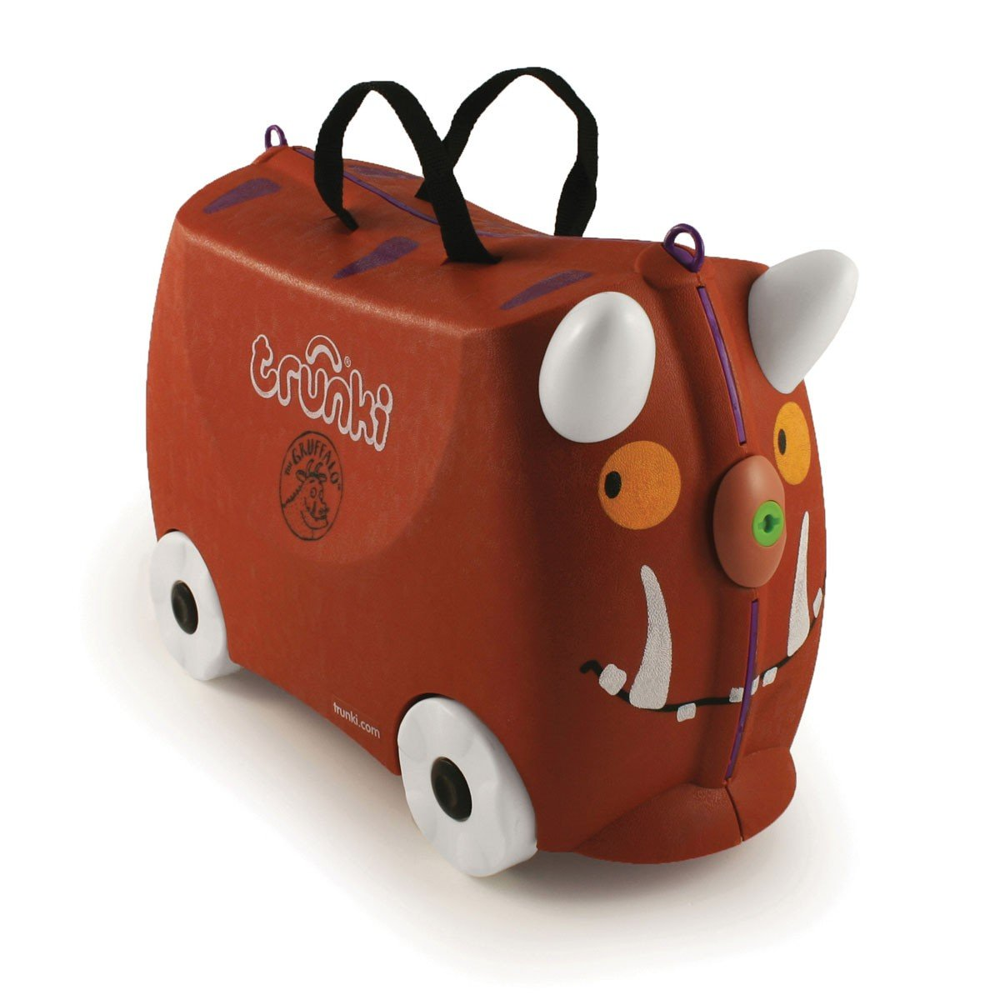
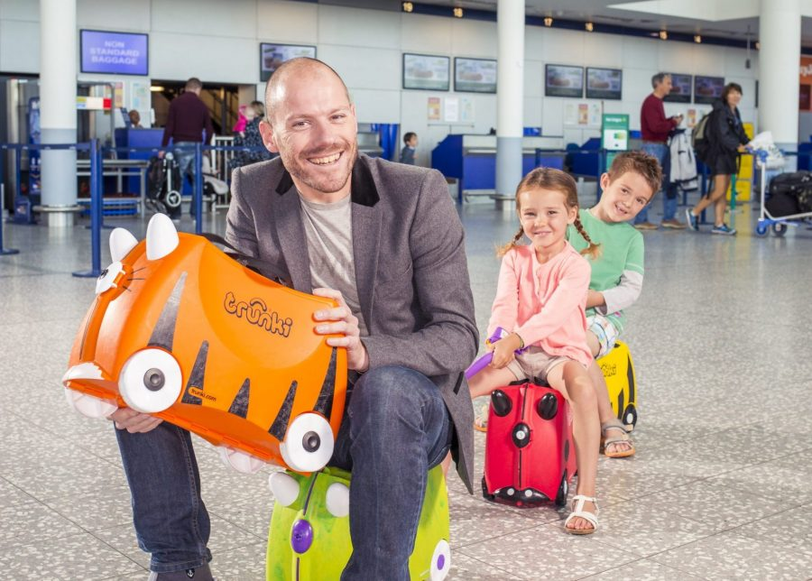

# A Case of Genius

Trunki is a brand of ride-on/carry-on hand luggage for children, designed by Rob Law. As we can see they are suitcases designed for young children to ride on, making travel more fun and less tiring for them. The suitcases are colourful, lightweight, and shaped like various animals or vehicles and come in an assortment of themes. 

---

Rob Law, the inventor originally pitched his concept on a British TV show 'Dragon's Den' but was rejected on the grounds that the product lacked strength (consistency). We’ll watch the video. 

What this case of genius can teach us about product design is the fact that Rob, who has a networth of around 12 Million, had intricately understood a few things pertaining to the customer journey. 

[https://youtu.be/CiFVdvU10L4?si=G6LHoyIp_0K70taj&t=55](https://youtu.be/CiFVdvU10L4?si=G6LHoyIp_0K70taj&t=55)

So what did he know, he knew:

- Airports are busy places
- Parents need to control their kids
- Parents can’t carry the kid’s luggage and carry children also
- Kids like to ride on suitcases
- Kids need to be stimulated
- He understood that kids need luggage

---

He also capably demonstrated an intimate knowledge of the mindset of the kid and whether on purpose or otherwise, he followed a key principle from Don Norman which is to make the product more pleasurable to use! Today, Rob Law has continued to expand and innovate within the company, adding many innovative and successful products to the market. 

---

## Why it matters for UX

Trunki succeeded because Rob Law understood the whole journey, the busy airport, the tired child and the parent with full hands, and designed for all of it. Great products come from understanding context and making the experience enjoyable, not just functional.

## Try it: analyse a product you love (30 minutes)

Now, please, I would like you to choose a product which you think exemplifies excellent product design. This could be anything from a tech gadget, kitchen tool, app, or piece of furniture.

**Customer Needs Analysis**:

- **Briefly Describe the Problem behind the product**
- Highlight key insights into the user journey. What I mean is that try to demonstrate what the product designer would have had to consider before creating the product.
- Think about the context in which the product is used. When is it used, At what time of day. When is the customer?

**UX Design Principles Application**:

- **Functionality and Enjoyment**: Explain how the product is designed to be both functional and enjoyable to use.

**Outcome:** a one-page analysis you can share with the class. It trains you to think about the user and the whole journey, not just the object.

## Media

[https://www.youtube.com/watch?v=oQTEwIz6Ehg](https://www.youtube.com/watch?v=oQTEwIz6Ehg)

## Resources

[Trunki – Wikipedia](https://en.wikipedia.org/wiki/Trunki)

[Principles of Human-Centered Design – Don Norman (video)](https://www.youtube.com/watch?v=rmM0kRf8Dbk)

## Key takeaways

- Understand the full context of use: where, when and who the customer is.
- Functional and enjoyable together beats functional alone.
- Rejection is feedback; Trunki was turned down on TV and still succeeded.
