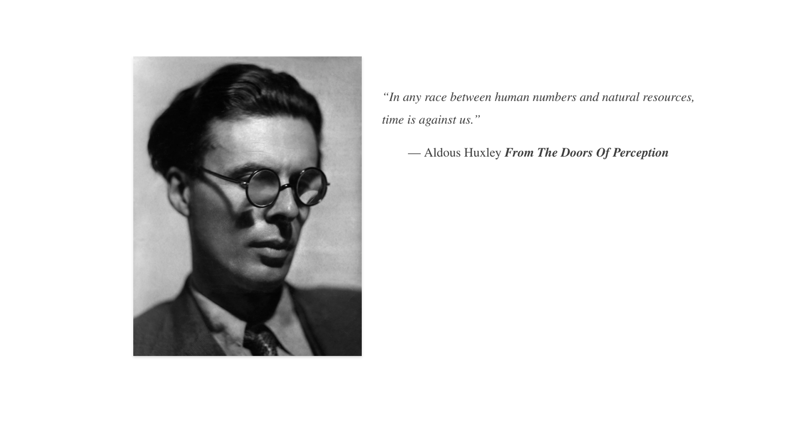
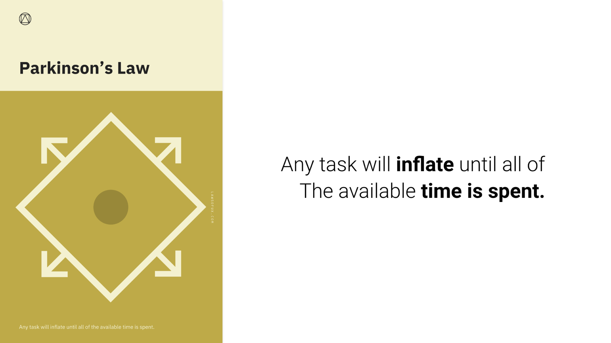
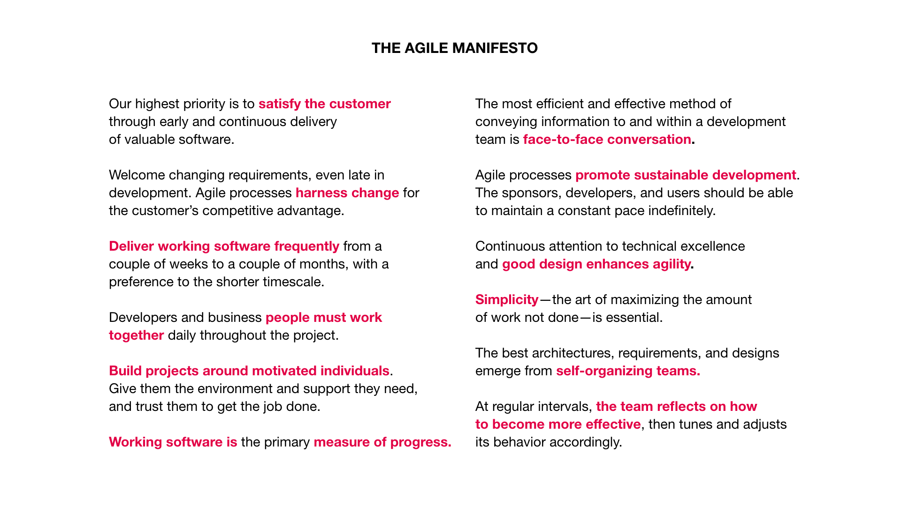

# Agile, Lean and the Toyota Way

Why we work in short sprints, and where the idea came from: a Japanese car factory and a ski lodge in Utah.

---

## Time is against us

Every project runs out of time. **Parkinson's Law**, first described by the historian C. Northcote Parkinson in 1955, puts it bluntly:

> Work expands so as to fill the time available for its completion.

Give a team six months to design an app and it will take six months. Give it one week, with a clear goal, and it will find the essential version. That's why we **time-box** our work into sprints.

---

## The Toyota Way

After the Second World War, Toyota couldn't compete with American car makers on size or money. Engineers such as **Taiichi Ohno** built a different system instead: the **Toyota Production System**, later known around the world as **lean manufacturing**. Rather than building huge batches in advance, Toyota built what customers needed, when they needed it, and constantly removed waste.

The ideas in the Toyota Way still shape how designers work today:

- **Long-term thinking:** decisions based on long-term goals, not short-term numbers.
- **Continuous flow:** small batches moving steadily, instead of big launches.
- **Stop to fix problems:** any worker could pull the *andon* cord to stop the line when something was wrong.
- **Heijunka (levelling):** an even, sustainable pace of work.
- **Visual control:** make the state of the work visible to everyone, like a sprint board.
- **Respect for people:** the people doing the work know best how to improve it.
- **Kaizen:** continuous improvement, every day.

---

## The Agile Manifesto

In 2001, seventeen software developers met at a ski lodge in Snowbird, Utah, frustrated with slow, document-heavy projects. They wrote the **Manifesto for Agile Software Development**, which values:

- **Individuals and interactions** over processes and tools
- **Working software** over comprehensive documentation
- **Customer collaboration** over contract negotiation
- **Responding to change** over following a plan

Its twelve principles include delivering working software frequently, welcoming changing requirements, face-to-face conversation and regular reflection: "at regular intervals, the team reflects on how to become more effective". That's your Retrospective.

---

## From factory floor to design sprint

Lean and Agile meet in the way you'll work on this course: short, time-boxed sprints; a visible board; small things built and tested quickly; and a team that stops, reflects and improves at the end of every sprint. Lean UX, the Lean Startup and the Design Sprint all grew from these roots.

---

## Why it matters for UX

Almost every design team you join will work in sprints, with stand-ups, boards and retrospectives. Knowing where those habits come from (Toyota's lean thinking and the Agile Manifesto) helps you understand why they work: small batches, fast feedback, visible work and continuous improvement.

## Try it: lean up your sprint (20 minutes)

1. List everything you've worked on in your current sprint.
2. Mark anything that was "waste": work nobody used, waiting, rework, over-polishing.
3. Pick one Toyota principle and one Agile value you'll apply in the next sprint.
4. Make your work visible: set up a simple board with To do, Doing and Done.

## Media

[https://www.youtube.com/watch?v=F5vtCRFRAK0](https://www.youtube.com/watch?v=F5vtCRFRAK0)

[https://www.youtube.com/watch?v=rf8Gi2RLKWQ](https://www.youtube.com/watch?v=rf8Gi2RLKWQ)

[https://www.youtube.com/watch?v=EcDjixqQZhU](https://www.youtube.com/watch?v=EcDjixqQZhU)

## Resources

[Manifesto for Agile Software Development](https://agilemanifesto.org/)

[Toyota Production System – Wikipedia](https://en.wikipedia.org/wiki/Toyota_Production_System)

[Parkinson's law – Wikipedia](https://en.wikipedia.org/wiki/Parkinson%27s_law)

## Key takeaways

- Parkinson's Law: work fills the time available, so we time-box work into sprints.
- Toyota's lean thinking: small batches, visible work, stop to fix problems, continuous improvement.
- The Agile Manifesto: people, working products, collaboration and responding to change.
