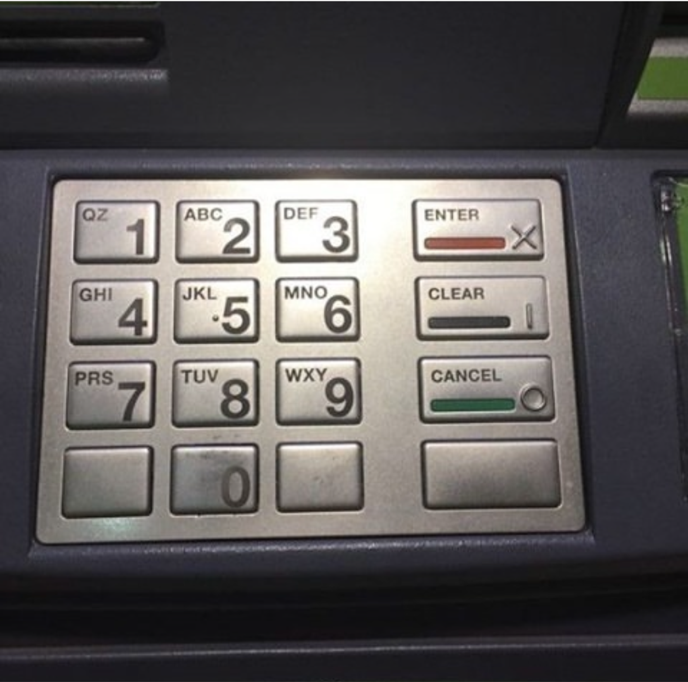
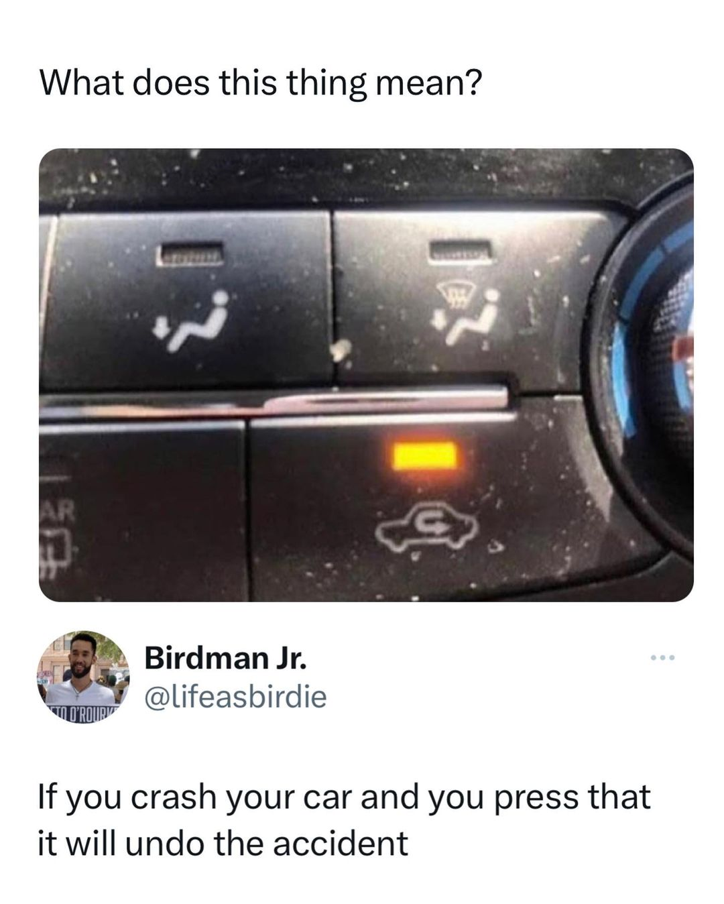
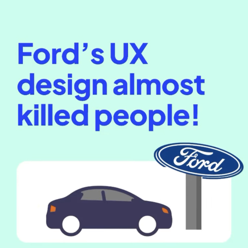
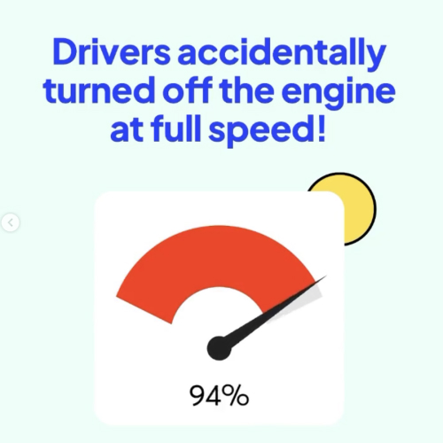
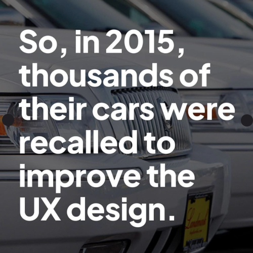
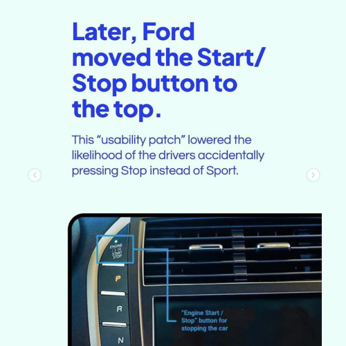

# Bad User Experience

So now we have an understanding of what a good user experience designer should do (consistency, utility and accessibility), and we recognise the importance of empathy and attention to detail. Let’s look at some examples of bad user experience design, starting with the Glasgow-based company House of Illuminati and their presentation of Willy’s Chocolate Experience.
 

The event organiser, House of Illuminati, charged up to £35 for tickets and promised an “immersive experience” based on the Warner Bros film *Wonka*, which stars Timothée Chalamet as the young chocolate entrepreneur.

The event publicly promised giant mushrooms, candy canes and chocolate fountains, along with special audio and visual effects, all narrated by dancing Oompa-Loompas.

According to the Guardian newspaper, eager families turned up to the address in Whiteinch industrial estate in Glasgow and they were presented with a sparsely decorated warehouse with a scattering of plastic props, a small bouncy castle and some backdrops pinned against the walls. 

Disclaimer: this incident drew international media attention, helped along by Hollywood’s interest in copyright infringement, but it’s still well worth examining as a UX failure.

[https://www.cbsnews.com/news/willy-wonka-immersive-experience-glasgow-illuminati-house-box-hub-angry-parents-called-police/](https://www.cbsnews.com/news/willy-wonka-immersive-experience-glasgow-illuminati-house-box-hub-angry-parents-called-police/)

The big issue was that the user was given unrealistic expectations from the advertisers and thus when presented with the realities, they were left feeling deceived.

Expectations are part of the experience. The advert, the website and the ticket all set a promise, and the experience is judged against it. Be honest and transparent from the very first touchpoint. And remember: people will use your products in ways you never expected. You’ll see it again and again in usability testing: they just don’t do what you expect them to do.

> Good design is honest.
> 

Dieter Rams

All design is user experience design. It’s just if it’s either a good experience or a bad experience.  The experience of waiting for a website to load, waiting for your food to come or waiting for your baggage to arrive, can have detrimental results in experience.   

At Houston's George Bush Airport, the airport management faced numerous complaints about the long wait times for baggage claim. After assessing the issue, they discovered that passengers actually spent most of their time standing around waiting at the carousel, even though the actual wait time for luggage wasn’t excessively long.

To address this, the airport made a simple but effective change: they moved the arrival gates farther away from the main terminal and baggage claim area. This increased the amount of walking time for passengers, which in turn decreased the amount of time they spent standing and waiting at the carousel. This change led to a significant reduction in complaints about baggage claim wait times.

This case demonstrates a key insight about good user experience design and behavioral economics: people's satisfaction with a waiting experience is influenced not just by the actual length of the wait, but also by how they spend that time. Making passengers walk instead of waiting idly made the wait feel shorter and more acceptable.

Attention given even to issues like how the loading screen works is imperative to good User Experience Design. 

### Coercive Design

[https://www.instagram.com/p/CxLDZcASFVy/?hl=en](https://www.instagram.com/p/CxLDZcASFVy/?hl=en)

I’m sure we all recognise that the reason the close ad button is so inaccessible is because the advertisers want you to see their services for as long as possible. Although we all know this, we should be aware that this may be considered unethical.  

## Accessibility

The above shows how people actually work with the construction of a park pathway. Field studies means going out there and actually seeing how people work with your design in advance. The more we can anticipate, the better the experience the customer will have and if you leave it too late, it can be an a costly fix. 

### Confusion and lack of Clear Signs

People interpret signs as meaning different things. Let’s be aware of this. 

## Visibility of System Status

> An informed customer is a happy customer.
> 

Google, anonymous 

When its so bad, its good. 

[LINGsCARS - Cheap Car Leasing](https://www.lingscars.com/)

