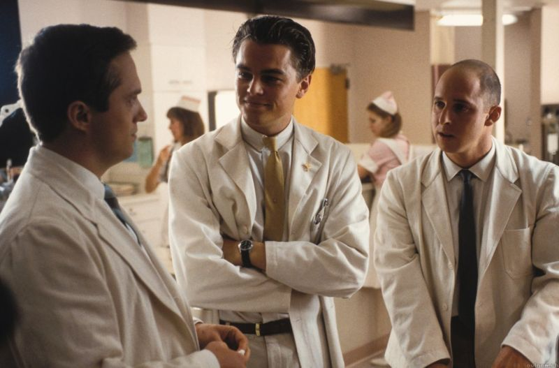

title: Bias
promise: Eleven mental shortcuts that bend how your users decide, and how you design. A quick tour of every bias in this section.
duration: 20 minutes
topics:
- What a cognitive bias is
- Biases in your users: authority, availability, anchoring, bandwagon, framing, scarcity, Barnum
- Biases in you: optimism, overconfidence, false consensus, survivorship
- Using biases honestly
---
@title
# Bias
The shortcuts that bend every decision, including yours.
---
@statement
A **cognitive bias** is a predictable error in thinking: a mental shortcut that usually helps, and sometimes misleads.
---
@text
## Two reasons designers study bias

1. **Your users** have them. Designs can help people decide well, or exploit them
2. **You** have them. They creep into your research, your ideas and your judgement

Every bias has its own short lesson in this section. Here's the tour.
---
@section
## Biases in your users
How people decide.
---
@split
## Authority bias

We trust experts, uniforms and titles, sometimes too much.

In *Catch Me If You Can*, a con man passes as a pilot and a doctor: the uniform does the work.

In UX: credentials and expert endorsements build trust. Fake ones break it.
---
@split
## Availability bias

We judge by what **comes to mind easily**.

After a plane crash in the news, flying feels more dangerous than driving, though it isn't. One vivid user complaint can feel bigger than the data.
---
@text
## Anchoring bias

The **first number** we see shapes every judgement after it.

A jacket "was €200, now €120" feels like a bargain, whatever it's really worth.

In UX: the first price on a pricing page sets the anchor for the rest.
---
@text
## Bandwagon effect

We do what **others** are doing.

Reviews, ratings, "most popular" and user counts are some of the most powerful patterns in UX.

Honest social proof helps people decide. "12 people are looking at this", invented, is a deceptive pattern.
---
@split
## Framing effect

The same fact, framed differently, gets a different answer.

"80% fat-free" sounds healthier than "20% fat". "Save 20%" and "Don't miss out" frame one discount as a gain or a loss.
---
@split
## Scarcity effect

We want what's **limited**: "only 2 left", countdown clocks, "24 hours only".

Real limits help people act. Fake urgency is a deceptive pattern.
---
@split
## Barnum effect

Vague descriptions feel **personal**: "You have a great deal of unused potential."

It's why horoscopes and "personalised" quiz results work. It can also make a lazy persona feel true.
---
@section
## Biases in you
How designers go wrong.
---
@cards
## Four biases that sink projects

- **Optimism** "It'll all go to plan." Projects run late; plan for risk
- **Overconfidence** "I know what users want." Your certainty isn't evidence
- **False consensus** "Everyone thinks like me." You are not the user
- **Survivorship** Studying only the successes, and missing why the rest failed
---
@text
## The planes that didn't come back

In the Second World War, the US military studied bullet holes on **returning** aircraft, to decide where to add armour.

The statistician **Abraham Wald** pointed out the flaw: the planes hit in the *other* places never came back. Armour the areas with no holes.

In UX: don't only listen to the users who stayed. Find the ones who left.
---
@exercise
## Name the bias

1. "Only 3 rooms left at this price!" on every hotel, every day
2. "We don't need to test it. I use apps like this all the time."
3. A pricing page shows the €99 plan first, so €29 feels cheap
4. "9 out of 10 dentists recommend it"
5. "Join 2 million happy customers"
6. "Let's copy what the top five apps do. They're the ones that succeeded."
---
@answers
## Check yourself

1. **Scarcity effect**, and a deceptive one if it isn't true
2. **False consensus** (and overconfidence): you are not the user
3. **Anchoring**
4. **Authority bias**
5. **Bandwagon effect**
6. **Survivorship bias:** you can't see what the failed apps also did

Now open each bias in this section for the full lesson.
