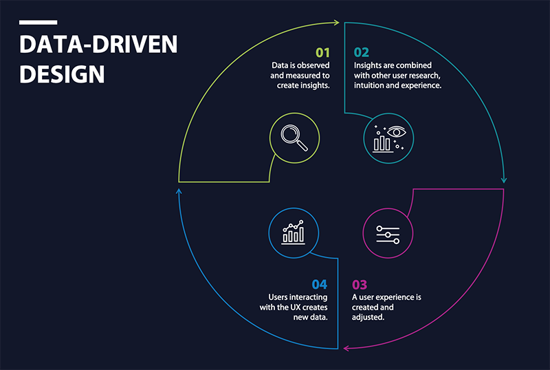
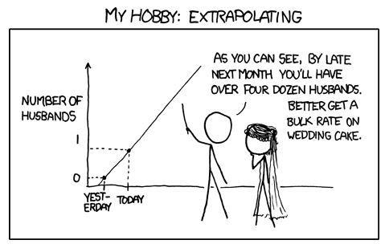
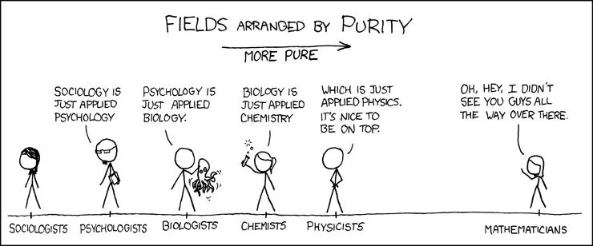
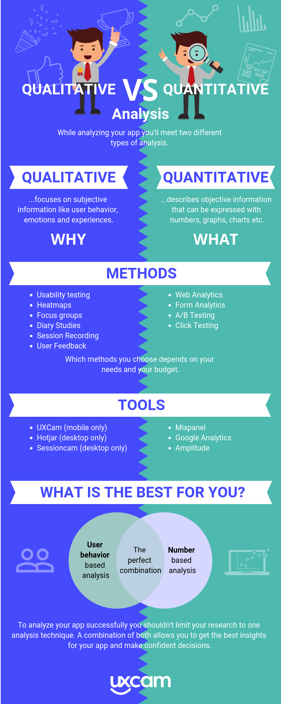
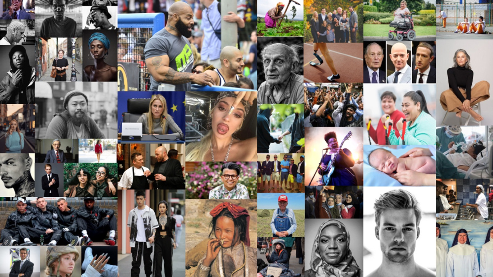
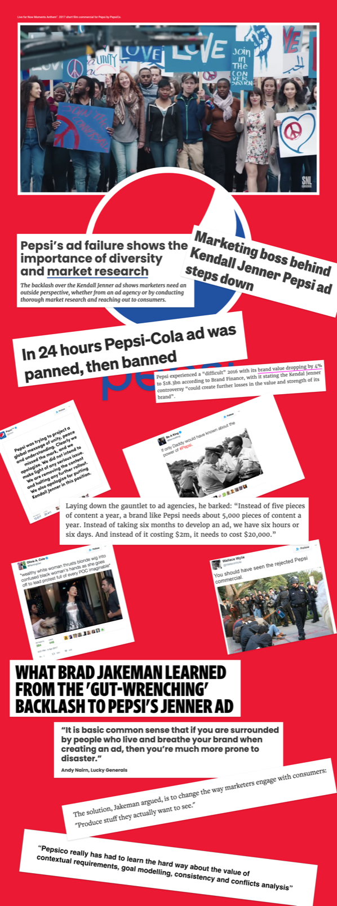

# Data

Primarily during your Discovery / Empathy phase, but throughout your sprint, you will be exploring the problem space and gathering data, gathering evidence and cycling those findings back into the design. This is the notion of data influenced design. Design thinking is predicated upon taking an **evidence** based approach to design.

Really the true mark of a good UX designer is that they can incorporate data into an abstract design process. And this happens specifically, and yet not limited to both discovery and in validation This really is the great divide that separates the old school top down pr marketing and management pitch from the science based design thinking method. Let us ask the question?

---

## What is Data?

So, evidence, evidence is data and evidence is a science. Science is true. Kind of, we'll get to that in fact, let's tackle that now.

Charles Barkley is a former American professional basketball player, 11-time NBA All-Star and the 1993 NBA Most Valuable Player. Currently a television analyst on the American network Showtime, he is considered by many to be one of the greatest basketball players of all time. Charles Barkley believes that reality cannot be measured. Let's listen.

[https://www.youtube.com/embed/2asGeItzGWM](https://www.youtube.com/embed/2asGeItzGWM)

> David Morey was the subject of The Undoing Project by Michael Lewis, who also wrote the book, Moneyball which was made into a film and is available on Netflix.
> 

---

## False Data

So is data false? Not exactly. The plot thickens.

No one can predict the future. What is the future! Well, Einstein mentioned that time is space and as a construct that's all quite abstract but for sure, we are all experiencing the same thing at the same moment, I hope. We are moving through space time and this is not something that any market or market force can predict. We really don't know. The universe may invert in a heartbeat and some distant galaxy may have just collapsed setting off a chain reaction resulting in the end of our own universe within the next ten minutes, probably not, but nothing is 100% certain.

Everything that we experience is part of a much older system of course and we are essentially part of a system, billions and billions of years old. As we say, yesterday is history. Tomorrow is a mystery. 

So we can't predict the future but we can prepare for it. *if* we carefully measure the market and recognize patterns, if have your finger on the pulse of a behavioural economics and truly understand your customer and your products, we can postulate with a **greater degree of accuracy** what *may* happen in the future and this backs up that fact that design thinking is all about mitigating risk or possibly keeping an eye out for a giant extinction event asteroid.

---

## Bad Data

*Do not preemptively see a correlation. Be rigorous in testing our imagination /assumptions.*

---

## What is Research

In all testing, in order to conduct effective research you must first know what you seek to learn. This is called epistemic pursuit. From the Greek, the pursuit of knowledge. We are all epistemologists! So we have to ask ourselves, what questions do we want answered? What do we want to know about our users? What is it we don't know about them?

This is the foundation for choosing your research methods, creating a problem statement or forming a research question. **A research question is simply an extension of what we wish to learn**. So all research methods are an extension of that one thing. That one question. What we want to know.

So we want to get knowledge. What's knowledge? Well, I think ... 

knowledge is the accepted belief in an objective truth by recognizing objective patterns in reality which correlate producing consistent results. 

This is a little abstract perhaps but in essence, in UX we are trying to determine signs which indicate truth in order to make accurate predictions.

---

## Data Purity

There is a scale of purity in research, in truth, whilst uncovering what is true whilst looking for patterns.

---

## Qualitative and Quantitative Data

Let's just open up to the floor and try and interpret this sentence. Ask yourself what do you define as true? Do you think reality a fixed place or is it negotiated?

After some contemplation, maybe you have considered both can be true. Reality is both negotiated and fixed. We can measure the length of a road, we can measure a sequence of numbers, the mathematical constant of π, the flight paths of Canadian geese and equally there are things that we can accept as negotiated reality. Love is real, violence towards children is morally abhorrent, the end of the observable universe is physically unobtainable, sweating hands and a beating heart are indicators of passion.

Where quantitative analysis presents a single version of truth, qualitative data presents us with a 'Good Enough' probability. Quantitative data tells us whats happening but it doesn't tell us why it's happening. For that we need quality insight. Both methods are necessary strategies for us as UX designers in order to see patterns. Essentially, this is all we are doing. We are always simply looking for patterns.

---

## Data in UX

---

## Big Data

In 2016, Cambridge Analytica finessed the technique of **data harvesting** by targeting specific users from information collected in Facebook. Intensive survey research, data modeling and performance-optimizing algorithms were used to target 10,000 different ads to different audiences in the months leading up to the 2016 Donald Trump election campaign. 

The ads were viewed billions of times, according to the The Guardian newspaper which claims this contributed to the rise of populism resulting in the UK leaving the EU that same year. [Further reading](https://www.theguardian.com/uk-news/2018/mar/23/leaked-cambridge-analyticas-blueprint-for-trump-victory)

*Christopher Wylie: a Canadian data consultant who released a cache of documents to The Guardian he obtained while he worked at Cambridge Analytica*

---

## Paradox of Humanity

So, we spend all our time asking ourselves who is the user, what type of user do we have, what is their demographic, what are their tastes, their habits, when is the user and we hopefully now know this is negotiated space. But I want to tease it out because I feel we should be aware of it and just answer the following question; What really is a human being?

Ok, after everyone has struggled to answer that and maybe even suffered an existentialist crisis or two, I will rely on Shakespeare to answer this one.

*What a piece of work is a man, how noble in reason, how infinite in faculties, in form and moving how express and admirable. In action how like an angel, in apprehension how like a God!* - Hamlet, William Shakespeare

---

## People (Negotiated and Fixed)

Everyone understands that human beings have fundamental needs. This is totally fixed.

This is a **one fixed truth** but after that things become variable and needs become wants

As UX Designers we often find ourselves within this negotiated space quite a bit. We can never really say for sure we know how a user will use our product but we can say, if we measure the market what, they will probably do. People make billions of different choices everyday which separates us from one another. People in general a pretty complex but basically the same and given similar sets of circumstances, people will behave in the same way. We should account for both outcomes. Expect your users to use your products in the same way, for the same reason, but don't be surprised if they don't. Here's how.

Did you know in 1975, the majority of people in every single US state, named their daughter Jennifer. How is it possible that in a country like the United State of America, with a population of 329.5 million people, most people could, year after year, give their children the same name?

Maybe you have more faith in Europe, a continent of 44 countries comprised of 24 languages, and a population of just under a quarter of a billion, 747 million people. Not really.

People are for the most part, the same and still characteristically different. Negotiable and yet fixed. When you write your persona next week, you will want to account for this; 

Whilst Shakespeare sees the individuality in the human being, and rightly so, the UX Designer takes a much broader angle and fixes users into groups. 

This is ultimately because groups tend to behave the same.

It's not so much that most people in 1975 loved the name Jennifer, Or that in 2005, people loved the name Sofia, but that when two people are about to have a child, this moment forces them to conform to society because of the intense need for that society at a time of increased vulnerability. 

Again, this should act as a reminder of that it's not just about who our user is but when is the user.

Also, this may helps to highlight why Elon Musk can afford to call his son, X Æ A-Xii. He could afford to! And now let's take the Pepsi Challenge;

---

## Pepsi Challenge

Let's examine what happens when we assume that we are correct about our users, when we ignore their opinions and take for granted their feelings. 

When we display an arrogant approach to data and believe that we somehow are impervious or immune to assumptions. 

This is just about as wrong as we can be;

Playing on just about every available stereotype - from an Asian guy playing cello to black guys dancing hip hop, the 2017 'Live For Now' Pepsi Campaign was was a total fail which which resulted in mass losses for PepsiCo and marked the end of Pepsi's in-house marketing tradition.

---

### A loose synopsis

One day in some unnamed non specific North American capital city, there is a protest featuring just about every stereotypical ethnicity under the sun. From The reason for the protest is unclear and unspecified. At some point during demonstrations, the high profile public figure and model, Kendell Jenner notices whats happening, she's invited to join the movement and does so accordingly becoming just another citizen of humanity.

Eventually she reaches an intense stand off between demonstrators and law enforcement. Cleverly she reaches for a Pepsi and hands it to a police officer.

This breaks the intense stand off, the moment is snapped up by a photographer in traditional Muslim Hijab and the whole things erupts into some sort of street party all brought about by Pepsi.

Unmistakably beautiful, gorgeously composed and dangerously polarizing, the 'Live For Now' advert exploits real world inequality, plays on a orchestra of emotions and glamorizes themes of oppression all in the name of profit and corporate objectives.

For a campaign which aimed so hard to side with non-discrimination and inclusivity, I'm particularly unsettled by the moment when the young, white, millionaire model Kendell Jenner thrusts into the hands of a black assistant her white wig. It's all strangely Aryan and tone deaf and a total mess. The advert was seen as even more ignorant than it already was given it surrounded the time of the Black Lives Matter Movement.

A movement where 25 people were killed in the United States by their fellow citizens while participating in political demonstrations.

Let's watch.

[https://www.youtube.com/embed/NApOXaynEJM](https://www.youtube.com/embed/NApOXaynEJM)

PepsiCo global beverage group president Brad Jakeman, who was head of its in-house content creation division, was responsible for the advert and replaced by Eugene Willemsen in 2016. Example of why we should never work in a silo. UX is about contact and peer review.

[further reading](https://www.theverge.com/2018/5/31/17377964/coca-cola-water-sustainability-recycling-controversy-investigation)

*Pepsi must work so tirelessly to create a clean brand image because the reality is that Coca-Cola, Nestle and Pepsi trample on the right to life in places like, Pakistan, Tamil Nadu, India and even Detroit where the price of water is directly correlated to the amount of use by these companies. Coca-Cola and Pepsi are among the 12 companies said to be responsible for 70% of branded packaging litter in the UK.*

In summary,

Remember even as far back as 300,000 years our ancient ancestors engaged in sophisticated problem solving tactics, namely they talked to each other, so let's do the same today. Let's talk to the users, let's communicate which them and make sure that, whatever it is that we are doing for our case study, make sure it will connect to the feelings on the ground in the real world. We aren't just doing our own thing because we think we know how - This is arrogant which will ultimately be truly revealed for ignorance.

In Summary, when dealing with data, you will be dealing with both qualitative and quantitative data. It’s important to try and interpret your data correctly and try not to taint the sample with bias. 

Ultimatley, you will learn where best to look for the type of information you need and most importantly, what you will know starts off by figuring out what you want to know, then what we need to know and refining and sharpening that understanding until you have a body of understanding from which you can build. Good Luck!

---

## Why it matters for UX

Data is what separates design thinking from guesswork. Quantitative data tells you what is happening; qualitative data tells you why. Knowing the difference, and knowing how data can be biased or misused, lets you make decisions you can defend.

## Try it: what and why (25 minutes)

1. Pick a question about your users, for example "Why do people abandon our sign-up?"
2. List two quantitative sources that would tell you what is happening (analytics, surveys with numbers).
3. List two qualitative sources that would tell you why (interviews, usability tests).
4. Write down one way each source could be biased, and how you would reduce it.

## Media

[https://www.youtube.com/watch?v=LmWPygSxMms](https://www.youtube.com/watch?v=LmWPygSxMms)

[https://www.youtube.com/watch?v=-bn2euyKhJo](https://www.youtube.com/watch?v=-bn2euyKhJo)

## Resources

[When to Use Which User-Experience Research Methods / Quant vs. Qual – Nielsen Norman Group](https://www.nngroup.com/articles/quant-vs-qual/)

[Data vs. Findings vs. Insights in UX – Nielsen Norman Group](https://www.nngroup.com/articles/data-findings-insights-differences/)

## Key takeaways

- Start every piece of research with what you want to know.
- Quantitative data shows what is happening; qualitative data shows why. You need both.
- Data can be biased or misused: be rigorous, talk to real users and never work in a silo.
