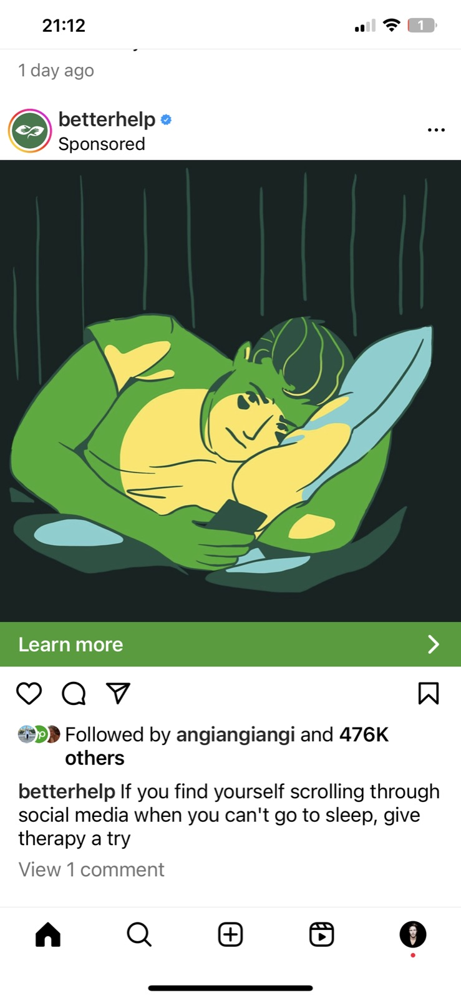

# Design Ethics and User Coercion

Everything you learn in this course, from Gestalt and colour to bias and fast thinking, is a way of influencing people. That power can make a product easier, calmer and fairer to use. It can also be used to push people into things they never meant to do. This lecture is about knowing the difference, and choosing the right side of it.

---

## Two pressures

Be aware of two things from your first day in the job.

One: your future employer will pay you to produce a great user experience, so that their customers **keep using their product**. Engagement, retention and conversion will be the numbers you're judged on.

Two: the people on the other side of the screen are human. Our brains respond to patterns, to rewards and to small hits of validation. Likes, streaks, notifications and infinite scroll are designed to keep us coming back, and those design decisions have real-world consequences.

When those two pressures meet, designers have to make choices.

---

## User coercion

**User coercion** means design tactics that manipulate or pressure people into actions that benefit the business more than the user. These are often called **deceptive patterns** (or "dark patterns"). Common ones include:

- **Forced continuity:** a free trial that quietly turns into a paid subscription, with no clear warning.
- **Hard to cancel (the "roach motel"):** easy to sign up, deliberately difficult to leave.
- **Hidden costs:** fees that only appear at the last step of checkout.
- **Confirmshaming:** guilt-tripping copy on the "no" button: "No thanks, I don't like saving money."
- **False urgency and scarcity:** fake countdowns and "only 2 left!" messages that aren't true.
- **Sneaking into the basket:** extras added to an order without asking.
- **Nagging:** asking again and again until people give in.

**Forced continuity** is particularly bad. Users are enrolled in a subscription after a free trial, often without clear notice, and then find the cancel option hidden behind cumbersome steps. It traps people into payments they never really agreed to, and it destroys trust.

---

## The cost: real people

Deceptive and addictive design isn't abstract. Common Sense Media's 2021 census found that children aged 8 to 12 in the US spent an average of **5 hours 33 minutes a day** on screen media for entertainment, up from 4 hours 44 minutes in 2019.

Heavy, compulsive phone use has been linked with poorer sleep, lower academic performance, higher anxiety and lower life satisfaction among young people. Designers didn't create every one of those problems, but our patterns are part of the system.

Data can be used against people too. In 2018, a whistleblower, Christopher Wylie, revealed that the political consultancy **Cambridge Analytica** had harvested data from millions of Facebook profiles without their consent and used it to target political advertising, including in the 2016 US presidential election. It's a reminder that what we collect about users is a responsibility, not just a resource. [Further reading – The Guardian](https://www.theguardian.com/uk-news/2018/mar/23/leaked-cambridge-analyticas-blueprint-for-trump-victory)

---

## Why companies get away with it (and increasingly don't)

Deceptive patterns work in the short term: they lift the numbers on a dashboard. But the law is catching up. In the EU, the **Digital Services Act** bans online platforms from designing their interfaces to deceive or manipulate users. In the US, the Federal Trade Commission sued Amazon in 2023 over how it enrolled people in Prime and made it hard to cancel; in September 2025 Amazon agreed to pay **$2.5 billion** to settle the case, and to make declining and cancelling Prime clear and simple.

Can you think of other coercive tactics used by tech companies?

---

## Designing ethically

You won't always control the business goals, but you do control the design. Ask these questions of every screen:

- **Would the user make the same choice if they fully understood it?**
- **Is saying no as easy as saying yes?** Cancelling as easy as signing up?
- **Is anything hidden, pre-ticked or deliberately confusing?**
- **Would I be comfortable if this design was explained on the news?**
- **Does this serve the user's interests, or only the metric?**

Dieter Rams put it in four words: **good design is honest**.

---

## Why it matters for UX

UX designers hold real power over people's attention, money and data. Deceptive patterns can lift short-term numbers, but they erode trust, harm vulnerable users and, increasingly, break the law. Designing honestly is part of the job, not an optional extra.

## Try it: an ethics audit (25 minutes)

1. Pick an app or website you use often, and try to cancel, unsubscribe or delete your account (stop before you actually do it).
2. Count the steps and screenshot every screen on the way.
3. Name every deceptive pattern you find, using the list in this lecture.
4. Redesign the flow so that leaving is as easy as joining, and present it in two minutes.

## Media

[https://www.youtube.com/watch?v=lJUW0iZzAaQ](https://www.youtube.com/watch?v=lJUW0iZzAaQ)

[https://www.youtube.com/watch?v=kxkrdLI6e6M](https://www.youtube.com/watch?v=kxkrdLI6e6M)

## Resources

[Deceptive Patterns – types and examples](https://www.deceptive.design/)

[Deceptive Patterns in UX – Nielsen Norman Group](https://www.nngroup.com/articles/deceptive-patterns/)

[Center for Humane Technology](https://humanetech.com/)

## Key takeaways

- Every design technique can help or manipulate; ethics is choosing to help.
- Learn to name deceptive patterns: forced continuity, hard to cancel, hidden costs, confirmshaming, false urgency.
- Make saying no as easy as saying yes. Good design is honest.
