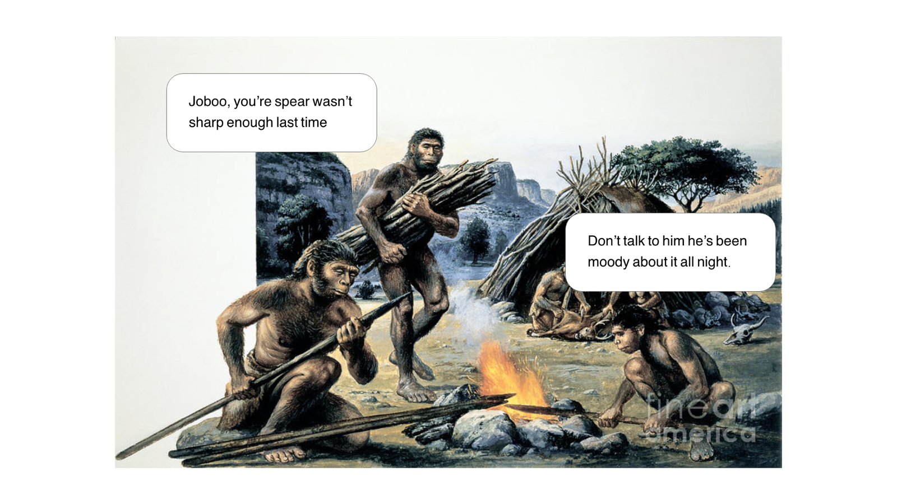
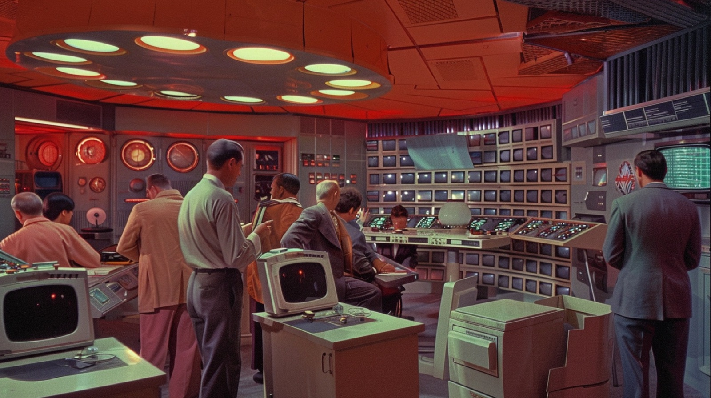
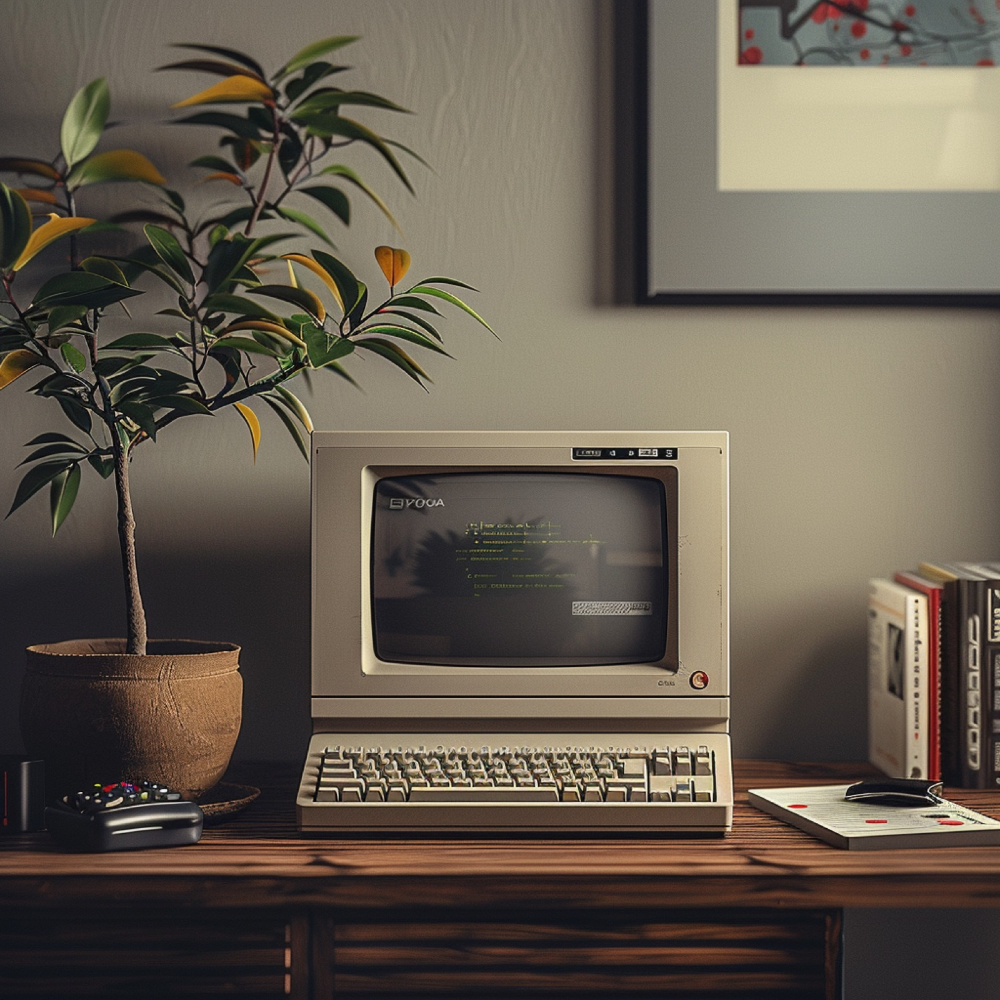
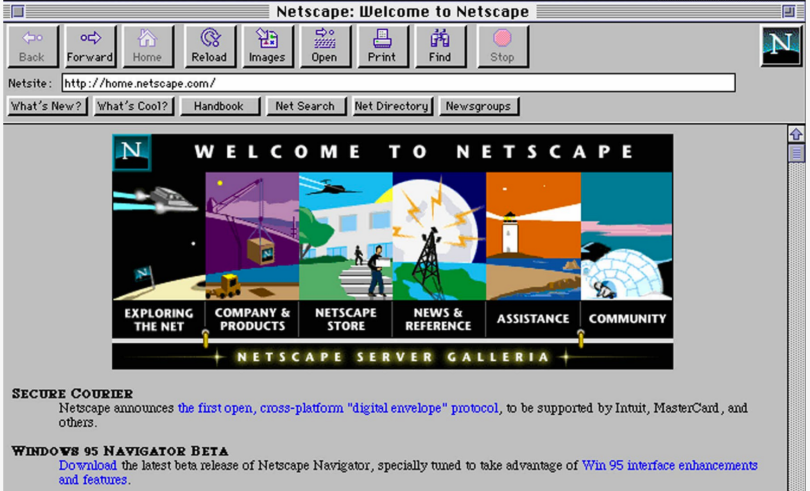
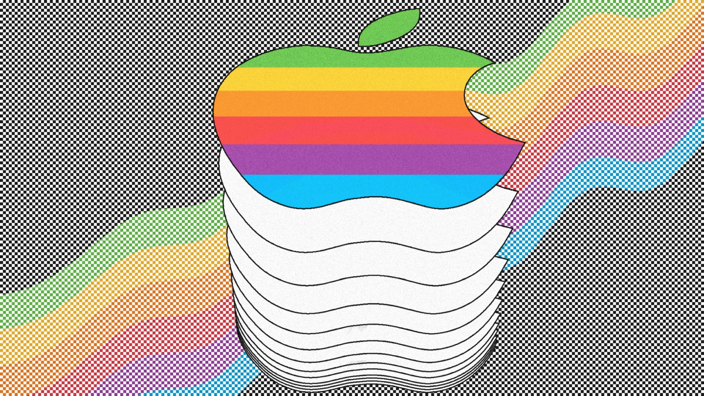
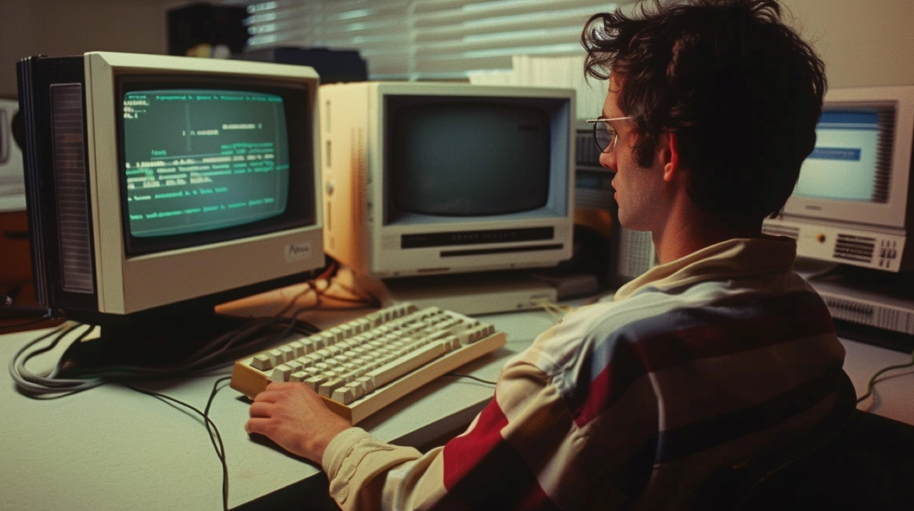
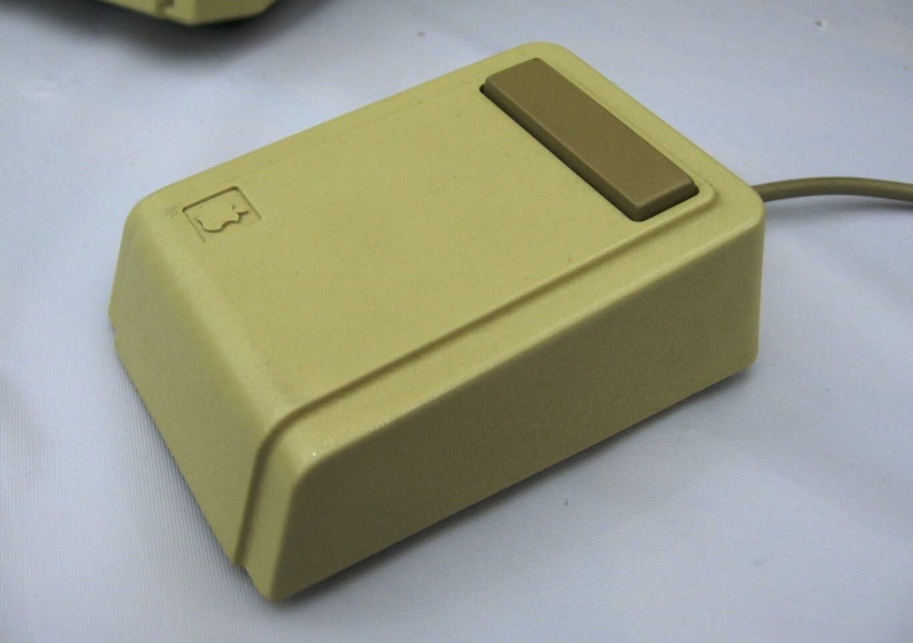
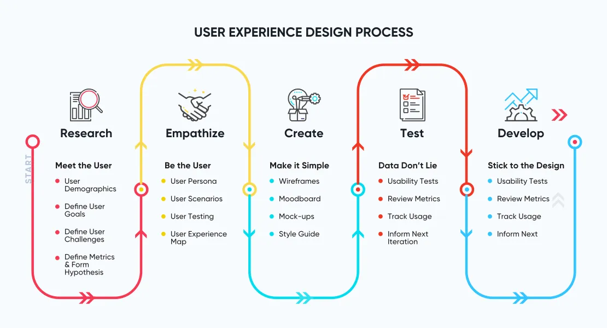

# Design Origins

## Origins of UX and The Birth of The Internet.

UX is often described as a set of methods that make software easy, accessible and enjoyable to use. But user experience is much older than software. It's as old as the first tool: every object people have ever made gives someone an experience, good or bad.

This lecture tells that story, from the first tools to the birth of the internet and the moment "user experience" became a job.

All design is user experience design. The only question is whether it's a good experience or a bad one. And the best design has always come from necessity: from a real problem that needed solving, not from making things for the sake of it. That matters more than ever now that AI makes it easy to create endlessly.

---

## The first designer

Good UX design is a story, so let's tell one. The very first UX designers were our distant ancestors: the oldest stone tools ever found are around 3.3 million years old. Imagine one of those early humans with a problem. They want to hunt a deer. They can't, not with bare hands. They need a tool, so they start sharpening a stone to make the tip of a spear.

Our designer now has to balance three requirements for the tip of the spear:

- Stone has to be **sharp enough**
- Stone has to be **light enough to carry**
- Stone to be **strong enough**

---

This is essential. Without these three properties. The spear would not work. These translate naturally into three properties which we still use today:

- Functionality - What it does.
- Accessibility - Where it is done.
- Consistency - How often it can be done.

---

Our ancient relative must have engaged in some **advanced thinking and planning** to make that spear! Moreover, because hafted spears are found so widely across the Middle Palaeolithic, archaeologists believe their makers must have shared knowledge and talked to each other. Imagine the first attempt didn't work: the spear lacked functionality, and the family is giving feedback our designer finds hard to accept. You, on the other hand, must learn to take design critique well. 

---

## Ancient Greece

Let's march on. User experience has always been linked to human creation. Let's move forward to the 5th century BC to Greek antiquity. Here human creation joins art and science to better produce the user experience of the Greek amphitheaters. 

---

The design was so that no matter where in the auditorium you were seated, you would hear the voice of the actor equally. We can just imagine what types of conversations the architects must have had with each other when considering the user and the construction of the these ancient monuments of technology. These guys really must have empathised with the audience and must have sat in their shoes many times. You must do the same.

---

---

## Byzantine Art

Consistency is key. Beauty is in the eye of the beholder. Let's visit the eastern world for a moment to visit the intense gorgeous visualisation of the Byzantine empire. What we see here is the emergence of a thematic and visual preoccupation. With intense mosaics on tile, decorative golds and stylized perceptions, we see a drift away from natural form into a world within a world, in your work, you will create a realm all of its own. A system which speaks for itself. An entire system. A design system, with its own style entirely. Envisage an entire ecosystem with an ecosystem. A world within a world. 

Stylised as if the Eye of God was peering down from Elysium upon creation. 

---

## Middle Ages

Let's switch it up to Germany during the middle ages in 1510. We’ll open this up and start talking technology from here. A locksmith by the name of Peter Henlein is woken up out of his sleep.

He has just dreamt up a brand new way of experiencing reading the time.

Using hammer and anvil, he wields into existence the first ever pocket watch. Good UX is always preoccupied with the experience of something and UX Designers are very clued into when a customer requires their product. So too must you. 

---

## Industrial Revolution

Let's shift forward to 1829 in North America. Whilst the United States was experiencing the opening acts of the Industrial Revolution, William Burt, an American inventor, patented the first ever typewriter which he called a ‘typographer’. It’s helpful here to accept that engineering is a large part of what UX Designers indirectly are responsible for and it’s important you develop your engineering abilities. Being competent at Information Architecture is a must. 

The modern era saw the rise of technologies such as reproductive technology, the television, man-made satellites, rockets, personal computers and many more. However, there is a specific event that triggered significant technological advancement and one which will become the focal point of our time here on the course.

---

## Birth of the Internet

Although the first internet (or intranet) was invented in the 1960's in the form of a peer to peer file sharing network used by government departments in the United States, it wasn't until January 1, 1983 that we actually saw the rise of what we understand today as the global internet.

---

Consecutively, the birth of the internet was accompanied with the rise of the personal computer. around 1984. In the early days of the internet, there was no major emphasis put on the user because during this time, it was mostly engineers and technicians that were the users. What changed the world was the consecutive advent of the personal computer because now the computer was for everyone. 

Below is an image of the one of the first landing pages belonging the Internet Service Provider, Netscape in 1994. These early web pioneers didn’t really give much consideration to the User Experience. Whilst there was some basic styling, there was no css and the page rendered out in plain html (hyper text mark up language) and was accessible over 56k dial up connection.

It's at this point in the mid nineties, when the internet was gaining popularity, the conversation really begins around user experience.

In 1993, an engineer at Apple, Don Norman is given the job title, ‘user experience architect’. This was the first time that the phrase user experience was featured in a job description. 

Don Norman established a small, high-level group, called the ‘user experience architect's office’, which worked across the company to make Apple products **easier to use**. Today he is considered by many to be the father of UX. Let's stick with 1994 and California.

---

After spending Labor Day weekend at home writing code on his personal computer a young engineer by the name of Pierre Omidyar launches a website called AuctionWeb. 

It's a site dedicated to bringing buyers and sellers together in an open and honest marketplace. The name would later be changed to eBay and the geeky kid would be worth $21.8 billion.

Same year, A young Stanford graduate by the name of Jim Yurchenco has just joined a brand new Palo Alto design firm called IDEO.

---

Fresh out of Apple, where he helped design the original mouse, Jim would would go on to join an illustrious group of design pioneers such as David Kelley and Tim Brown with some brand new approaches to product strategy which has in essence shaped the future that we, as UX designers live in today.

It’s a new five staged methodology called Design Thinking.

And really to be perfectly honest with you, this is where the technology industry is today, in a period which began around the mid nineties, with massive technology companies like Apple, Ebay, Facebook and design companies like IDEO, who focus on great design and user experience and it’s been something of an explosion and real recognition of user needs ever since. 

Now UX is formalised and transformed into a major part of technology development. Designers and developers work in totally specialised fields of technology which has been highly specialised and diversified into specific departments.

---

## Why it matters for UX

Knowing where UX comes from shows you that it is not a fashion or a job title but the oldest kind of design: making tools that fit people. The same three questions the first toolmakers faced, functionality, accessibility and consistency, are the ones you will ask of every screen you design.

## Try it: the history of one object (20 minutes)

1. Pick an everyday object, such as a chair, a phone or a pair of scissors.
2. Find two earlier versions of it (an image search is fine).
3. For each version, write what problem it solved better than the one before.
4. Rate each version for functionality, accessibility and consistency, and share the object's story with a classmate in two minutes.

## Media

[https://www.youtube.com/watch?v=zKK1I2n53pk](https://www.youtube.com/watch?v=zKK1I2n53pk)

## Resources

[A 100-Year View of User Experience – Nielsen Norman Group](https://www.nngroup.com/articles/100-years-ux/)

[What is User Experience (UX) Design? – Interaction Design Foundation](https://www.interaction-design.org/literature/topics/ux-design)

## Key takeaways

- All design is user experience design; it is just a good or a bad experience.
- Functionality, accessibility and consistency have shaped tools since the first spear.
- UX became a profession with personal computers and the web, and the term with Don Norman at Apple in 1993.
