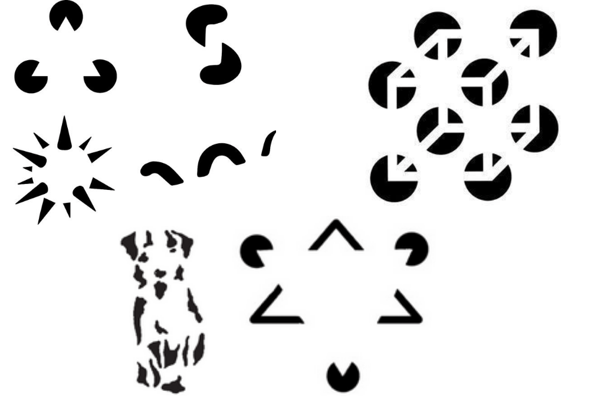
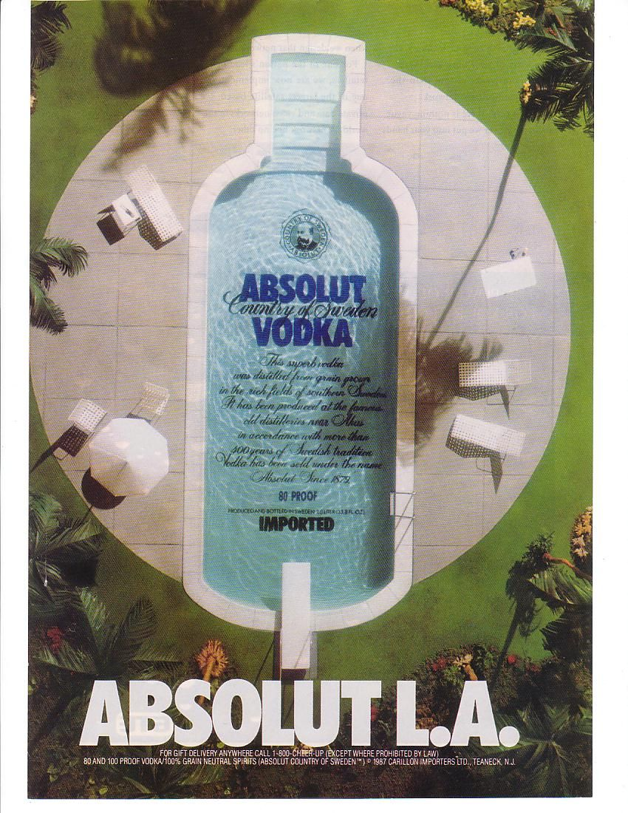
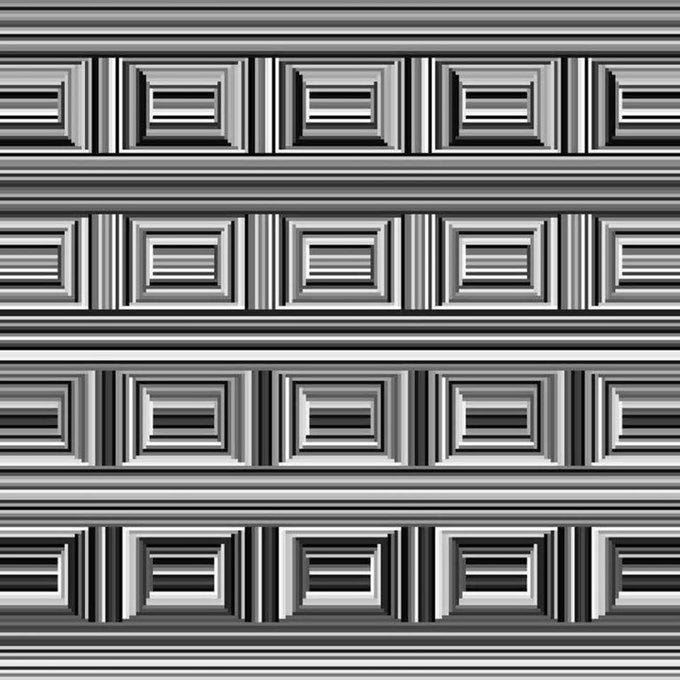
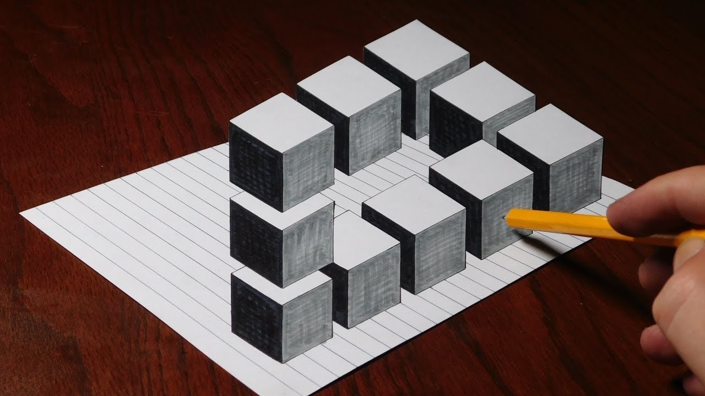
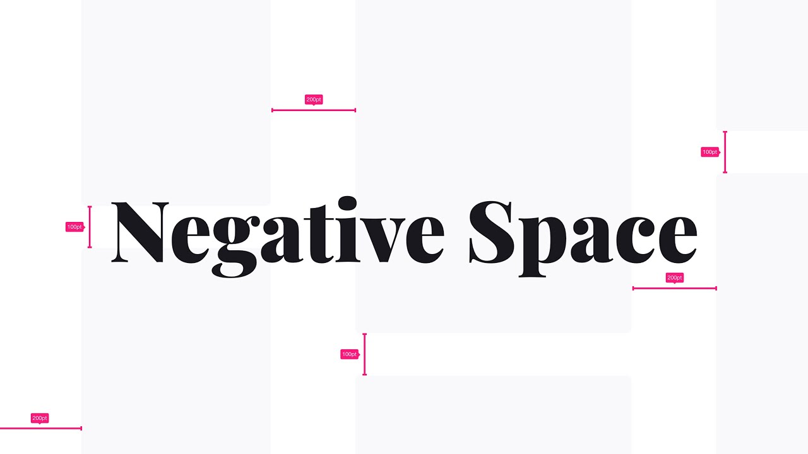
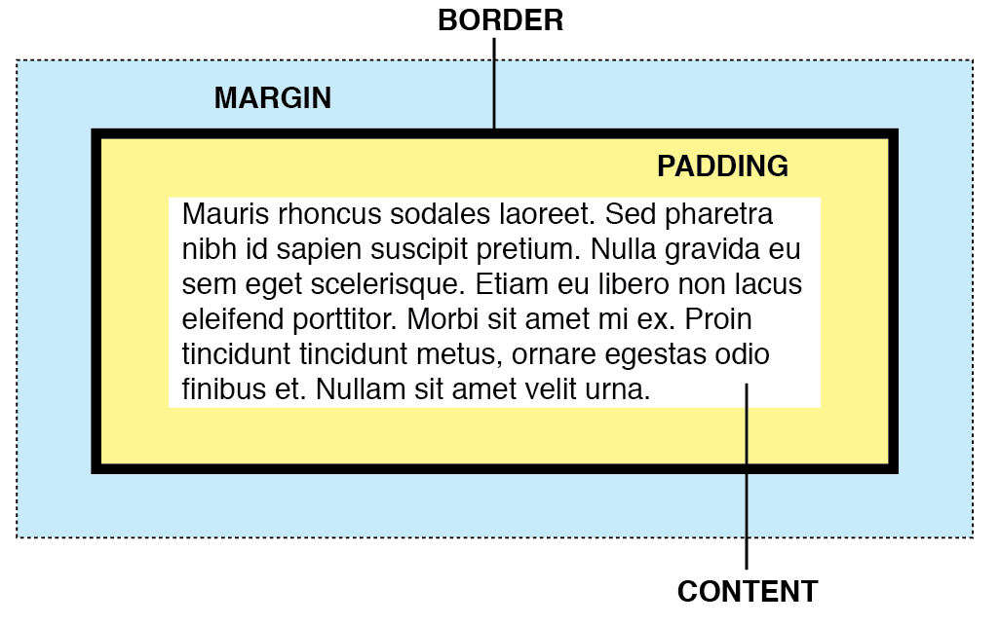
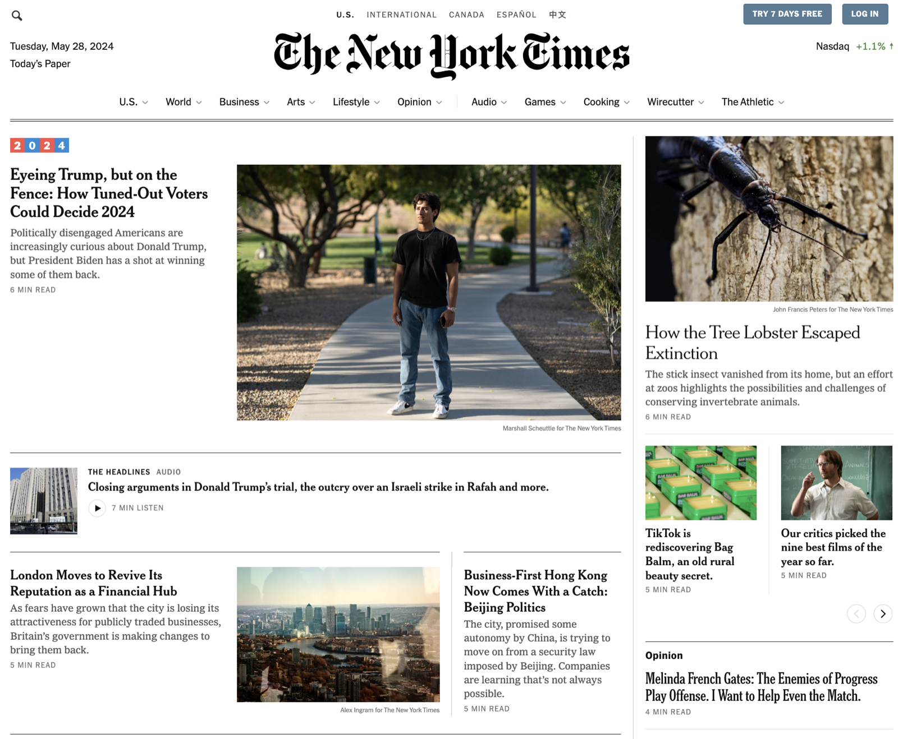

# Gestalt and Perception

How the brain turns shapes, space and contrast into meaning, and how to design with it. Colour, type and brand are covered in [Emotional Design](emotional-design.html).

## Gestalt Psychology

Gestalt psychology began in Germany in the early 1910s with **Max Wertheimer**, working with Wolfgang Köhler and Kurt Koffka. Wertheimer was fascinated by visual perception: why we see movement in a series of still images, and why we see shapes and groups where there are only separate marks.

---

Their central idea is that the human brain is wired to see order and patterns in what would otherwise be chaos, because it helps us make sense of the world. We see the whole before the parts.

---

*Gestalt* is German for "shape" or "form". Gestalt psychology is the theory that people naturally organise visual elements into unified wholes. Its principles became the bedrock of the Laws of UX:

- **Proximity:** things close together seem to belong together.
- **Similarity:** things that look alike seem related.
- **Closure:** we complete incomplete shapes in our minds.
- **Continuity:** we follow lines and curves in the smoothest direction.
- **Common region:** things inside a shared boundary seem grouped.
- **Figure and ground:** we separate an object (the figure) from its background (the ground).

[https://www.youtube.com/watch?v=G-xD1bDoNl4](https://www.youtube.com/watch?v=G-xD1bDoNl4)

---

You must also accept that people perceive and interpret visual information differently based on their backgrounds, experiences, and cognitive styles. In the below image, do you see circles or squares?

---

## Depth and Shadow

In UI design we borrow the laws of perception from the natural world to create depth, mainly with contrast, shadow and gradient. A shadow tells the brain that a card sits above the page, so it must be something you can pick up or press.

Above, Google's Material Design team experiments with lighting to find the right shadows for Google's icons. Small changes in perception change how users understand, and feel about, a product.

---

---

## Negative Space

Negative space, also known as white space, is figure and ground at work. It means the empty areas in a design. It surrounds and defines the main elements, enhancing visual clarity, balance, and focus, ultimately contributing to a cleaner and more effective composition.

---

In Chanel No. 5 advertisements, the use of negative space is exemplified by placing the perfume bottle centrally in the frame against a minimalist background. This approach highlights the bottle, drawing the viewer's attention directly to the product, and conveying elegance and luxury through simplicity. 

All copy and content should have negative space surrounding it at all times. This allows your design to breathe and gives a feeling of space. allowing viewers to focus on one element at a time. 

---

---

Negative space is as important to your design as positive space. 

Less is more. 

---

---

## Visual Hierarchy
Visual hierarchy is the arrangement of design elements to guide the viewer's eye and emphasize the most important information first. It uses size, colour, contrast, alignment and spacing, and the Gestalt principles, to create a sense of order and priority.

On the New York Times website, visual hierarchy is used effectively to guide readers through the content. Headlines are large and bold, attracting immediate attention, followed by subheadings, images, and body text in descending order of prominence.

---

## Why it matters for UX

People don't read interfaces, they perceive them. Gestalt principles, depth, white space and hierarchy decide what users see first and what they think belongs together, long before they read a word. Use them deliberately and your layouts explain themselves.

## Try it: a perception audit (20 minutes)

1. Take a screenshot of the home screen of an app you use every day.
2. Draw boxes around every group you see, and label which Gestalt principle makes it a group (proximity, similarity, common region or closure).
3. Number the first five things your eye lands on. Is that the order the designer intended?
4. Find one place where the grouping or hierarchy misleads you, and sketch a fix.

## Media

[https://www.youtube.com/watch?v=DwR0SZTBMTU](https://www.youtube.com/watch?v=DwR0SZTBMTU)

[https://www.youtube.com/watch?v=lpmRwGqEb0c](https://www.youtube.com/watch?v=lpmRwGqEb0c)

## Resources

[Proximity Principle in Visual Design – Nielsen Norman Group](https://www.nngroup.com/articles/gestalt-proximity/)

[Visual Hierarchy in UX: Definition – Nielsen Norman Group](https://www.nngroup.com/articles/visual-hierarchy-ux-definition/)

## Key takeaways

- Gestalt principles describe how the brain groups what it sees; use them to group related elements.
- Depth, negative space and visual hierarchy decide what users notice first.
- People see the whole before the parts: design the whole, then check every part.
