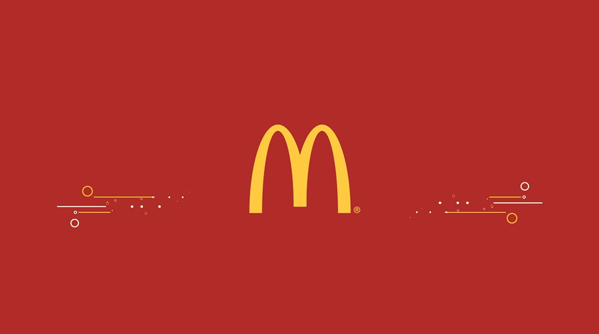
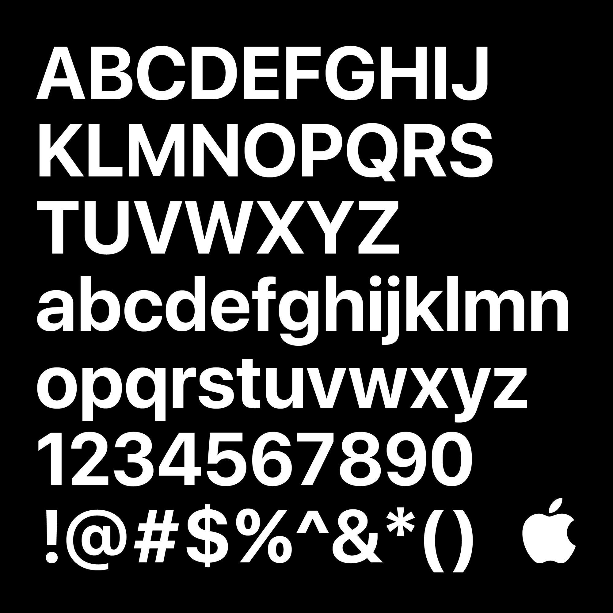
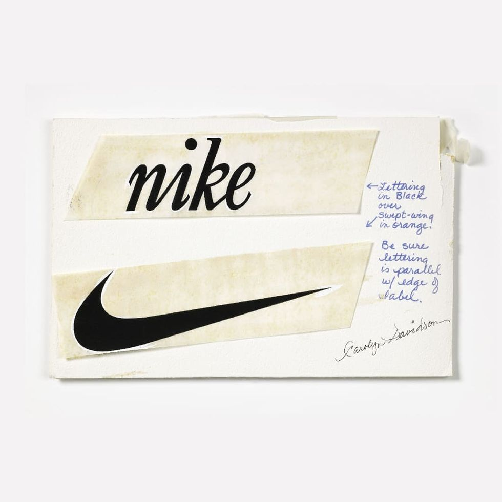

# Gestalt and Perception

## Gestalt Psychology

Let’s begin in 1903 with a young psychology student called Max Wertheimer who is very busy writing his pHD at the University of Würzburg, the subject of which is visual perception.

---

He begins to notice and postulate that the human brain is hard wired to see logic and patterns in otherwise what would be chaos because it helps us make sense of the world around us.

---

His postulations would go on to become known as Gestalt psychology: The theory of perception emphasizing that humans naturally organise visual elements into unified wholes. It focuses on principles like similarity, proximity, closure, and continuity to explain how we perceive complex patterns rather than just individual components and his work has become the bedrock of the Laws of UX. 

[https://www.youtube.com/watch?v=G-xD1bDoNl4](https://www.youtube.com/watch?v=G-xD1bDoNl4)

---

You must also accept that people perceive and interpret visual information differently based on their backgrounds, experiences, and cognitive styles. In the below image, do you see circles or squares?

---

## Perception Manipulation
It is the case that in UI design, we bend the laws of perception to mimic the natural world and primarily utilise contrast, shadow and gradient to do so. 

The above is a still image Google’s Material Design team as they played with different lighting arrangements to create the optimum shadow for Google icons.  Designers must be acutely aware of the sensitivity of perception because it deeply influences how users feel when they experience a product. 

---

---

## Negative Space

Negative space, also known as white space, is the empty or unused areas in a design. It surrounds and defines the main elements, enhancing visual clarity, balance, and focus, ultimately contributing to a cleaner and more effective composition.

---

In Chanel No. 5 advertisements, the use of negative space is exemplified by placing the perfume bottle centrally in the frame against a minimalist background. This approach highlights the bottle, drawing the viewer's attention directly to the product, and conveying elegance and luxury through simplicity. 

All copy and content should have negative space surrounding it at all times. This allows your design to breath and gives a feeling of space. allowing viewers to focus on one element at a time. 

---

---

Negative space is as important to your design as positive space. 

Less is more. 

---

## Color
Color psychology examines how different colors influence human emotions, behaviors, and perceptions. Each color can evoke specific responses; for example, red can stimulate excitement or urgency, while blue often promotes calmness and trust. Understanding these associations helps designers create effective and emotionally resonant visuals. 

McDonalds, for example, use red and yellow extensively in their branding. Red is known to stimulate appetite and create a sense of urgency, while yellow evokes feelings of happiness and friendliness. This color combination encourages quick decisions and positive feelings towards the brand, contributing to the high foot traffic and quick turnover rate typical of fast-food restaurants.

---

## Typography
Typography is the art and technique of arranging type to make written language legible, readable, and visually appealing. It encompasses font selection, point size, line length, spacing, and alignment. Effective typography ensures clear communication and can significantly impact the mood and tone of a design. Different fonts convey different emotions; for instance, serif fonts often suggest tradition and reliability, while sans-serif fonts appear modern and clean. Good typography enhances user experience by improving readability and establishing a visual hierarchy in the text.

---

Apple’s use of the San Francisco typeface across its products and marketing materials is a prime example of effective typography. The sans-serif font is clean, modern, and highly legible, aligning with Apple's brand identity of innovation, simplicity, and sophistication. The consistent use of San Francisco enhances the user experience by maintaining readability across different devices and sizes, reinforcing Apple's cohesive brand image.

---

## Visual Hierarchy
As discussed previously, Visual hierarchy is the arrangement of design elements to guide the viewer's eye and emphasize the most important information first. It uses size, color, contrast, alignment, and spacing to create a sense of order and priority. 

On the New York Times website, visual hierarchy is used effectively to guide readers through the content. Headlines are bold and large, attracting immediate attention, followed by subheadings, images, and body text in descending order of prominence. 

---

## Branding and Identity
Branding and identity involve creating a distinct image and personality for a company or product through design elements such as logos, colors, typography, and messaging. A strong brand identity fosters recognition, builds trust, and creates emotional connections with the audience. 

Nike’s "swoosh" logo and the slogan "Just Do It" are powerful elements of its brand identity. The swoosh symbolizes movement and speed, aligning with Nike’s emphasis on athletic performance. The consistent use of this logo, along with a bold, motivational tagline, creates a strong, recognizable brand that resonates with consumers on an emotional level. 

---

## User Coercion

User coercion in design refers to tactics that manipulate or pressure users into taking specific actions, often benefiting the designer or organization more than the user. These can include deceptive patterns like hidden fees, forced continuity, or misleading user interfaces, ultimately undermining user trust and autonomy.

[https://www.instagram.com/p/CyEpc-fP6Eq/](https://www.instagram.com/p/CyEpc-fP6Eq/)

---

Perception is a fundamental trick that we regularly twist and manipulate to create impactful design but being said, I think you should be aware of two thing at this stage. One, your future employer will pay you to produce great user experience so that their customer will keep using their product. 

---

Secondly, you should be aware of ethics. The human brain becomes sickened by patterns, addicted to micro-interactions, dopamine levels can spike with likes and validations. Serotonin levels overload the brain with design practices like infinite scroll on social media feeds. These design decisions have real world consequences. 

---

## Coercive Design

Did you know that the New York Times wrote an article last year stating that the average screen time on social media for ages 8-12 in the US went up from 4.4 hours in 2022 to 5.3 hrs in 2023. 

Thats the ugly side of beauty. 

---

The particularly bad type of user coercion is **forced continuity**. This occurs when users are automatically enrolled in a subscription service after a free trial, often without clear notice or consent. Companies may make it difficult to cancel the subscription, hiding cancellation options or requiring cumbersome steps, thereby trapping users into ongoing payments they did not explicitly agree to. This practice exploits users' trust and can lead to financial loss and significant frustration.

---

Can you think of other corecive tactics employed by tech companies?

Here may be why they can get away with it

---

 

## Fast and Slow Thinking

Let’s finish and talk about another another psychologist, Daniel Kahneman who in 2002 was awarded a Nobel prize by the Royal Swedish Academy of Sciences for discovering a new field of science called Behavioural Economics. 

His primal finding was that market forces, (people buying stuff) behave without fundamental logic, in summary, they behave irrationally. The don't behave in a rational sense. That's because human beings don't actually make rational logical decisions. This was proven by years and years and years of rigorous testing which resulted in the understanding that in each of our minds, we have two modes of thinking. System 1 and System 2. This is how Kahneman frames his conclusions. Fast thinking operates automatically and is responsible for memory recall. This is where our imagination is from.

---

1. Complete the phrase: Bread and ...
2. What's 2 + 2 = ?
3. Tell the first letter of the word 'Bing'

Slow thinking allocates attention to effortful mental activities that require it. this includes complex computations and sophisticated problem solving techniques.

---

1. What is 17 x 24 = ?
2. Tell me about the last time you heard a surprising sound
3. Tell me how many i's are in the word, indivisibilities

Why Kahneman is really useful for UX designers is that he's basically given us the manual on how people make decisions. For the most part they make decisions based on imagination. Let's talk about what imagination is? Let's think of some words associated with imagination. Let's run some tests for ourselves!

---

1. [Presentation on Judgement](https://xd.adobe.com/view/709c742f-081c-44f7-9a65-2a9a233b116e-25cf/?fullscreen)
2. [Personality test](https://xd.adobe.com/view/01087389-edda-4564-83a5-319e76d1c6e9-545b/?fullscreen)

In summary, the core of Kahneman's study on behavioural economics stipulates that System 1 is quick, imaginative, playful, responsible for memory recall and actually kind of fun to do. It is however susceptible to bias and system error. System 2, Slow Thinking is arduous, anxiety inducing, prone to cognitive overload and often downright painful but it's accurate. This tells us two things, one, we shouldn’t try to make the users think, make it fun! and two, we should not make any assumptions. 

---

The entire notion behind Fast and Slow thinking and why it correlates to UX is because a lot of what we do is try and remove the cognitive load from the user. Essentially, we make it as fun and simple as possible for the user and this means everything we do should be geared around getting the user to make emotional decisions. 

It also means that we as designers should never rush into Figma but rather slow the entire process down to produce data influenced accurate results rather than things that we think just look good. 

---

It also means that we should build ethically because the negative impacts of mobile phone addiction are real and has direct correlations from as discussed hyper addiction for kids to lower academic performance in high school, increased anxiety levels amongst teenagers, and reduced satisfaction with life among young people in general.

---

## Why it matters for UX

People don't read interfaces, they perceive them. Gestalt principles, contrast, colour and hierarchy decide what users see first and what they think belongs together, long before they read a word. Use them deliberately, and ethically, and your layouts explain themselves.

## Try it: a perception audit (20 minutes)

1. Take a screenshot of the home screen of an app you use every day.
2. Draw boxes around every group you see, and label which Gestalt principle makes it a group (proximity, similarity, common region or closure).
3. Number the first five things your eye lands on. Is that the order the designer intended?
4. Find one element that pushes you to act against your interest (coercive design) and describe how you would make it honest.

## Media

[https://www.youtube.com/watch?v=DwR0SZTBMTU](https://www.youtube.com/watch?v=DwR0SZTBMTU)

## Resources

[Proximity Principle in Visual Design – Nielsen Norman Group](https://www.nngroup.com/articles/gestalt-proximity/)

[Visual Hierarchy in UX: Definition – Nielsen Norman Group](https://www.nngroup.com/articles/visual-hierarchy-ux-definition/)

## Key takeaways

- Gestalt principles describe how the brain groups what it sees; use them to group related elements.
- Colour, type, negative space and hierarchy decide what users notice first.
- Perception can be used to coerce; design for people's real interests, not just engagement.
