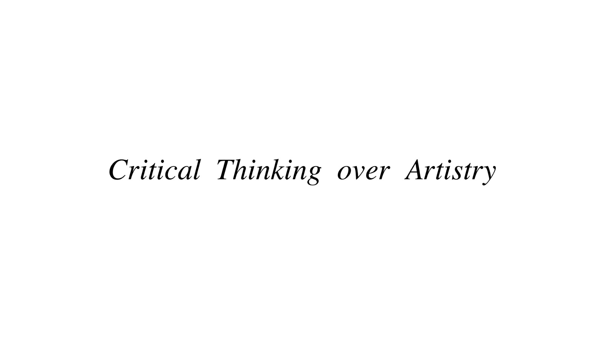
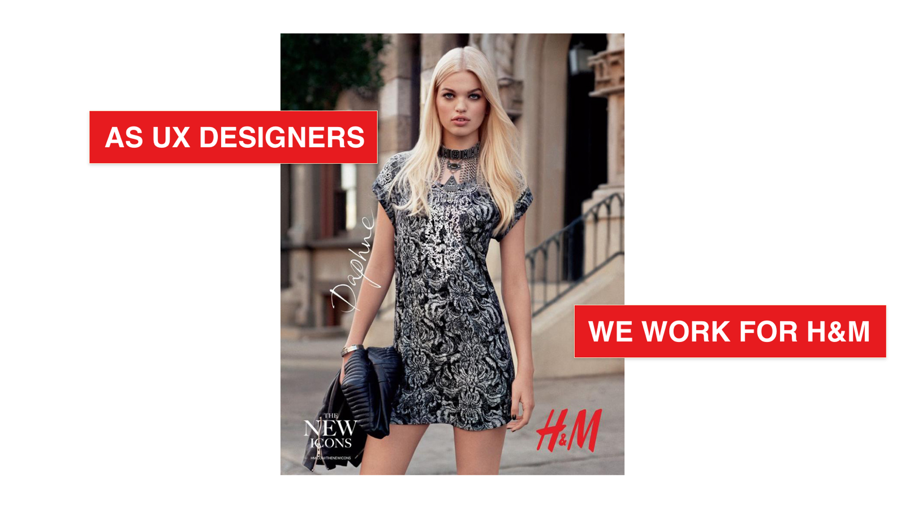
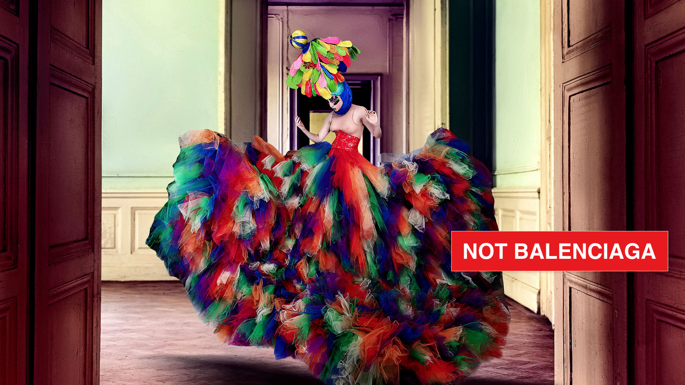
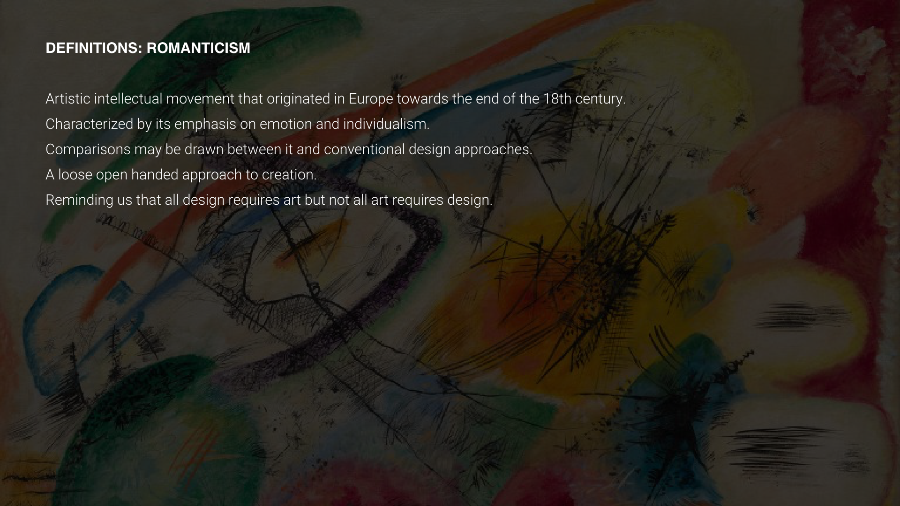
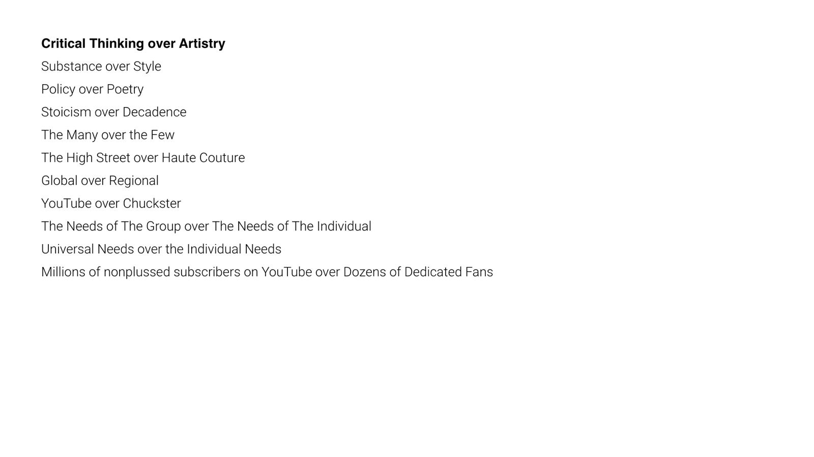

# Critical Thinking over Artistry

All design requires art, but not all art is design. This lecture is about the difference, and why, as a UX designer, you work for the many, not the few.

---

## We work for H&M, not Balenciaga

A couture gown can be breathtaking, impractical and made for one person. A high-street shirt has to fit millions of different bodies, survive the wash and sell at a price people can pay.

UX design is the high street. Your work has to make sense to people who are not you, who are in a hurry, and who will never read your design rationale. That means choosing clarity over self-expression, and evidence over taste.

---

## Two traditions: Classicism and Romanticism

Art history gives us a useful way to see the difference.

**Classicism** draws on ancient Greek and Roman principles: form, simplicity, proportion, clarity of structure and restrained emotion, with an appeal to the intellect.

It values recognised standards of form and craftsmanship, and it shares with design thinking a preoccupation with structure and strategy.

**Romanticism**, and later abstract art, puts emotion, imagination and the individual first. Kandinsky's abstract work uses shape, colour and line almost independently of the visible world.

Both are valuable. But a design system, a checkout or a hospital app needs the discipline of the first more than the freedom of the second.

---

## Critical thinking over artistry

In practice, that means choosing:

- **Substance** over style
- **Critical thinking** over assumptions and "experience"
- **The many** over the few
- **Universal needs** over individual taste
- **Form that follows function**: still beautiful, but never decadent

Tolkien preferred **applicability**, which lives in the freedom of the reader, to allegory, which lives in the purposed domination of the author. Good UX works the same way: the user, not the designer, decides what the product means to them.

---

## Why it matters for UX

Great visual craft matters, but a UX designer's first job is to solve a problem for many people, not to express a personal style. Thinking critically, backing decisions with evidence and designing for the many is what makes your work useful, and it's what employers hire UX designers for.

## Try it: H&M or Balenciaga? (15 minutes)

1. Find two apps or websites in the same category, one that feels "artistic" and one that feels "high street" (for example, a fashion label's site and a big retailer's).
2. Try the same task on both, such as finding a product and adding it to the basket.
3. List where the artistic one put expression before usability, and where the high-street one put usability before expression.
4. Decide which approach suits your current project, and write one sentence on why.

## Media

[https://www.youtube.com/watch?v=dZmkPmfW0XA](https://www.youtube.com/watch?v=dZmkPmfW0XA)

## Resources

[Classicism – Wikipedia](https://en.wikipedia.org/wiki/Classicism)

[Romanticism – Wikipedia](https://en.wikipedia.org/wiki/Romanticism)

## Key takeaways

- All design requires art, but not all art is design.
- UX designers design for the many: clarity and evidence come before personal style.
- Think critically: substance over style, form following function, beautiful but not decadent.
