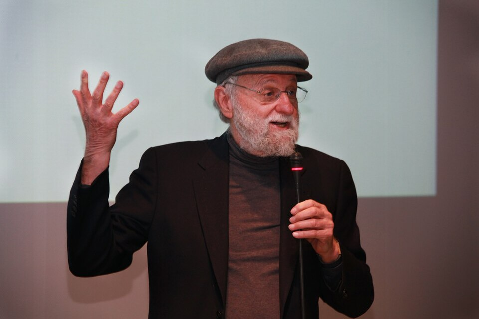

# Key Figures: Don Norman

> The cognitive scientist who popularised user experience and human-centred design.

*Photo: CC BY-SA 2.0, via Wikimedia Commons*

| | |
| --- | --- |
| **Born** | 25 December 1935, USA |
| **Field** | Cognitive science, design |
| **Known for** | Coining "user experience"; affordances and signifiers; human-centred design |
| **Key work** | *The Design of Everyday Things* (1988) |

## Who they are

Norman is an American cognitive scientist and designer. In the 1990s he joined Apple with the job title User Experience Architect, the first time "user experience" was used in a job title, and in 1998 he co-founded the Nielsen Norman Group with Jakob Nielsen.

## Key contributions

- **User experience:** he coined the term to cover every part of a person's experience with a product, not just the interface.
- **Affordances and signifiers:** what an object lets you do, and the cues that tell you how.
- **Human-centred design:** start from people's needs and abilities, and blame bad design, not users, for errors.

## Why it matters for UX

Norman gave UX its name and much of its vocabulary. When a door has a handle that you pull but it needs a push (a "Norman door"), you are seeing his ideas in action. *The Design of Everyday Things* remains essential reading.
