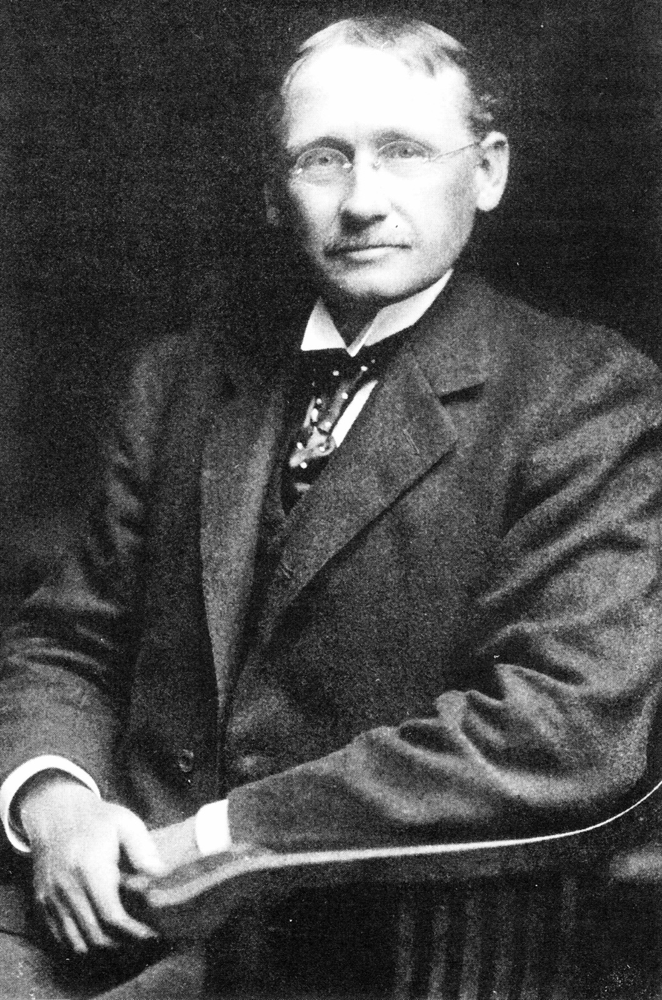

# Key Figures: Frederick Winslow Taylor

> The father of scientific management, who first studied work by measuring it.

| | |
| --- | --- |
| **Born** | 20 March 1856, Philadelphia, USA (died 1915) |
| **Field** | Mechanical engineering, management |
| **Known for** | Scientific management, time studies |
| **Key work** | *The Principles of Scientific Management* (1911) |

## Who they are

Taylor was an American mechanical engineer and management consultant. He believed there was "one best way" to do any job, and that it could be found by observing and timing workers precisely, rather than relying on habit and rules of thumb.

## Key contributions

- **Time studies:** breaking a job into small steps and timing each one to find the most efficient method.
- **Standardisation:** standard tools, methods and working conditions for every task.
- **Separating planning from doing:** managers design the work; workers carry it out.

## Why it matters for UX

Taylor was the first to treat work as something you could study and redesign, and that thinking runs through task analysis and efficiency in UX today. He is also a warning: his methods often treated people like parts of a machine, ignoring their wellbeing. Human-centred design grew partly in reaction to that.
