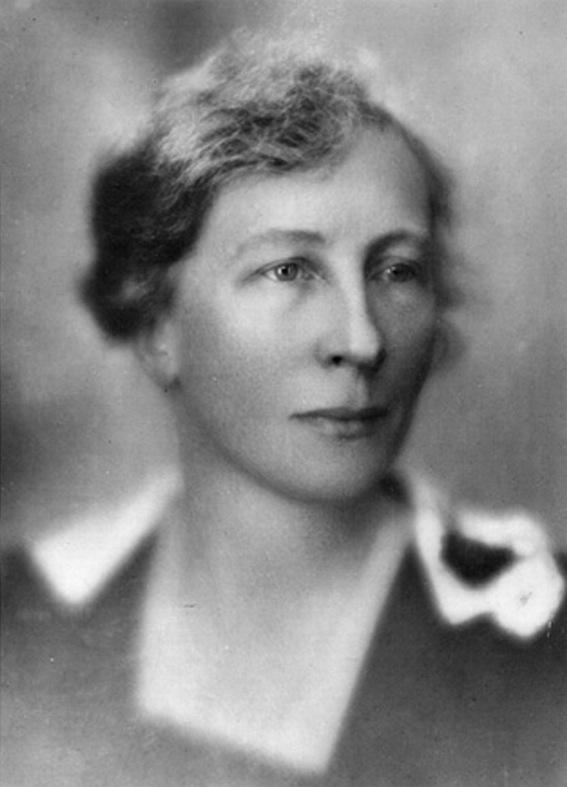

# Key Figures: Lillian Gilbreth

> The psychologist and engineer who put the human at the centre of efficiency.

*Photo: 1921, public domain, via Wikimedia Commons*

| | |
| --- | --- |
| **Born** | 24 May 1878, Oakland, California, USA (died 1972) |
| **Field** | Industrial psychology, industrial engineering |
| **Known for** | Motion study, human factors and ergonomic kitchen design |
| **Key work** | *The Psychology of Management* (1914) |

## Who they are

Lillian Gilbreth was an American psychologist and industrial engineer, and one of the first female engineers to earn a PhD. With her husband Frank Gilbreth she studied how people move when they work. After his death in 1924 she ran their consultancy herself, while raising their large family (their family life inspired the book *Cheaper by the Dozen*).

## Key contributions

- **Motion study:** filming and analysing workers' movements to remove unnecessary, tiring steps.
- **Psychology in management:** she argued that workers' wellbeing, fatigue and motivation matter, not just output. She is considered the first industrial and organisational psychologist.
- **Designing the home:** she applied motion study to kitchens, arranging them so everyday tasks took fewer steps.

## Why it matters for UX

Where Taylor timed the work, Gilbreth looked at the **person** doing it. Her focus on fatigue, comfort and the layout of real environments is an early form of ergonomics and human factors, the discipline UX grew out of. Every time you observe someone in their environment on a site visit, you are working in her tradition.
