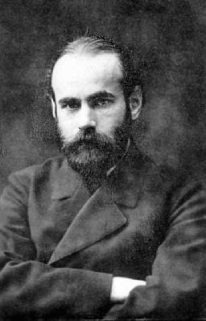

# Key Figures: Max Wertheimer

> A founder of Gestalt psychology, which explains how we see groups and patterns.

*Photo: public domain, via Wikimedia Commons*

| | |
| --- | --- |
| **Born** | 15 April 1880, Prague (died 1943) |
| **Field** | Psychology |
| **Known for** | Gestalt psychology and the principles of perceptual organisation |
| **Key work** | *Laws of Organization in Perceptual Forms* (1923) |

## Who they are

Wertheimer was a psychologist born in Prague who worked in Germany and, from 1933, in the United States. With Wolfgang Köhler and Kurt Koffka he founded **Gestalt psychology**, the idea that we perceive whole patterns, not separate parts: the whole is different from the sum of its parts.

## Key contributions

- **The phi phenomenon (1912):** his study of apparent motion, the illusion that makes a series of still images look like movement.
- **Principles of grouping:** proximity, similarity, continuity, closure and more: the rules our brains use to organise what we see.

## Why it matters for UX

The Gestalt principles are the foundation of layout and visual hierarchy. Grouping related items with spacing (proximity), styling items the same way to show they belong together (similarity) and aligning elements (continuity) all come from his work. See the Laws of UX lecture.
