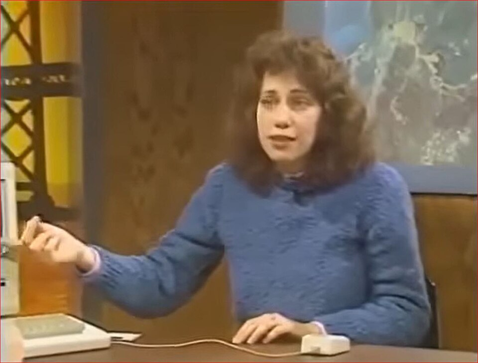

# Key Figures: Susan Kare

> The designer who gave the personal computer its friendly face.

*Photo: 1984, CC BY 3.0, via Wikimedia Commons*

| | |
| --- | --- |
| **Born** | 5 February 1954, Ithaca, New York, USA |
| **Field** | Graphic design, interface and icon design |
| **Known for** | The icons and typefaces of the original Apple Macintosh |
| **Key work** | Macintosh interface (1983–1986) |

## Who they are

Susan Kare is an American artist and graphic designer. With a background in fine art rather than computing, she joined Apple in the early 1980s and designed the icons and fonts of the first Macintosh, working on a grid of tiny pixels. She later became creative director at NeXT and has worked for Microsoft, IBM, Facebook, Pinterest and Niantic.

## Key contributions

- **Icons:** the Macintosh trash can, the happy Mac, the paintbrush and many more, each drawn in a few dozen pixels.
- **Typefaces:** Chicago and Geneva, among the first fonts designed for a screen.
- **Pixel art:** she showed that tiny, low-resolution images could be clear, friendly and full of personality.

## Why it matters for UX

Kare made computers feel approachable, using familiar metaphors (a trash can, a folder) so people could recognise what to do instead of remembering commands. Her work is a masterclass in clarity under tight constraints, and every icon set you design follows in her footsteps. See the Icons lecture.
