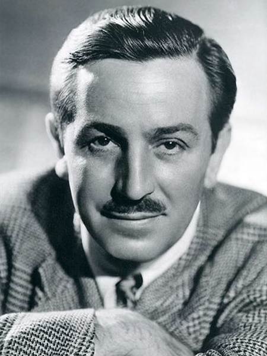

# Key Figures: Walt Disney

> The storyteller who designed entire experiences, not just films.

*Photo: 1946, public domain, via Wikimedia Commons*

| | |
| --- | --- |
| **Born** | 5 December 1901, Chicago, USA (died 1966) |
| **Field** | Animation, entertainment, experience design |
| **Known for** | Mickey Mouse, feature-length animation and Disneyland |
| **Key work** | *Steamboat Willie* (1928); Disneyland (1955) |

## Who they are

Disney was an American animator, film producer and entrepreneur. He co-founded what became the Walt Disney Company and, with Disneyland, created a place where every detail, from the paths to the staff's costumes, served one story.

## Key contributions

- **Storytelling:** every film, ride and space was designed around a story.
- **Attention to detail:** the smallest details were treated as part of the experience.
- **Designing the whole journey:** Disneyland was planned around how guests move, wait and feel, including hiding the "backstage" from view.

## Why it matters for UX

Disney thought like a service designer before the term existed. The idea of a front stage and a backstage, managing queues and emotions, and designing every touchpoint of a journey are exactly what you map in a journey map and a service blueprint.
