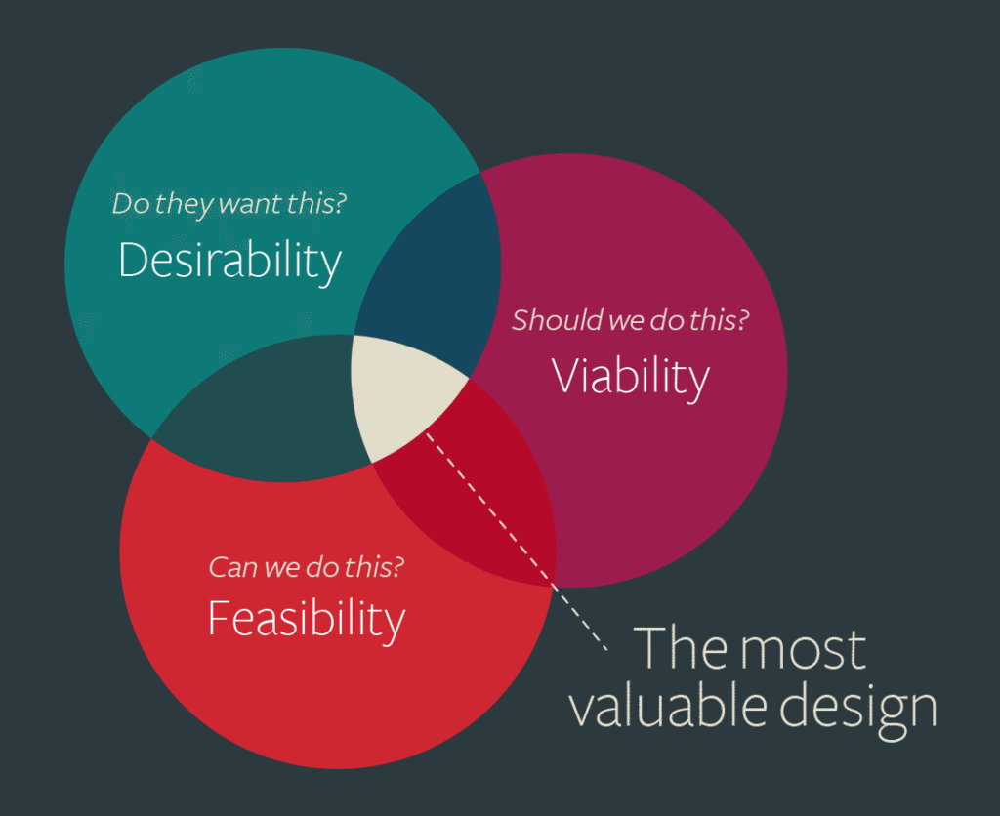

title: Key Figures
promise: Fifteen people whose ideas shaped user experience design, from the factory floor and psychology labs to games, computers and design thinking.
duration: 20 minutes
topics:
- The factory floor: Taylor, Ford, Gilbreth, Ohno
- The mind: Wertheimer and Kahneman
- Experiences and objects: Disney, Rams, Ive
- Screens and usability: Norman, Nielsen, Kare, Miyamoto, Laurel
- Design thinking: Tim Brown
---
@title
# Key Figures
The people whose ideas shaped UX.
---
@statement
UX didn't begin with apps.

It grew from engineers, psychologists, storytellers and designers who all asked one question: **how do people actually work, think and feel?**
---
@cards
## The factory floor

- **Frederick Winslow Taylor** Scientific management: time every step to find the "one best way" (1911)
- **Henry Ford** The Model T (1908) and the moving assembly line (1913)
- **Lillian Gilbreth** Motion study, with the worker's wellbeing at the centre
- **Taiichi Ohno** The Toyota Production System, Just-in-Time and the 5 Whys
---
@split
## Lillian Gilbreth

A psychologist and engineer, and one of the first women engineers to earn a PhD.

She argued that fatigue, motivation and wellbeing matter, not just output, and redesigned kitchens so everyday tasks took fewer steps.
---
@cards
## The mind

- **Max Wertheimer** A founder of Gestalt psychology: we see wholes, not separate parts
- **Daniel Kahneman** Heuristics, biases and System 1 and 2. Nobel Prize, 2002
---
@section
## Experiences and objects
Designing the whole thing.
---
@split
## Walt Disney

The storyteller who designed **entire experiences**, not just films.

Disneyland (1955) was planned around how guests move, wait and feel, with the "backstage" hidden from view.
---
@split
## Dieter Rams

Head of design at **Braun** from 1961 to 1995, and author of the ten principles for good design.

His motto: *Weniger, aber besser*. **Less, but better.**
---
@text
## Jony Ive

A British industrial designer who joined Apple in 1992 and became its Chief Design Officer.

The iMac G3 (1998), the iPod, the iPhone (2007), the iPad and the Apple Watch.

He left in 2019 to found the design collective LoveFrom.
---
@section
## Screens and usability
When the computer became for everyone.
---
@cards
## The usability pioneers

- **Don Norman** Affordances, signifiers and *The Design of Everyday Things*. Apple's first User Experience Architect
- **Jakob Nielsen** The 10 usability heuristics (1994) and "test with five users"
- **Brenda Laurel** *Computers as Theatre* (1991): the user is an actor, not an audience
- **Shigeru Miyamoto** Mario and Zelda: the first level of *Super Mario Bros.* teaches you without a word
---
@split
## Susan Kare

An artist who gave the first **Macintosh** its friendly face.

The trash can, the happy Mac and the fonts Chicago and Geneva, each drawn in a grid of tiny pixels.
---
@split
## Tim Brown

Led **IDEO** as CEO for almost two decades, and took design thinking into business with *Change by Design* (2009).

The balance at its heart: **desirable** to people, **viable** for the business, **feasible** to build.
---
@exercise
## Who am I?

1. "I timed every step of the job with a stopwatch."
2. "I drew the Macintosh trash can."
3. "Less, but better."
4. "Ask why five times."
5. "The interface is a stage, and the user is an actor."
6. "My first level teaches you to play without a single instruction."
7. "I was the first User Experience Architect."
8. "Desirable, viable, feasible."
---
@answers
## Check yourself

1. **Frederick Winslow Taylor**
2. **Susan Kare**
3. **Dieter Rams**
4. **Taiichi Ohno**
5. **Brenda Laurel**
6. **Shigeru Miyamoto**
7. **Don Norman**
8. **Tim Brown**

Open each figure in this section for their full story.
